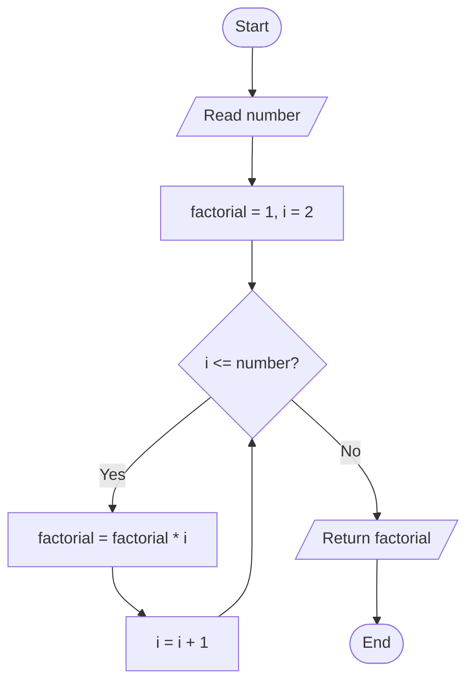
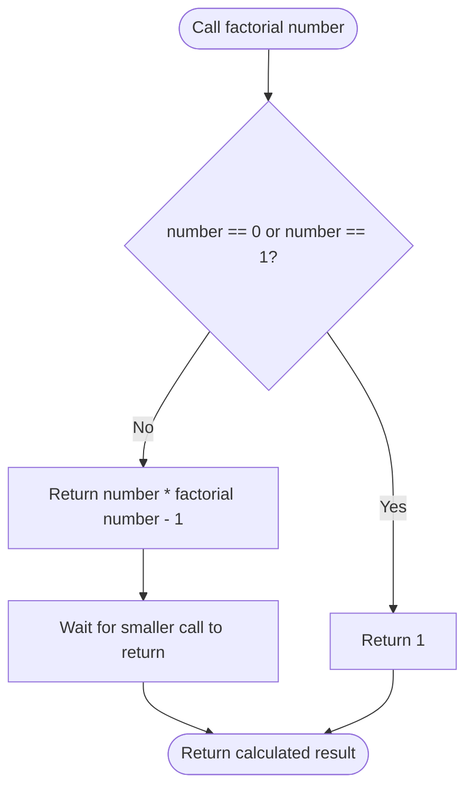

# 06. Factorial of a Number

**Difficulty:** Easy  
**Main concepts:** Functions, `while` loop, recursion, conditional statements, multiplication

[← Previous: Overlapping Rectangles](./05_Overlapping_Rectangles.md) | [Next: Pair Cube Count →](./07_Pair_Cube_Count.md)

---

## 1. Problem Statement

Given a non-negative integer `n`, calculate its **factorial**.

The factorial of a number is the product of all positive integers from `1` to that number. It is written as `n!`.

For example:

\[
5! = 5 \times 4 \times 3 \times 2 \times 1 = 120
\]

Special case:

\[
0! = 1
\]

The supplied Python program solves this problem in two ways:

1. Using a `while` loop
2. Using recursion

## 2. Examples

| Input | Calculation | Output |
|---:|---|---:|
| `5` | `5 × 4 × 3 × 2 × 1` | `120` |
| `4` | `4 × 3 × 2 × 1` | `24` |
| `1` | `1` | `1` |
| `0` | Special case: `0! = 1` | `1` |

Negative numbers are not valid factorial inputs in this program.

## 3. Understand the Concept

Factorial means multiplying a number by every positive integer smaller than it, until we reach `1`.

For `5`:

```text
5! = 5 × 4 × 3 × 2 × 1
   = 120
```

A useful mathematical relationship is:

\[
n! = n \times (n-1)!
\]

This relationship is especially important for the recursive approach.

## 4. Approach 1 — Using a `while` Loop

### Idea

Start with `factorial = 1`, then multiply it by each integer from `2` through `n`.

The variable `i` tracks the current integer. After each multiplication, increase `i` by one.

### Algorithm

1. Set `factorial = 1`.
2. Set `i = 2`.
3. While `i <= number`:
   - Multiply `factorial` by `i`.
   - Increase `i` by `1`.
4. Return `factorial`.

### Flowchart



### Dry Run: `number = 5`

| Iteration | `i` | Calculation | `factorial` |
|---:|---:|---|---:|
| Initial | — | Start with `1` | `1` |
| 1 | 2 | `1 × 2` | `2` |
| 2 | 3 | `2 × 3` | `6` |
| 3 | 4 | `6 × 4` | `24` |
| 4 | 5 | `24 × 5` | `120` |

Now `i` becomes `6`. Since `6 <= 5` is false, the loop stops.

**Final result:** `120`

### Python Code

```python
def factorial_using_loop(number: int) -> int:
    """Calculate the factorial of a number using a while loop."""

    factorial = 1
    i = 2

    while i <= number:
        factorial *= i
        i += 1

    return factorial
```

### Why does `factorial` start at `1`?

`1` is the multiplicative identity: multiplying any number by `1` leaves it unchanged.

It also handles `0!` correctly. When `number` is `0` or `1`, the loop does not run, so the function returns `1`.

---

## 5. Approach 2 — Using Recursion

### What is recursion?

Recursion is a technique in which a function calls itself to solve a smaller version of the same problem.

A recursive function needs two important parts:

- **Base case:** The condition that stops further function calls.
- **Recursive case:** The function calls itself with a smaller input.

### Factorial relationship

\[
n! = n \times (n-1)!
\]

For example:

```text
5! = 5 × 4!
   = 5 × 4 × 3!
   = 5 × 4 × 3 × 2!
   = 5 × 4 × 3 × 2 × 1!
   = 5 × 4 × 3 × 2 × 1
   = 120
```

### Flowchart



### Recursive Call Trace: `factorial_using_recursion(4)`

```text
factorial(4)
    = 4 × factorial(3)
              = 3 × factorial(2)
                        = 2 × factorial(1)
                                  = 1  ← Base case
```

The calls then return in reverse order:

```text
factorial(1) = 1
factorial(2) = 2 × 1 = 2
factorial(3) = 3 × 2 = 6
factorial(4) = 4 × 6 = 24
```

### Python Code

```python
def factorial_using_recursion(number: int) -> int:
    """Calculate the factorial of a number using recursion."""

    if number == 0 or number == 1:
        return 1

    return number * factorial_using_recursion(number - 1)
```

### Why is the base case necessary?

Without the base case, the function would keep calling itself and would not stop at the intended point. The base case returns `1` when the input reaches `0` or `1`.

---

## 6. Complete Program

The following is the complete program, following the supplied `06_Factorial.py` implementation. It checks for negative input before calling either factorial function.

```python
def factorial_using_loop(number: int) -> int:
    """Calculate the factorial of a number using a while loop."""

    factorial = 1
    i = 2

    while i <= number:
        factorial *= i
        i += 1

    return factorial


def factorial_using_recursion(number: int) -> int:
    """Calculate the factorial of a number using recursion."""

    if number == 0 or number == 1:
        return 1

    return number * factorial_using_recursion(number - 1)


if __name__ == "__main__":

    number = int(input("Enter a number: "))

    if number < 0:
        print("Factorial is not defined for negative numbers.")

    else:
        result_loop = factorial_using_loop(number)
        result_recursion = factorial_using_recursion(number)

        print(f"Factorial using While Loop: {result_loop}")
        print(f"Factorial using Recursion: {result_recursion}")
```

### Sample Output 1

```text
Enter a number: 5
Factorial using While Loop: 120
Factorial using Recursion: 120
```

### Sample Output 2

```text
Enter a number: 0
Factorial using While Loop: 1
Factorial using Recursion: 1
```

### Sample Output 3

```text
Enter a number: -3
Factorial is not defined for negative numbers.
```

---

## 7. Time and Space Complexity

Let `n` be the input number.

| Approach | Time Complexity | Auxiliary Space Complexity | Reason |
|---|---|---|---|
| `while` loop | `O(n)` | `O(1)` | Performs a number of loop iterations proportional to `n`, using a fixed number of variables. |
| Recursion | `O(n)` | `O(n)` | Makes approximately `n` nested calls, which occupy the call stack. |

**Which approach should you use?**

- The `while` loop is straightforward and uses constant auxiliary space.
- Recursion demonstrates the mathematical definition of factorial, but uses additional call-stack memory.

## 8. Important Python Concepts

| Concept | Meaning in this program |
|---|---|
| Function | A reusable block of code that calculates and returns a result. |
| `while` loop | Repeats multiplication while `i <= number`. |
| Recursion | A function calls itself with `number - 1`. |
| Base case | Stops recursion when the number is `0` or `1`. |
| `return` | Sends the calculated factorial back to the caller. |
| `*=` | Multiplies a variable by a value and stores the result. |
| `if __name__ == "__main__":` | Runs the input/output section when this file is executed directly. |

## 9. Common Interview Questions

**Q1. What is the factorial of a number?**

The factorial of a non-negative integer `n` is the product of all positive integers from `1` to `n`.

**Q2. What is `0!`?**

`0!` is defined as `1`.

**Q3. Why does the loop approach start with `factorial = 1`?**

Because `1` is the multiplicative identity, and it also gives the correct result when the input is `0` or `1`.

**Q4. What is recursion?**

Recursion is a programming technique in which a function calls itself to solve a smaller version of a problem.

**Q5. What is a base case?**

A base case is the stopping condition of a recursive function. Here, the base case is `number == 0 or number == 1`.

**Q6. Which approach uses less auxiliary space?**

The `while` loop uses `O(1)` auxiliary space, while recursion uses `O(n)` call-stack space.

**Q7. Is factorial defined for negative integers in this program?**

No. The program prints a message and does not calculate factorial for negative input.

## 10. Practice Questions

Try these questions without immediately looking at the code:

1. What will both functions return for input `6`?
2. Why does the `while` loop begin with `i = 2` instead of `i = 1`?
3. Trace the recursive calls for `factorial_using_recursion(3)`.
4. What would happen if the recursive base case were removed?
5. Can you write the factorial solution using a `for` loop?

### Test Cases

| Input | Expected factorial |
|---:|---:|
| `0` | `1` |
| `1` | `1` |
| `3` | `6` |
| `5` | `120` |
| `7` | `5040` |

## 11. Key Takeaways

- Factorial is the product of all positive integers up to a given non-negative integer.
- `0!` and `1!` are both equal to `1`.
- A `while` loop can calculate factorial through repeated multiplication.
- Recursion solves the problem by calling the same function with a smaller number.
- Every recursive solution needs a correct base case.
- The loop approach uses `O(1)` auxiliary space; the recursive approach uses `O(n)` call-stack space.

---

**Next step:** Try implementing the factorial using a `for` loop on your own, then compare it with these two approaches.

[← Previous: Overlapping Rectangles](./05_Overlapping_Rectangles.md) | [Next: Pair Cube Count →](./07_Pair_Cube_Count.md)
