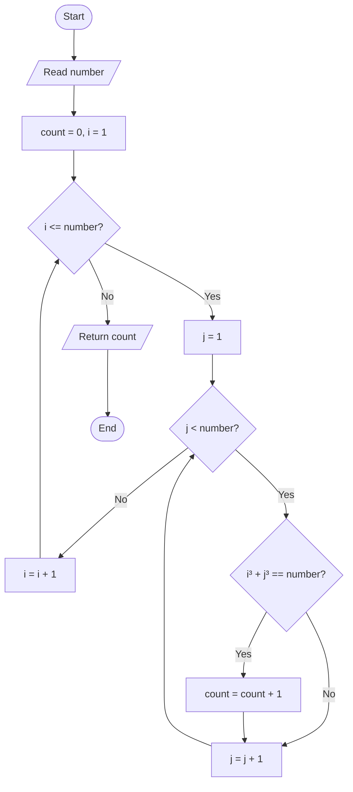

# 07. Count Pairs Whose Cube Sum Equals a Given Number

**Difficulty:** Easy  
**Main concepts:** Variables, functions, nested loops, conditional statements, exponentiation (`**`)

[← Previous: Factorial](./06_Factorial.md) | [Next: GCD or HCF →](./08_GCD_or_HCF.md)

---

## 1. Problem Statement

Given a positive integer `number`, count the pairs of positive integers `(i, j)` that satisfy:

\[
i^3 + j^3 = number
\]

A pair is counted when the sum of the cubes of its two values is equal to the given number.

The supplied Python program uses **nested loops** to check possible values of `i` and `j`.

## 2. Examples

For `number = 9`:

\[
1^3 + 2^3 = 1 + 8 = 9
\]

And:

\[
2^3 + 1^3 = 8 + 1 = 9
\]

So the program counts two matching ordered pairs:

```text
(1, 2)
(2, 1)
```

Output:

```text
Number of valid pairs: 2
```

For `number = 10`, no positive integer pair satisfies the equation, so the count is `0`.

> **Important:** The code treats `(1, 2)` and `(2, 1)` as two different pairs. It counts ordered pairs, because both loop orders are checked.

## 3. Understand the Concepts

### What is a cube?

The cube of a number is that number multiplied by itself three times.

\[
n^3 = n \times n \times n
\]

Examples:

| Number | Cube | Calculation |
|---:|---:|---|
| 1 | 1 | `1 × 1 × 1` |
| 2 | 8 | `2 × 2 × 2` |
| 3 | 27 | `3 × 3 × 3` |
| 4 | 64 | `4 × 4 × 4` |

In Python, the exponentiation operator `**` calculates powers:

```python
2 ** 3  # 8
3 ** 3  # 27
```

### What are nested loops?

A nested loop means placing one loop inside another loop.

- The outer loop selects a value for `i`.
- For each value of `i`, the inner loop checks the possible values of `j`.

This lets us test combinations of two numbers.

## 4. Approach — Using Nested Loops

### Idea

Check possible values of `i` and `j`. For every pair, calculate `i**3 + j**3`.

If the result equals `number`, increase the counter by one.

### Algorithm

1. Initialize `count = 0`.
2. Run the outer loop with `i` from `1` through `number`.
3. For each `i`, run the inner loop with `j` from `1` through `number - 1`.
4. Check whether `i**3 + j**3 == number`.
5. If the condition is true, increase `count` by one.
6. After both loops finish, return `count`.

### Flowchart



### Dry Run: `number = 9`

The program checks these loop ranges:

- `i` takes values from `1` to `9`.
- For each `i`, `j` takes values from `1` to `8`.

Some of the checked combinations are:

| `i` | `j` | `i³ + j³` | Equals 9? | Count |
|---:|---:|---:|---|---:|
| 1 | 1 | `1 + 1 = 2` | No | 0 |
| 1 | 2 | `1 + 8 = 9` | Yes | 1 |
| 1 | 3 | `1 + 27 = 28` | No | 1 |
| 2 | 1 | `8 + 1 = 9` | Yes | 2 |
| 2 | 2 | `8 + 8 = 16` | No | 2 |

The remaining combinations are checked in the same way. No other pair matches.

**Final result:** `2`

### Python Code

```python
def count_cube_sum_pairs(number: int) -> int:
    """Count pairs (i, j) satisfying i^3 + j^3 = number."""

    count = 0

    for i in range(1, number + 1):
        for j in range(1, number):
            if i**3 + j**3 == number:
                count += 1

    return count
```

## 5. Understanding the Important Lines

### `count = 0`

This variable stores the number of matching pairs found so far.

### `range(1, number + 1)`

Python's `range()` excludes its stop value. Therefore, `number + 1` allows the outer loop to include `number`.

### `range(1, number)`

The inner loop checks values from `1` through `number - 1`.

### `i**3 + j**3`

The `**` operator raises a number to a power. Here, both values are raised to the third power.

### `count += 1`

Whenever a pair satisfies the equation, increase the count by one.

### Why can the count include both `(i, j)` and `(j, i)`?

The loops independently visit both orders. For example, when the input is `9`, both `(1, 2)` and `(2, 1)` satisfy the equation. The supplied code counts both.

---

## 6. Complete Program

This is the complete program, following the supplied `07_Pair_Cube_Count.py` implementation.

```python
def count_cube_sum_pairs(number: int) -> int:
    """Count pairs (i, j) satisfying i^3 + j^3 = number."""

    count = 0

    for i in range(1, number + 1):
        for j in range(1, number):
            if i**3 + j**3 == number:
                count += 1

    return count


if __name__ == "__main__":

    number = int(input("Enter a number: "))

    if number <= 0:
        print("Please enter a positive number.")

    else:
        result = count_cube_sum_pairs(number)

        print(f"Number of valid pairs: {result}")
```

### Sample Output 1

```text
Enter a number: 9
Number of valid pairs: 2
```

### Sample Output 2

```text
Enter a number: 10
Number of valid pairs: 0
```

### Sample Output 3

```text
Enter a number: 0
Please enter a positive number.
```

---

## 7. Time and Space Complexity

Let `n` be the input number.

| Complexity | Result | Explanation |
|---|---|---|
| Time | `O(n²)` | The outer loop runs `n` times, and the inner loop runs `n - 1` times for each outer iteration. |
| Auxiliary Space | `O(1)` | Only a fixed number of variables are used, regardless of the input size. |

The nested loops are the reason the time complexity is quadratic.

## 8. Important Python Concepts

| Concept | Meaning in this program |
|---|---|
| Variable | `count`, `i`, and `j` store values. |
| Function | `count_cube_sum_pairs()` contains the reusable solution. |
| Nested loops | The inner `for` loop runs for each outer-loop iteration. |
| `range()` | Generates the integer values used by the loops. |
| Conditional statement | `if` checks whether the cube sum equals the input. |
| Exponentiation (`**`) | Calculates the cube of each number. |
| Counter | `count += 1` records each matching pair. |

## 9. Common Interview Questions

**Q1. What is the cube of a number?**

The cube is the number multiplied by itself three times. For example, `3³ = 3 × 3 × 3 = 27`.

**Q2. Which operator is used for exponentiation in Python?**

The `**` operator. For example, `2 ** 3` gives `8`.

**Q3. What is a nested loop?**

A nested loop is a loop inside another loop. The inner loop executes for every iteration of the outer loop.

**Q4. Why do we use a counter variable?**

The counter records how many pairs satisfy the given condition.

**Q5. Why is the time complexity `O(n²)`?**

Because two loops run over ranges proportional to `n`. Their total number of iterations is approximately `n × n`.

**Q6. What is the auxiliary space complexity?**

It is `O(1)` because the program uses only a fixed number of additional variables.

**Q7. Does the program count `(1, 2)` and `(2, 1)` separately?**

Yes. The loops check both orders, so both are counted.

## 10. Practice Questions

Try these without immediately looking at the code:

1. What output will the program produce for input `9`?
2. Why does input `9` produce two matching pairs?
3. What is the difference between `i * 3` and `i ** 3`?
4. Why do we initialize `count` to `0`?
5. What is the time complexity of two nested loops?
6. Can you modify the program to count each unordered pair only once, so `(1, 2)` and `(2, 1)` are treated as the same pair?

### Test Cases

| Input | Expected output |
|---:|---:|
| `1` | `0` |
| `8` | `0` |
| `9` | `2` |
| `10` | `0` |
| `28` | `2` |

## 11. Key Takeaways

- A cube is calculated using `number ** 3`.
- Nested loops help check combinations of two values.
- The `if` condition checks whether the sum of cubes equals the input.
- A counter records every matching pair.
- The supplied implementation counts ordered pairs, so reversed pairs are counted separately.
- Time complexity is `O(n²)` and auxiliary space complexity is `O(1)`.

---

**Next step:** Try changing the program so that it counts each pair only once, then compare its result with the original implementation.

[← Previous: Factorial](./06_Factorial.md) | [Next: GCD or HCF →](./08_GCD_or_HCF.md)
