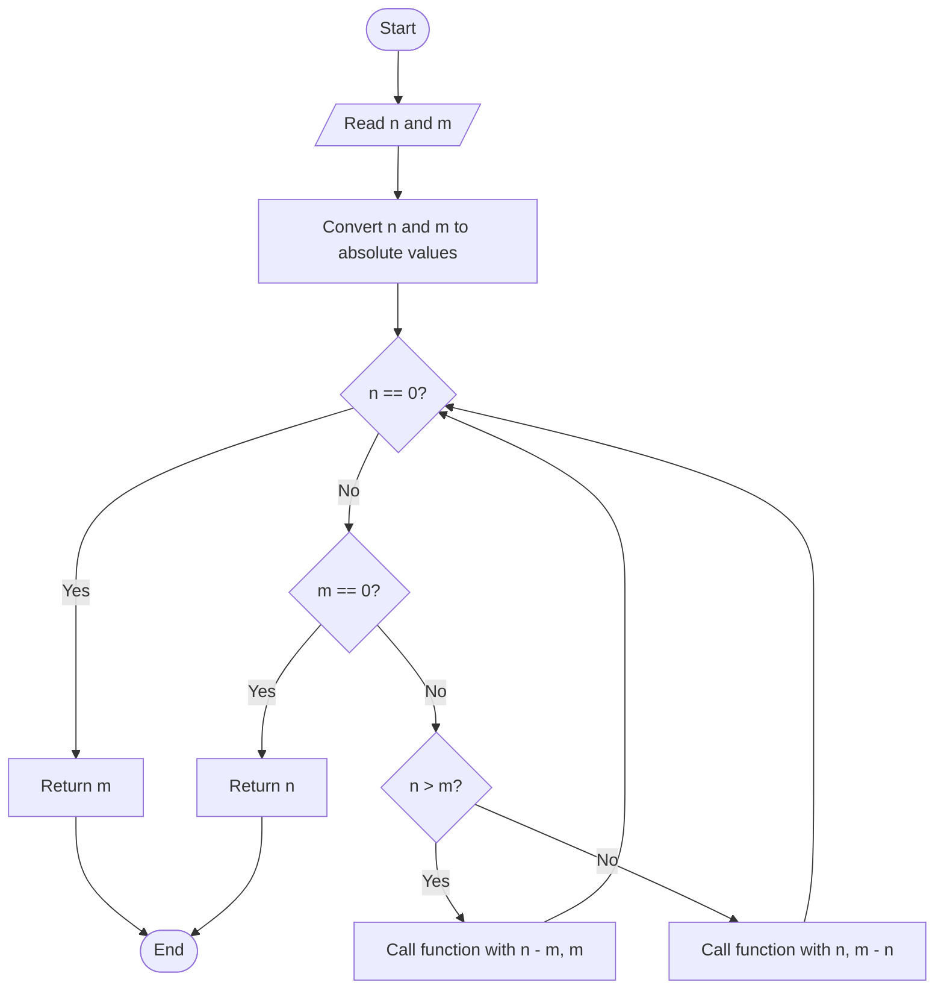
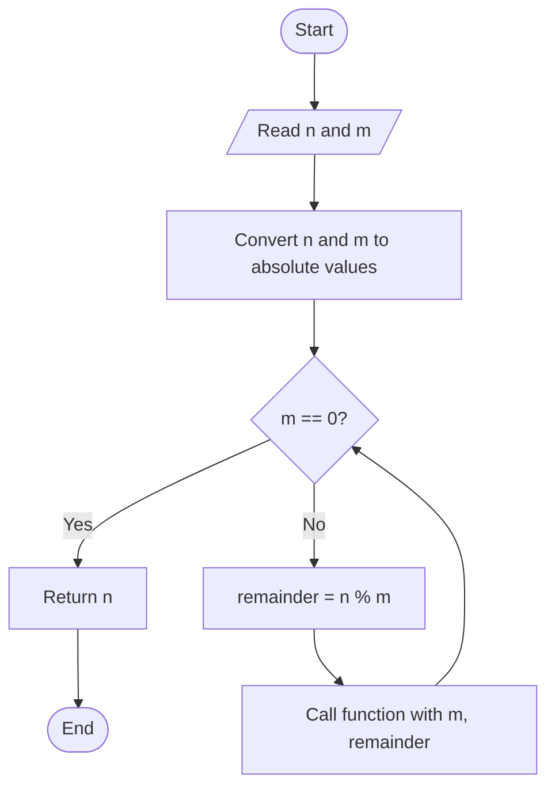

# 08. Find HCF (Highest Common Factor) of Two Numbers

**Difficulty:** Easy  
**Main concepts:** Variables, functions, recursion, conditional statements, modulus operator (`%`), Euclidean algorithm

[← Previous: Pair Cube Count](./07_Pair_Cube_Count.md) | [Next: LCM →](./09_LCM.md)

---

## 1. Problem Statement

Given two integers `n` and `m`, find their **HCF (Highest Common Factor)**.

HCF is the largest positive integer that divides both numbers exactly, without leaving a remainder. It is also called **GCD (Greatest Common Divisor)**.

For example, consider `12` and `18`.

- Factors of `12`: `1, 2, 3, 4, 6, 12`
- Factors of `18`: `1, 2, 3, 6, 9, 18`
- Common factors: `1, 2, 3, 6`

The largest common factor is `6`.

Therefore:

\[
HCF(12,18)=6
\]

The supplied Python program implements two recursive approaches:

1. Recursive subtraction
2. Euclidean algorithm using the modulus operator (`%`)

## 2. Examples

| First number | Second number | HCF |
|---:|---:|---:|
| `12` | `18` | `6` |
| `20` | `30` | `10` |
| `7` | `13` | `1` |
| `15` | `15` | `15` |
| `0` | `8` | `8` |

The supplied main program treats `0` and `0` as a special case because their HCF is undefined.

## 3. Understand the Important Concepts

### What are factors?

A factor of a number divides that number exactly, leaving remainder `0`.

For example, `3` is a factor of `12` because:

\[
12 \div 3 = 4
\]

There is no remainder.

### What is the modulus operator (`%`)?

The modulus operator returns the remainder after division.

```python
10 % 3  # 1
12 % 3  # 0
18 % 12 # 6
```

If `a % b == 0`, then `b` divides `a` exactly.

### What is recursion?

Recursion occurs when a function calls itself with a smaller or changed input.

Both approaches in this program use recursion. Each one must have a stopping condition, called a **base case**.

---

## 4. Approach 1 — Using Recursive Subtraction

### Idea

Repeatedly subtract the smaller number from the larger number.

Continue until:

- One number becomes `0`.
- The other number is the HCF.

Before starting, the function converts both inputs to their absolute values using `abs()`. This allows the calculation to work with negative inputs too.

### Algorithm

1. Convert `n` and `m` to positive values using `abs()`.
2. If `n == 0`, return `m`.
3. If `m == 0`, return `n`.
4. If `n > m`, call the function again with `n - m` and `m`.
5. Otherwise, call the function again with `n` and `m - n`.

### Flowchart



### Dry Run: `n = 18`, `m = 12`

| Step | `n` | `m` | Operation |
|---:|---:|---:|---|
| 1 | 18 | 12 | `n > m`, so `n = 18 - 12 = 6` |
| 2 | 6 | 12 | `n < m`, so `m = 12 - 6 = 6` |
| 3 | 6 | 6 | `n < m` is false, so `m = 6 - 6 = 0` |
| 4 | 6 | 0 | Base case: return `n`, which is `6` |

**Final result:** `HCF = 6`

### Python Code

```python
def find_hcf_using_subtraction(n: int, m: int) -> int:
    """Calculate HCF using recursive subtraction."""

    n = abs(n)
    m = abs(m)

    if n == 0:
        return m

    if m == 0:
        return n

    if n > m:
        return find_hcf_using_subtraction(n - m, m)

    return find_hcf_using_subtraction(n, m - n)
```

### Why does subtraction work?

If two numbers have a common divisor, that divisor also divides their difference.

For example, the common divisors of `18` and `12` are also common divisors of `6` and `12`. Repeating this process preserves the HCF until one value becomes zero.

---

## 5. Approach 2 — Using the Euclidean Algorithm

### What is the Euclidean algorithm?

The Euclidean algorithm is an efficient method for finding the HCF of two numbers.

Its main rule is:

\[
HCF(a,b)=HCF(b,a \bmod b)
\]

In simple words:

1. Divide the first number by the second number.
2. Find the remainder using `%`.
3. Replace the first number with the second number.
4. Replace the second number with the remainder.
5. Repeat until the second number becomes `0`.
6. The first number is the HCF.

### Algorithm

1. Convert both inputs to absolute values.
2. If `m == 0`, return `n`.
3. Otherwise, recursively call the function with:
   - `m` as the first argument.
   - `n % m` as the second argument.

### Flowchart



### Dry Run: `n = 18`, `m = 12`

| Step | `n` | `m` | `n % m` |
|---:|---:|---:|---:|
| 1 | 18 | 12 | `18 % 12 = 6` |
| 2 | 12 | 6 | `12 % 6 = 0` |
| 3 | 6 | 0 | Base case reached |

When `m` becomes `0`, the function returns `n`, which is `6`.

**Final result:** `HCF = 6`

### Python Code

```python
def find_hcf_using_euclidean(n: int, m: int) -> int:
    """Calculate HCF using the optimized Euclidean algorithm."""

    n = abs(n)
    m = abs(m)

    if m == 0:
        return n

    return find_hcf_using_euclidean(m, n % m)
```

### Why is the Euclidean algorithm faster?

Instead of repeatedly subtracting the smaller number, it uses the remainder operation to reduce the problem quickly.

For example, with `100` and `1`, repeated subtraction needs many recursive calls, while the Euclidean algorithm reaches the answer in very few calls.

---

## 6. Complete Program

This is the complete program, following the supplied `08_GCD_or_HCF.py` implementation.

```python
def find_hcf_using_subtraction(n: int, m: int) -> int:
    """Calculate HCF using recursive subtraction."""

    n = abs(n)
    m = abs(m)

    if n == 0:
        return m

    if m == 0:
        return n

    if n > m:
        return find_hcf_using_subtraction(n - m, m)

    return find_hcf_using_subtraction(n, m - n)


def find_hcf_using_euclidean(n: int, m: int) -> int:
    """Calculate HCF using the optimized Euclidean algorithm."""

    n = abs(n)
    m = abs(m)

    if m == 0:
        return n

    return find_hcf_using_euclidean(m, n % m)


if __name__ == "__main__":

    n = int(input("Enter first number (n): "))
    m = int(input("Enter second number (m): "))

    if n == 0 and m == 0:
        print("HCF is undefined for two zeros.")

    else:
        result_subtraction = find_hcf_using_subtraction(n, m)
        result_euclidean = find_hcf_using_euclidean(n, m)

        print(f"HCF using Subtraction: {result_subtraction}")
        print(f"HCF using Euclidean Algorithm: {result_euclidean}")
```

### Sample Output 1

```text
Enter first number (n): 18
Enter second number (m): 12
HCF using Subtraction: 6
HCF using Euclidean Algorithm: 6
```

### Sample Output 2

```text
Enter first number (n): 20
Enter second number (m): 30
HCF using Subtraction: 10
HCF using Euclidean Algorithm: 10
```

### Sample Output 3

```text
Enter first number (n): 0
Enter second number (m): 0
HCF is undefined for two zeros.
```

---

## 7. Time and Space Complexity

Let `n` and `m` be the two input numbers.

| Approach | Time Complexity | Auxiliary Space Complexity | Explanation |
|---|---|---|---|
| Recursive subtraction | `O(max(n, m))` | `O(max(n, m))` | In the worst case, subtraction may require many recursive calls. |
| Euclidean algorithm | `O(log(min(n, m)))` | `O(log(min(n, m)))` | The remainder operation reduces the values quickly; recursive calls use stack space. |

**Which approach is better?**

The Euclidean algorithm is generally much more efficient, especially for large numbers. Both implementations use recursion, so their recursive calls consume call-stack space.

## 8. Important Python Concepts

| Concept | Meaning in this program |
|---|---|
| `abs()` | Converts a negative number to its non-negative magnitude. |
| Recursion | A function calls itself with updated values. |
| Base case | Stops recursion when the required value becomes `0`. |
| `if` statement | Checks the conditions that control the algorithm. |
| `%` | Returns the remainder after division. |
| `return` | Sends the calculated HCF back to the caller. |
| Euclidean algorithm | Finds HCF by repeatedly replacing a pair with the divisor and remainder. |

## 9. Common Interview Questions

**Q1. What is HCF?**

HCF is the largest positive integer that divides two numbers exactly.

**Q2. What is the difference between HCF and GCD?**

They refer to the same mathematical concept. HCF means Highest Common Factor, while GCD means Greatest Common Divisor.

**Q3. What is the Euclidean algorithm?**

It is a method of finding HCF by repeatedly replacing two numbers with the second number and the remainder of their division.

**Q4. What does the modulus operator (`%`) do?**

It returns the remainder after division. For example, `18 % 12` gives `6`.

**Q5. Why do we use `abs()`?**

It converts negative inputs to non-negative values before calculating HCF.

**Q6. What is the base case in the Euclidean algorithm?**

The condition `m == 0`. When it is true, the function returns `n`.

**Q7. Which approach is more efficient?**

The Euclidean algorithm is more efficient because it reduces the numbers much faster than repeated subtraction.

**Q8. What is the HCF of two zeros in this program?**

The program treats it as undefined and displays a message.

## 10. Practice Questions

Try these questions without immediately looking at the code:

1. Find the HCF of `24` and `36`.
2. Find the HCF of `15` and `25`.
3. Trace the Euclidean algorithm for `48` and `18`.
4. What does `abs(-20)` return?
5. Why does the Euclidean algorithm stop when the second number becomes `0`?
6. Compare the number of recursive calls for subtraction and Euclidean approaches using `100` and `1`.

### Test Cases

| First number | Second number | Expected HCF |
|---:|---:|---:|
| `12` | `18` | `6` |
| `20` | `30` | `10` |
| `7` | `13` | `1` |
| `15` | `15` | `15` |
| `0` | `8` | `8` |
| `-18` | `12` | `6` |

## 11. Key Takeaways

- HCF and GCD mean the same thing.
- HCF is the largest number that divides both inputs exactly.
- Recursive subtraction repeatedly subtracts the smaller value from the larger one.
- The Euclidean algorithm uses the modulus operator (`%`) to reduce the problem.
- The Euclidean algorithm is generally faster than repeated subtraction.
- Both supplied approaches use recursion and therefore use call-stack space.

---

**Next step:** Practise finding HCF manually using the Euclidean algorithm. Then trace how the `%` operation changes the two values in each recursive call.

[← Previous: Pair Cube Count](./07_Pair_Cube_Count.md) | [Next: LCM →](./09_LCM.md)
