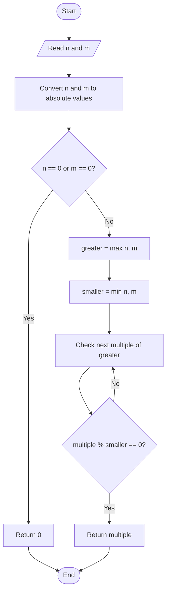

# 09. Find LCM (Least Common Multiple) of Two Numbers

**Difficulty:** Easy  
**Main concepts:** Variables, functions, `for` loop, conditional statements, modulus operator (`%`), `max()`, `min()`, GCD / HCF

[← Previous: GCD or HCF](./08_GCD_or_HCF.md) | [Next: Perfect Number →](./10_Perfect_Number.md)

---

## 1. Problem Statement

Given two integers `n` and `m`, find their **LCM (Least Common Multiple)**.

The LCM is the smallest positive number that is exactly divisible by both numbers.

For example, consider `4` and `6`.

- Multiples of `4`: `4, 8, 12, 16, 20, ...`
- Multiples of `6`: `6, 12, 18, 24, ...`
- Common multiples: `12, 24, ...`

The smallest common multiple is `12`.

Therefore:

\[
LCM(4,6)=12
\]

The supplied Python program solves this problem in two ways:

1. Checking multiples using a `for` loop
2. Using the GCD formula

## 2. Examples

| First number | Second number | LCM |
|---:|---:|---:|
| `4` | `6` | `12` |
| `5` | `10` | `10` |
| `12` | `18` | `36` |
| `7` | `9` | `63` |
| `8` | `8` | `8` |
| `0` | `5` | `0` |

The supplied functions use absolute values in the loop approach and return `0` if either input is zero. The GCD-based approach also returns `0` for a zero input.

## 3. Understand the Important Concepts

### What are multiples?

A multiple of a number is the result of multiplying it by an integer.

For example, multiples of `5` are:

```text
5, 10, 15, 20, 25, 30, ...
```

To find LCM, we need the smallest number that appears in the multiples of both inputs.

### What is the modulus operator (`%`)?

The modulus operator returns the remainder after division.

```python
12 % 4  # 0
15 % 4  # 3
```

If `a % b == 0`, then `a` is exactly divisible by `b`.

### What are `max()` and `min()`?

Python provides two built-in functions:

- `max(n, m)` returns the larger value.
- `min(n, m)` returns the smaller value.

Example:

```python
max(4, 6)  # 6
min(4, 6)  # 4
```

These functions help the first approach start checking multiples from the larger input.

---

## 4. Approach 1 — Using Multiples and a `for` Loop

### Idea

The LCM must be a multiple of both numbers. Every common multiple is also a multiple of the larger number.

So, start from the larger number and check its multiples until a number is divisible by the smaller number too.

The first such value is the LCM.

### Algorithm

1. Convert `n` and `m` to absolute values.
2. If either number is `0`, return `0`.
3. Find the larger number using `max(n, m)`.
4. Find the smaller number using `min(n, m)`.
5. Generate multiples of the larger number, starting from the larger number itself.
6. Check whether each multiple is divisible by the smaller number using `%`.
7. Return the first multiple for which the remainder is `0`.

### Flowchart



### Dry Run: `n = 4`, `m = 6`

First, determine the values:

```text
greater = max(4, 6) = 6
smaller = min(4, 6) = 4
```

Now check multiples of `6`:

| Step | Multiple of 6 | Check | Divisible by 4? |
|---:|---:|---|---|
| 1 | 6 | `6 % 4` | No, remainder is 2 |
| 2 | 12 | `12 % 4` | Yes, remainder is 0 |

The first common multiple is `12`.

**Final result:** `LCM = 12`

### Python Code

```python
def find_lcm_using_loop(n: int, m: int) -> int:
    """Calculate LCM by checking multiples of the larger number."""

    n = abs(n)
    m = abs(m)

    if n == 0 or m == 0:
        return 0

    greater = max(n, m)
    smaller = min(n, m)

    for i in range(greater, n * m + 1, greater):
        if i % smaller == 0:
            return i

    return 0
```

### Understanding `range(greater, n * m + 1, greater)`

The `range()` function has three arguments:

```python
range(start, stop, step)
```

In this code:

- `start = greater`: begin with the larger number.
- `stop = n * m + 1`: use the product as an inclusive upper bound.
- `step = greater`: move to the next multiple of the larger number.

For `n = 4` and `m = 6`, the generated values are:

```text
6, 12, 18, 24
```

The function returns as soon as it finds `12`.

---

## 5. Approach 2 — Using the GCD Formula

### What is GCD?

GCD (Greatest Common Divisor), also called HCF (Highest Common Factor), is the largest positive integer that divides both numbers exactly.

The LCM and GCD are connected by this formula:

\[
LCM(a,b)=\frac{|a \times b|}{GCD(a,b)}
\]

In Python, integer division `//` is used:

```python
abs(n * m) // find_gcd(abs(n), abs(m))
```

The supplied program uses the **Euclidean algorithm** to calculate GCD.

### How does the Euclidean algorithm work?

It repeatedly replaces two numbers with the second number and the remainder of their division.

\[
GCD(a,b)=GCD(b,a \bmod b)
\]

When the second number becomes `0`, the first number is the GCD.

### Algorithm

**Step 1: Find GCD**

1. While `m != 0`:
   - Replace `n` with `m`.
   - Replace `m` with `n % m`, using the previous value of `n`.
2. Return `n`.

**Step 2: Find LCM**

1. If either input is `0`, return `0`.
2. Calculate the absolute product `abs(n * m)`.
3. Find the GCD of the absolute input values.
4. Divide the product by the GCD using `//`.
5. Return the result.

### Flowchart

```mermaid
flowchart TD
    A([Start]) --> B[/Read n and m/]
    B --> C{n == 0 or m == 0?}
    C -- Yes --> D[Return 0]
    C -- No --> E[Find GCD using Euclidean algorithm]
    E --> F{m != 0?}
    F -- Yes --> G[Update n = m and m = old n % old m]
    G --> F
    F -- No --> H[GCD = n]
    H --> I[LCM = abs(original n * original m) // GCD]
    I --> J[Return LCM]
    D --> K([End])
    J --> K
```

### Dry Run: `n = 4`, `m = 6`

First, calculate the GCD:

| Step | `n` | `m` | Remainder `n % m` |
|---:|---:|---:|---:|
| 1 | 4 | 6 | `4 % 6 = 4` |
| 2 | 6 | 4 | `6 % 4 = 2` |
| 3 | 4 | 2 | `4 % 2 = 0` |
| 4 | 2 | 0 | Stop |

Therefore:

```text
GCD = 2
```

Now apply the LCM formula:

\[
LCM(4,6)=\frac{|4 \times 6|}{2}
\]

\[
LCM(4,6)=\frac{24}{2}=12
\]

**Final result:** `LCM = 12`

### Python Code

```python
def find_gcd(n: int, m: int) -> int:
    """Calculate GCD using the Euclidean algorithm."""

    while m != 0:
        n, m = m, n % m

    return n


def find_lcm_using_gcd(n: int, m: int) -> int:
    """Calculate LCM using the GCD formula."""

    if n == 0 or m == 0:
        return 0

    return abs(n * m) // find_gcd(abs(n), abs(m))
```

### Understanding `n, m = m, n % m`

This is Python's multiple assignment. Both right-hand expressions are evaluated using the old values before the variables are updated.

For example, if:

```python
n = 6
m = 4
```

Then:

```python
n, m = m, n % m
```

updates the values to:

```text
n = 4
m = 2
```

This is one step of the Euclidean algorithm.

---

## 6. Complete Program

This is the complete program, following the supplied `09_LCM.py` implementation.

```python
def find_lcm_using_loop(n: int, m: int) -> int:
    """Calculate LCM by checking multiples of the larger number."""

    n = abs(n)
    m = abs(m)

    if n == 0 or m == 0:
        return 0

    greater = max(n, m)
    smaller = min(n, m)

    for i in range(greater, n * m + 1, greater):
        if i % smaller == 0:
            return i

    return 0


def find_gcd(n: int, m: int) -> int:
    """Calculate GCD using the Euclidean algorithm."""

    while m != 0:
        n, m = m, n % m

    return n


def find_lcm_using_gcd(n: int, m: int) -> int:
    """Calculate LCM using the GCD formula."""

    if n == 0 or m == 0:
        return 0

    return abs(n * m) // find_gcd(abs(n), abs(m))


if __name__ == "__main__":

    n = int(input("Enter first number (n): "))
    m = int(input("Enter second number (m): "))

    result_loop = find_lcm_using_loop(n, m)
    result_gcd = find_lcm_using_gcd(n, m)

    print(f"LCM using Loop: {result_loop}")
    print(f"LCM using GCD: {result_gcd}")
```

### Sample Output 1

```text
Enter first number (n): 4
Enter second number (m): 6
LCM using Loop: 12
LCM using GCD: 12
```

### Sample Output 2

```text
Enter first number (n): 12
Enter second number (m): 18
LCM using Loop: 36
LCM using GCD: 36
```

### Sample Output 3

```text
Enter first number (n): 0
Enter second number (m): 5
LCM using Loop: 0
LCM using GCD: 0
```

---

## 7. Time and Space Complexity

Let `n` and `m` be the input numbers.

| Approach | Time Complexity | Auxiliary Space Complexity | Explanation |
|---|---|---|---|
| Multiples and loop | `O(n)` upper bound, where `n` here represents the larger input | `O(1)` | Checks multiples of the larger number until a common multiple is found. |
| GCD formula | `O(log(min(n, m)))` | `O(1)` | Uses the iterative Euclidean algorithm, which needs a logarithmic number of steps and constant extra space. |

**Which approach is better?**

- The multiples approach is easy to understand and demonstrates loops and divisibility.
- The GCD formula is generally more efficient for large numbers.
- The supplied `find_gcd()` uses a `while` loop, not recursion, so it uses `O(1)` auxiliary space.

## 8. Important Python Concepts

| Concept | Meaning in this program |
|---|---|
| `abs()` | Returns the absolute value of a number. |
| `max()` | Returns the larger of two values. |
| `min()` | Returns the smaller of two values. |
| `range()` | Generates the multiples checked by the first approach. |
| `for` loop | Repeats the check for each multiple. |
| `while` loop | Repeats the Euclidean algorithm until the remainder becomes zero. |
| `%` | Returns the remainder after division. |
| `//` | Performs integer division. |
| Multiple assignment | Updates `n` and `m` together in the GCD function. |

## 9. Common Interview Questions

**Q1. What is LCM?**

LCM is the smallest positive number that is exactly divisible by both given numbers.

**Q2. What is the difference between LCM and GCD?**

- LCM is the smallest common multiple.
- GCD is the greatest common divisor.

**Q3. What is the formula for LCM using GCD?**

\[
LCM(a,b)=\frac{|a \times b|}{GCD(a,b)}
\]

**Q4. Why do we use `max()` and `min()` in the loop approach?**

We start checking multiples of the larger number and test whether they are also divisible by the smaller number.

**Q5. Why do we use `%` in the loop approach?**

To check whether a candidate multiple is exactly divisible by the smaller input. A remainder of `0` means it is divisible.

**Q6. What is the Euclidean algorithm?**

It is an efficient method for finding GCD by repeatedly replacing a pair of numbers with the second number and the remainder.

**Q7. What is the LCM if one input is zero?**

The supplied program returns `0` if either input is zero.

**Q8. Which approach is more efficient?**

The GCD-based approach is generally more efficient, especially for large inputs.

## 10. Practice Questions

Try these questions without immediately looking at the code:

1. Find the LCM of `8` and `12`.
2. Find the LCM of `15` and `20`.
3. Find the GCD of `18` and `24`, then use it to calculate their LCM.
4. What does `12 % 4` return?
5. What is the purpose of `range(start, stop, step)`?
6. Explain the update `n, m = m, n % m` in the GCD function.
7. Why is the GCD-based approach usually faster for large inputs?

### Test Cases

| First number | Second number | Expected LCM |
|---:|---:|---:|
| `4` | `6` | `12` |
| `5` | `10` | `10` |
| `12` | `18` | `36` |
| `7` | `9` | `63` |
| `8` | `8` | `8` |
| `0` | `5` | `0` |

## 11. Key Takeaways

- LCM is the smallest common multiple of two numbers.
- The first approach checks multiples of the larger number.
- The `%` operator checks whether a number divides another exactly.
- The second approach uses the formula `LCM(a, b) = abs(a * b) // GCD(a, b)`.
- The Euclidean algorithm calculates GCD efficiently.
- The GCD-based approach is generally better for large inputs.

---

**Next step:** Practise calculating GCD first, then use the LCM formula. This will help you understand the connection between both problems.

[← Previous: GCD or HCF](./08_GCD_or_HCF.md) | [Next: Perfect Number →](./10_Perfect_Number.md)
