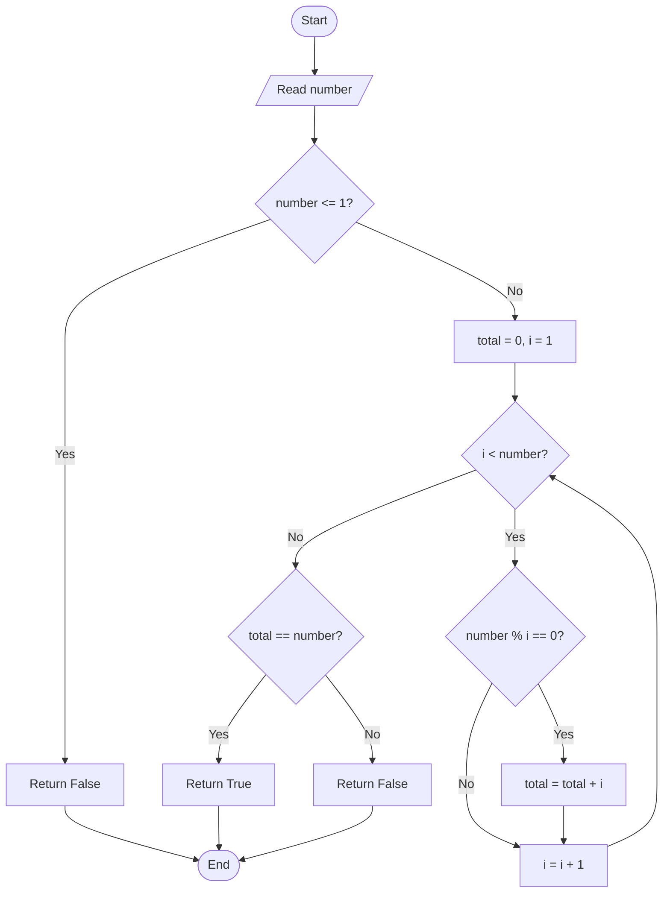
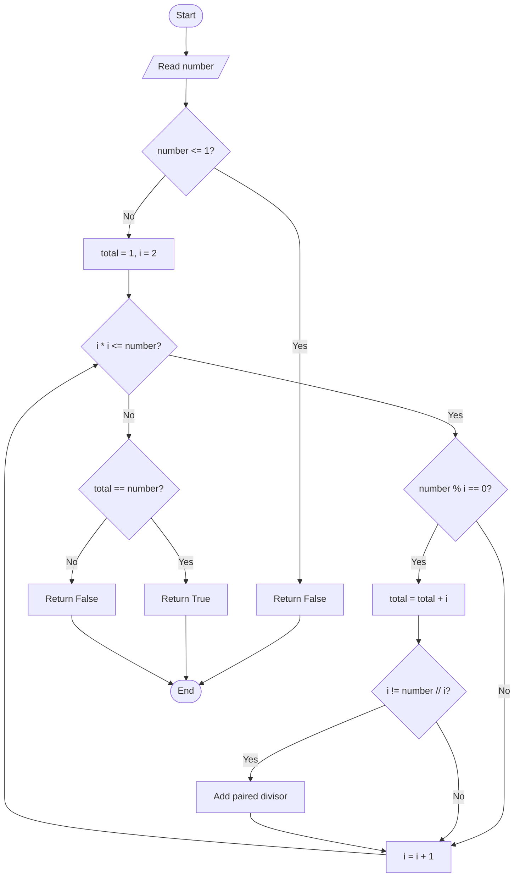

# 10. Check Whether a Number Is a Perfect Number

**Difficulty:** Easy  
**Main concepts:** Variables, functions, `for` loop, `while` loop, conditional statements, modulus operator (`%`), square root, divisors

[← Previous: LCM](./09_LCM.md) | [Next: Add Two Fractions →](./11_Add_Two_Fractions.md)

---

## 1. Problem Statement

Given an integer `number`, check whether it is a **Perfect Number**.

A perfect number is a positive integer that is equal to the sum of all its positive divisors, excluding the number itself.

For example, consider `6`.

The positive divisors of `6`, excluding `6` itself, are:

```text
1, 2, 3
```

Their sum is:

\[
1 + 2 + 3 = 6
\]

Because the sum is equal to the original number, `6` is a Perfect Number.

The supplied Python program solves this problem in two ways:

1. Using a basic `for` loop
2. Using square root optimization

## 2. Examples

| Number | Proper divisors | Sum | Result |
|---:|---|---:|---|
| `6` | `1, 2, 3` | `6` | Perfect |
| `28` | `1, 2, 4, 7, 14` | `28` | Perfect |
| `12` | `1, 2, 3, 4, 6` | `16` | Not perfect |
| `10` | `1, 2, 5` | `8` | Not perfect |
| `1` | No positive proper divisors | `0` | Not perfect |

The supplied functions return `False` for any input less than or equal to `1`.

## 3. Understand the Important Concepts

### What is a divisor?

A divisor is a number that divides another number exactly, without leaving a remainder.

For example, the divisors of `12` are:

```text
1, 2, 3, 4, 6, 12
```

We can check whether a number is divisible using the modulus operator (`%`).

```python
12 % 3  # 0
12 % 5  # 2
```

If `number % i == 0`, then `i` is a divisor of `number`.

### What are proper divisors?

Proper divisors are all positive divisors of a number except the number itself.

For `12`, the proper divisors are:

```text
1, 2, 3, 4, 6
```

### What is square root optimization?

Divisors usually come in pairs.

For example, for `28`:

```text
1 × 28
2 × 14
4 × 7
```

If we find one divisor, we can also find its matching divisor using integer division.

We only need to check possible divisors up to the square root of the number. This reduces the number of checks.

---

## 4. Approach 1 — Using a Basic `for` Loop

### Idea

Check every integer from `1` to `number - 1`.

If a value divides the number exactly, add it to `total`.

At the end, compare `total` with the original number.

- If both are equal, the number is perfect.
- Otherwise, it is not perfect.

### Algorithm

1. If `number <= 1`, return `False`.
2. Initialize `total = 0`.
3. Run a `for` loop from `1` to `number - 1`.
4. Check whether `number % i == 0`.
5. If true, add `i` to `total`.
6. After the loop, return whether `total == number`.

### Flowchart



### Dry Run: `number = 6`

The function checks all integers from `1` to `5`.

| Step | `i` | `6 % i` | Divisor? | `total` |
|---:|---:|---:|---|---:|
| Initial | — | — | — | 0 |
| 1 | 1 | 0 | Yes | 1 |
| 2 | 2 | 0 | Yes | 3 |
| 3 | 3 | 0 | Yes | 6 |
| 4 | 4 | 2 | No | 6 |
| 5 | 5 | 1 | No | 6 |

After the loop:

```text
total = 6
number = 6
```

Since `total == number`, the function returns `True`.

**Final result:** `6 is a Perfect Number`

### Python Code

```python
def is_perfect_basic(number: int) -> bool:
    """Check whether a number is perfect using a basic loop."""

    if number <= 1:
        return False

    total = 0

    for i in range(1, number):
        if number % i == 0:
            total += i

    return total == number
```

### Why do we use `range(1, number)`?

The number itself must not be included in the sum of its proper divisors.

For `number = 6`, the loop checks `1, 2, 3, 4, 5`, but does not check `6`.

---

## 5. Approach 2 — Using Square Root Optimization

### Idea

Instead of checking every number from `1` to `number - 1`, check possible divisors only while:

```python
i * i <= number
```

When a divisor is found, add both members of its divisor pair:

```python
total += i
total += number // i
```

There is one special case: if both divisor-pair values are equal, add the divisor only once.

### Example: Divisor Pairs of 28

```text
1 × 28
2 × 14
4 × 7
```

We only need to check `1`, `2`, and `4`. Each matching divisor gives us its partner.

The square root of `28` is approximately `5.29`, so checking values up to `5` is enough.

### Algorithm

1. If `number <= 1`, return `False`.
2. Initialize `total = 1`, because `1` is a proper divisor of every integer greater than `1`.
3. Initialize `i = 2`.
4. While `i * i <= number`:
   - Check whether `number % i == 0`.
   - If it is a divisor, add `i` to `total`.
   - Calculate its paired divisor using `number // i`.
   - If `i` and `number // i` are different, add the paired divisor too.
   - Increase `i` by `1`.
5. Return whether `total == number`.

### Flowchart



### Dry Run: `number = 28`

Initial values:

```text
total = 1
i = 2
```

The function already includes `1` in the divisor sum.

| Step | `i` | `28 % i` | Divisor pair | Updated `total` |
|---:|---:|---:|---|---:|
| Initial | — | — | `1` | 1 |
| 1 | 2 | 0 | `2` and `14` | 17 |
| 2 | 3 | 1 | Not a divisor | 17 |
| 3 | 4 | 0 | `4` and `7` | 28 |
| 4 | 5 | 3 | Not a divisor | 28 |

Next, `i = 6`.

Check the loop condition:

```text
6 * 6 <= 28
36 <= 28  → False
```

The loop stops.

Now compare:

```text
total = 28
number = 28
```

The function returns `True`.

**Final result:** `28 is a Perfect Number`

### Why do we check `i != number // i`?

For a perfect square, a divisor may pair with itself.

For example, the divisor pair for `36` includes:

```text
6 × 6 = 36
```

If we add `6` twice, the divisor sum becomes incorrect. The condition ensures that this divisor is added only once.

### Python Code

```python
def is_perfect_optimized(number: int) -> bool:
    """Check whether a number is perfect using square root optimization."""

    if number <= 1:
        return False

    total = 1
    i = 2

    while i * i <= number:

        if number % i == 0:
            total += i

            if i != number // i:
                total += number // i

        i += 1

    return total == number
```

---

## 6. Complete Program

This is the complete program, following the supplied `10_Perfect_Number.py` implementation.

```python
def is_perfect_basic(number: int) -> bool:
    """Check whether a number is perfect using a basic loop."""

    if number <= 1:
        return False

    total = 0

    for i in range(1, number):
        if number % i == 0:
            total += i

    return total == number


def is_perfect_optimized(number: int) -> bool:
    """Check whether a number is perfect using square root optimization."""

    if number <= 1:
        return False

    total = 1
    i = 2

    while i * i <= number:

        if number % i == 0:
            total += i

            if i != number // i:
                total += number // i

        i += 1

    return total == number


if __name__ == "__main__":

    number = int(input("Enter a number: "))

    result_basic = is_perfect_basic(number)
    result_optimized = is_perfect_optimized(number)

    print(
        f"Basic Approach: {number} is "
        f"{'a Perfect Number' if result_basic else 'not a Perfect Number'}."
    )

    print(
        f"Optimized Approach: {number} is "
        f"{'a Perfect Number' if result_optimized else 'not a Perfect Number'}."
    )
```

### Sample Output 1

```text
Enter a number: 6
Basic Approach: 6 is a Perfect Number.
Optimized Approach: 6 is a Perfect Number.
```

### Sample Output 2

```text
Enter a number: 12
Basic Approach: 12 is not a Perfect Number.
Optimized Approach: 12 is not a Perfect Number.
```

### Sample Output 3

```text
Enter a number: 28
Basic Approach: 28 is a Perfect Number.
Optimized Approach: 28 is a Perfect Number.
```

---

## 7. Time and Space Complexity

Let `n` be the input number.

| Approach | Time Complexity | Auxiliary Space Complexity | Explanation |
|---|---|---|---|
| Basic loop | `O(n)` | `O(1)` | Checks every possible proper divisor from `1` to `n - 1`. |
| Square root optimization | `O(√n)` | `O(1)` | Checks possible divisors only up to the square root and adds divisor pairs. |

**Which approach is better?**

- The basic approach is easier to understand and implement.
- The optimized approach performs fewer checks, especially for large numbers.
- Both approaches use constant auxiliary space.

## 8. Important Python Concepts

| Concept | Meaning in this program |
|---|---|
| Function | `is_perfect_basic()` and `is_perfect_optimized()` return Boolean results. |
| `for` loop | Checks possible divisors in the basic approach. |
| `while` loop | Checks possible divisors up to the square root in the optimized approach. |
| `%` | Checks whether a number is divisible without a remainder. |
| `//` | Calculates the paired divisor using integer division. |
| `i * i <= number` | Checks whether `i` is within the square root limit without calculating a square root. |
| Boolean | The functions return `True` or `False`. |
| `+=` | Adds a divisor to the running sum. |

## 9. Common Interview Questions

**Q1. What is a Perfect Number?**

A perfect number is equal to the sum of all its positive divisors except itself.

**Q2. Give an example of a Perfect Number.**

`6` is a perfect number because `1 + 2 + 3 = 6`.

**Q3. Why do we start `total` with `0` in the basic approach?**

The basic loop checks all proper divisors, including `1`, so the sum starts at zero.

**Q4. Why do we start `total` with `1` in the optimized approach?**

Every integer greater than `1` has `1` as a proper divisor. The optimized loop starts checking from `2`, so `1` is included initially.

**Q5. Why do we check divisors only up to the square root?**

Divisors occur in pairs. If one divisor is greater than the square root, its paired divisor is smaller than the square root and will be found during the checks.

**Q6. Why do we use `i != number // i`?**

To avoid adding the same divisor twice when the number is a perfect square.

**Q7. What is the time complexity of the optimized approach?**

`O(√n)`, because the loop checks possible divisors only up to the square root of the input.

**Q8. What is the difference between `%` and `//`?**

- `%` returns the remainder.
- `//` returns the integer quotient.

## 10. Practice Questions

Try these questions without immediately looking at the code:

1. Is `6` a Perfect Number? Explain why.
2. Is `12` a Perfect Number? Calculate the sum of its proper divisors.
3. Check whether `28` is a Perfect Number.
4. Why does the optimized approach start with `total = 1`?
5. Why is the loop condition `i * i <= number`?
6. What happens if we add the square-root divisor twice?
7. Compare the number of checks for `number = 100` in both approaches.

### Test Cases

| Input | Expected result |
|---:|---|
| `1` | Not a Perfect Number |
| `6` | Perfect Number |
| `10` | Not a Perfect Number |
| `12` | Not a Perfect Number |
| `28` | Perfect Number |
| `496` | Perfect Number |

## 11. Key Takeaways

- A perfect number equals the sum of its positive proper divisors.
- The modulus operator (`%`) helps identify divisors.
- The basic approach checks every number below the input.
- The optimized approach checks only up to the square root.
- Divisors are added in pairs in the optimized approach.
- The condition `i != number // i` prevents double-counting a square-root divisor.
- The optimized approach improves time complexity from `O(n)` to `O(√n)`.

---

**Next step:** Try writing the optimized solution yourself. Pay special attention to how divisor pairs are found and why the square-root condition reduces the number of checks.

[← Previous: LCM](./09_LCM.md) | [Next: Add Two Fractions →](./11_Add_Two_Fractions.md)
