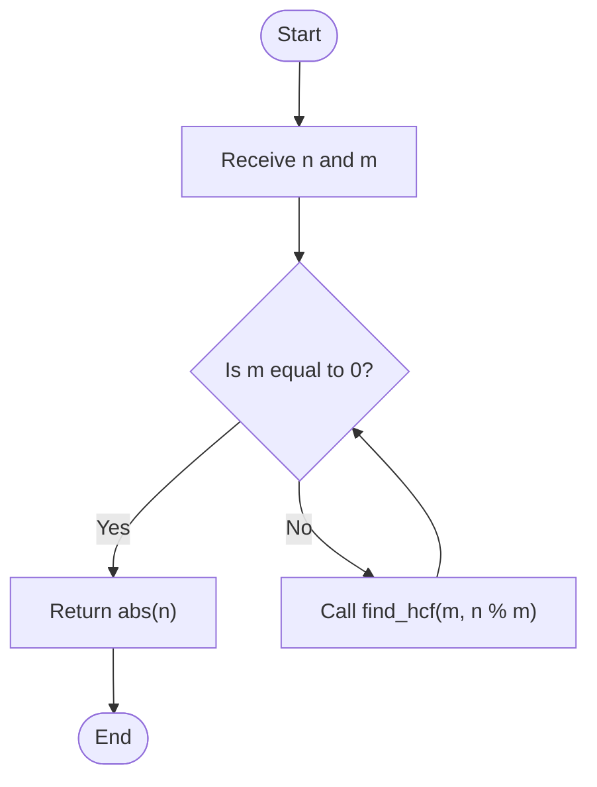
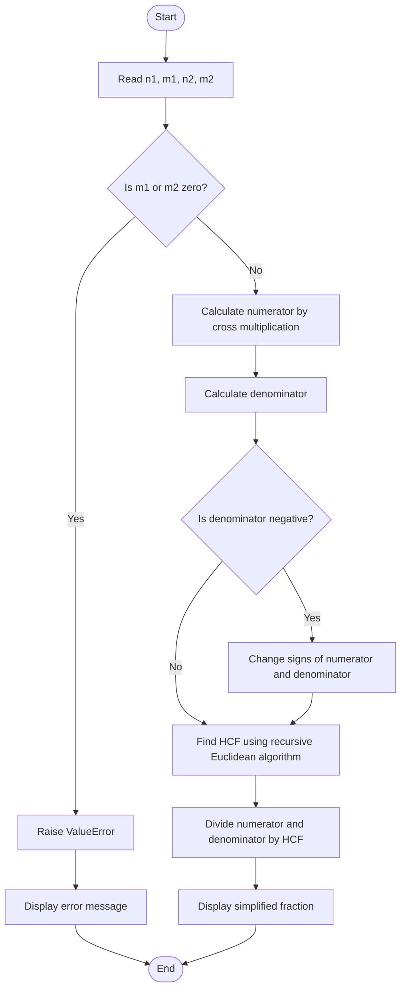

# 11. Add Two Fractions

## Problem statement

Given two fractions, add them and return the result in its **simplest form**.

Each fraction is represented by a numerator and a denominator:

\[
\frac{n_1}{m_1}+\frac{n_2}{m_2}
\]

The program must:
1. Make the denominators equal using cross multiplication.
2. Add the resulting numerators.
3. Simplify the answer using HCF (GCD).
4. Keep the denominator positive.
5. Reject a fraction if either denominator is zero.

### Examples

| First fraction | Second fraction | Calculation | Simplified result |
|---|---|---|---|
| `1/2` | `1/3` | `5/6` | `5/6` |
| `1/4` | `1/4` | `8/16` | `1/2` |
| `2/3` | `1/6` | `15/18` | `5/6` |

## Concepts used

- Variables and functions
- Arithmetic operators
- Recursion
- HCF / GCD
- Fraction simplification
- Conditional statements
- Exception handling (`ValueError`)

## 1. Understand fraction addition

To add fractions with different denominators, use cross multiplication:

\[
\frac{n_1}{m_1}+\frac{n_2}{m_2}
=
\frac{n_1m_2+n_2m_1}{m_1m_2}
\]

For example:

\[
\frac{1}{2}+\frac{1}{3}
=
\frac{1\times3+1\times2}{2\times3}
=
\frac{5}{6}
\]

The resulting fraction may not always be in its simplest form. We simplify it by dividing both numerator and denominator by their HCF.

## 2. Find HCF using the recursive Euclidean algorithm

The program defines `find_hcf(n, m)` to calculate the HCF.

### How it works

- If `m == 0`, return `abs(n)`. This is the base case.
- Otherwise, call the function again with `m` and `n % m`.
- Each recursive call makes the second value smaller until it becomes zero.

The rule is:

\[
\operatorname{HCF}(n,m)=\operatorname{HCF}(m,n\bmod m)
\]

### Dry run: `find_hcf(5, 6)`

| Call | `n` | `m` | `n % m` | Next action |
|---:|---:|---:|---:|---|
| 1 | 5 | 6 | 5 | Call `find_hcf(6, 5)` |
| 2 | 6 | 5 | 1 | Call `find_hcf(5, 1)` |
| 3 | 5 | 1 | 0 | Call `find_hcf(1, 0)` |
| 4 | 1 | 0 | — | Return `1` |

Therefore, HCF of 5 and 6 is `1`.

### Flowchart



### Code

```python
def find_hcf(n: int, m: int) -> int:
    """Calculate HCF using the Euclidean algorithm."""

    if m == 0:
        return abs(n)

    return find_hcf(m, n % m)
```

## 3. Add and simplify two fractions

The `add_fractions()` function performs the main work.

### Step 1: Validate denominators

```python
if m1 == 0 or m2 == 0:
    raise ValueError("Denominator cannot be zero.")
```

A fraction cannot have a zero denominator. The function raises a `ValueError` if either denominator is zero.

### Step 2: Calculate numerator and denominator

```python
numerator = n1 * m2 + n2 * m1
denominator = m1 * m2
```

This applies the cross-multiplication formula.

### Step 3: Keep the denominator positive

```python
if denominator < 0:
    numerator = -numerator
    denominator = -denominator
```

If the product of the denominators is negative, both values are multiplied by `-1`. The fraction's value stays the same, but its denominator becomes positive.

### Step 4: Find HCF and simplify

```python
hcf = find_hcf(numerator, denominator)

numerator //= hcf
denominator //= hcf
```

Divide both values by their HCF. The function then returns the simplified numerator and denominator.

## 4. Complete dry run

Add:

\[
\frac{1}{2}+\frac{1}{3}
\]

Inputs:

- `n1 = 1`, `m1 = 2`
- `n2 = 1`, `m2 = 3`

| Step | Operation | Result |
|---|---|---:|
| 1 | Check whether either denominator is zero | No |
| 2 | `numerator = 1 * 3 + 1 * 2` | `5` |
| 3 | `denominator = 2 * 3` | `6` |
| 4 | `hcf = find_hcf(5, 6)` | `1` |
| 5 | `numerator //= 1` | `5` |
| 6 | `denominator //= 1` | `6` |

Final answer: **`5/6`**

## 5. Flowchart of the complete program



## 6. Complete Python program

This is the same implementation structure as the Python solution file.

```python
def find_hcf(n: int, m: int) -> int:
    """Calculate HCF using the Euclidean algorithm."""

    if m == 0:
        return abs(n)

    return find_hcf(m, n % m)


def add_fractions(n1: int, m1: int, n2: int, m2: int) -> tuple[int, int]:
    """Add two fractions and return the simplified numerator and denominator."""

    if m1 == 0 or m2 == 0:
        raise ValueError("Denominator cannot be zero.")

    # Calculate numerator and denominator
    numerator = n1 * m2 + n2 * m1
    denominator = m1 * m2

    # Keep denominator positive
    if denominator < 0:
        numerator = -numerator
        denominator = -denominator

    # Find HCF
    hcf = find_hcf(numerator, denominator)

    # Simplify the fraction
    numerator //= hcf
    denominator //= hcf

    return numerator, denominator


if __name__ == "__main__":

    n1 = int(input("Enter first numerator: "))
    m1 = int(input("Enter first denominator: "))

    n2 = int(input("Enter second numerator: "))
    m2 = int(input("Enter second denominator: "))

    try:
        numerator, denominator = add_fractions(n1, m1, n2, m2)

        print(f"Sum of fractions: {numerator}/{denominator}")

    except ValueError as error:
        print(error)
```

## 7. Sample output

### Example 1: Different denominators

```text
Enter first numerator: 1
Enter first denominator: 2
Enter second numerator: 1
Enter second denominator: 3
Sum of fractions: 5/6
```

### Example 2: Result needs simplification

```text
Enter first numerator: 1
Enter first denominator: 4
Enter second numerator: 1
Enter second denominator: 4
Sum of fractions: 1/2
```

### Example 3: Zero denominator

```text
Enter first numerator: 1
Enter first denominator: 0
Enter second numerator: 1
Enter second denominator: 3
Denominator cannot be zero.
```

## 8. Time and space complexity

Let \(a\) be the calculated numerator and \(b\) the calculated denominator before simplification.

| Part | Time complexity | Explanation |
|---|---|---|
| Cross multiplication | `O(1)` arithmetic operations | A fixed number of operations |
| Recursive HCF | `O(log(min(|a|, |b|)))` | Euclidean algorithm reduces the values quickly |
| Fraction simplification | `O(1)` arithmetic operations | Two divisions |

**Overall time complexity:** `O(log(min(|a|, |b|)))`, based on the recursive HCF calculation.

**Auxiliary space complexity:** `O(log(min(|a|, |b|)))` for the recursive call stack in the worst case.

These are the complexity descriptions used in the source program's header.

## 9. Important Python concepts

| Concept | Meaning in this program |
|---|---|
| Function | `find_hcf()` and `add_fractions()` divide the work into reusable parts. |
| Recursion | `find_hcf()` calls itself with smaller values. |
| Base case | `m == 0` stops the recursive calls. |
| Modulo `%` | Finds the remainder for the Euclidean algorithm. |
| Floor division `//` | Divides numerator and denominator by the HCF. |
| `abs()` | Returns the non-negative value. |
| `raise ValueError` | Reports an invalid zero denominator. |
| `try-except` | Handles the `ValueError` and displays its message. |
| Tuple return | `return numerator, denominator` returns two values. |

## 10. Interview questions

**1. What is a fraction?**

A fraction represents a part of a whole. It has a numerator and a non-zero denominator.

**2. Why do we use cross multiplication?**

It allows us to add fractions with different denominators by producing a common denominator.

**3. What is HCF?**

HCF is the greatest positive integer that divides two integers without leaving a remainder.

**4. What is the Euclidean algorithm?**

It is a method for finding HCF using repeated remainders:

\[
\operatorname{HCF}(a,b)=\operatorname{HCF}(b,a\bmod b)
\]

**5. Why is `m == 0` the base case?**

When the second value becomes zero, the first value is the HCF, so recursion can stop.

**6. Why do we make the denominator positive?**

It gives the fraction a consistent representation without changing its mathematical value.

**7. Why is a zero denominator invalid?**

Division by zero is undefined, so a fraction cannot have a zero denominator.

**8. What does `tuple[int, int]` mean?**

It is a type annotation indicating that the function returns a tuple containing two integers.

## 11. Practice questions

1. Add `2/5` and `3/5`.
2. Add `1/3` and `1/6`.
3. Add `3/4` and `1/8`.
4. Add `-1/2` and `1/3`.
5. Try inputs with a negative denominator.
6. Try a zero denominator and observe the error message.

## 12. Key takeaways

- Use cross multiplication to add fractions with different denominators.
- Use HCF to simplify the result.
- The recursive Euclidean algorithm is an efficient way to calculate HCF.
- Check denominators before performing fraction arithmetic.
- Keep the denominator positive for a consistent result.
- Use `try-except` to handle invalid input safely.

## Navigation

- Previous: [10. Perfect Number](./10_Perfect_Number.md)
- Next: [12. Day of the Week](./12_Day_of_the_Week.md)
- Python source: [11_Add_Two_Fractions.py](./11_Add_Two_Fractions.py)
