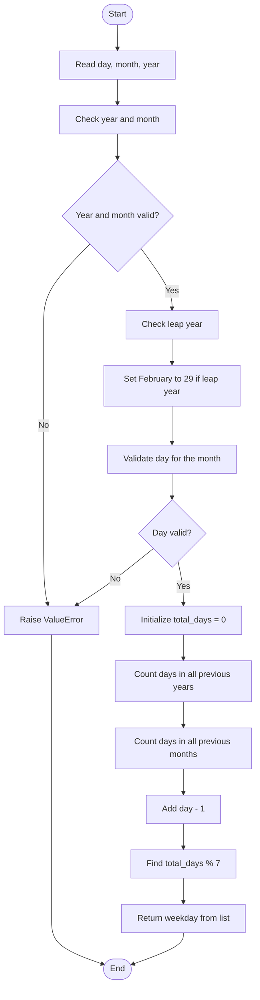

# 12. Day of the Week

## Problem statement

Given a date in the format **day, month, year**, find the day of the week for that date.

The program uses **01-01-0001 as Monday** in the Gregorian calendar. It counts the number of days from this starting date and uses the remainder after division by 7 to identify the weekday.

### Example

For the date `1-1-1`:

- No complete years come before year 1.
- No complete months come before January.
- No days come before day 1.
- Total days counted = `0`.
- `0 % 7 = 0`, so the weekday is `Monday`.

## Concepts used

- Variables
- Functions
- `for` loops
- Lists
- Conditional statements
- Leap year
- Modulus operator (`%`)
- Date calculation
- Exception handling (`ValueError`)

## 1. Check whether a year is a leap year

The function `is_leap_year(year)` checks whether the given year is a leap year.

A year is a leap year when:

- It is divisible by 400, or
- It is divisible by 4 but not divisible by 100.

The source code expresses this rule as:

```python
return (year % 400 == 0) or (
    year % 4 == 0 and year % 100 != 0
)
```

### Examples

| Year | Check | Leap year? |
|---:|---|---|
| 2024 | Divisible by 4, not by 100 | Yes |
| 1900 | Divisible by 100, not by 400 | No |
| 2000 | Divisible by 400 | Yes |
| 2023 | Not divisible by 4 | No |

### Code

```python
def is_leap_year(year: int) -> bool:
    """Check whether a year is a leap year."""

    return (year % 400 == 0) or (
        year % 4 == 0 and year % 100 != 0
    )
```

## 2. Store the number of days in each month

The program creates a list containing the normal number of days in each month:

```python
days_in_month = [
    31, 28, 31, 30, 31, 30,
    31, 31, 30, 31, 30, 31
]
```

The list positions represent the months:

| List index | Month | Days |
|---:|---|---:|
| 0 | January | 31 |
| 1 | February | 28 |
| 2 | March | 31 |
| 3 | April | 30 |
| 4 | May | 31 |
| 5 | June | 30 |
| 6 | July | 31 |
| 7 | August | 31 |
| 8 | September | 30 |
| 9 | October | 31 |
| 10 | November | 30 |
| 11 | December | 31 |

Python list indexing starts at zero. Therefore, the number of days for a month is accessed with `days_in_month[month - 1]`.

If the year is a leap year, February has 29 days:

```python
if is_leap_year(year):
    days_in_month[1] = 29
```

## 3. Store weekday names

The program stores weekday names in this order:

```python
weekdays = [
    "Monday", "Tuesday", "Wednesday",
    "Thursday", "Friday", "Saturday", "Sunday"
]
```

The order starts with Monday because the source program uses 01-01-0001 as Monday.

The weekday is selected using the calculated remainder:

```python
weekdays[total_days % 7]
```

## 4. Validate the date

Before counting days, the program checks whether the year and month are valid:

```python
if year < 1 or month < 1 or month > 12:
    raise ValueError("Please enter a valid date.")
```

After adjusting February for a leap year, it checks whether the day is valid for the selected month:

```python
if day < 1 or day > days_in_month[month - 1]:
    raise ValueError("Invalid day for the given month.")
```

For example, `31-4-2024` is invalid because April has only 30 days.

## 5. Count total days from 01-01-0001

The main function is `get_day_of_week(date)`. It receives a list in this order:

```python
[day, month, year]
```

It calculates the total number of days before the given date in three parts.

### Step 1: Count complete years

```python
for y in range(1, year):
    total_days += 366 if is_leap_year(y) else 365
```

The loop counts every complete year before the requested year.

- Add 366 for a leap year.
- Add 365 for a normal year.

The requested year itself is not counted as a complete year.

### Step 2: Count complete months

```python
for m in range(month - 1):
    total_days += days_in_month[m]
```

This loop adds the days in all months before the requested month.

For example, if the month is March, it adds January and February.

### Step 3: Count days before the given date

```python
total_days += day - 1
```

We use `day - 1` because the starting date itself contributes zero days before it.

For example:
- On day 1, add 0.
- On day 2, add 1.
- On day 10, add 9.

## 6. Calculate the weekday using `% 7`

There are seven days in a week. Therefore, the program uses the remainder after dividing the total number of days by 7:

```python
return weekdays[total_days % 7]
```

| Remainder | Weekday |
|---:|---|
| 0 | Monday |
| 1 | Tuesday |
| 2 | Wednesday |
| 3 | Thursday |
| 4 | Friday |
| 5 | Saturday |
| 6 | Sunday |

## 7. Complete dry run

Find the weekday for **1 January 2024**.

Input:

```text
day = 1
month = 1
year = 2024
```

### Step 1: Count complete years

The program counts years from 1 through 2023.

- Leap years contribute 366 days.
- Normal years contribute 365 days.

For this date, the total number of days before 2024-01-01 is `738885`.

### Step 2: Count complete months

January is the first month, so there are no complete months before it.

```text
Days from complete months = 0
```

### Step 3: Count days before the date

```text
day - 1 = 1 - 1 = 0
```

### Step 4: Calculate the weekday

```text
total_days = 738885
remainder = 738885 % 7 = 0
```

The weekday at index 0 is `Monday`.

**Result: Monday**

## 8. Flowchart



## 9. Complete Python program

The following code follows the uploaded `12_Day_of_the_Week.py` implementation.

```python
def is_leap_year(year: int) -> bool:
    """Check whether a year is a leap year."""

    return (year % 400 == 0) or (
        year % 4 == 0 and year % 100 != 0
    )


def get_day_of_week(date: list[int]) -> str:
    """Find the weekday for a given date [day, month, year]."""

    day, month, year = date

    days_in_month = [
        31, 28, 31, 30, 31, 30,
        31, 31, 30, 31, 30, 31
    ]

    weekdays = [
        "Monday", "Tuesday", "Wednesday",
        "Thursday", "Friday", "Saturday", "Sunday"
    ]

    # Validate year and month
    if year < 1 or month < 1 or month > 12:
        raise ValueError("Please enter a valid date.")

    # Handle leap year
    if is_leap_year(year):
        days_in_month[1] = 29

    # Validate day
    if day < 1 or day > days_in_month[month - 1]:
        raise ValueError("Invalid day for the given month.")

    total_days = 0

    # Count complete years before the given year
    for y in range(1, year):
        total_days += 366 if is_leap_year(y) else 365

    # Count complete months before the given month
    for m in range(month - 1):
        total_days += days_in_month[m]

    # Count days before the given date
    total_days += day - 1

    # Calculate weekday
    return weekdays[total_days % 7]


if __name__ == "__main__":

    day = int(input("Enter day: "))
    month = int(input("Enter month: "))
    year = int(input("Enter year: "))

    try:
        result = get_day_of_week([day, month, year])

        print(f"Day of the week: {result}")

    except ValueError as error:
        print(error)
```

## 10. Sample outputs

### Example 1: A normal date

```text
Enter day: 1
Enter month: 1
Enter year: 2024
Day of the week: Monday
```

### Example 2: A date in a leap year

```text
Enter day: 29
Enter month: 2
Enter year: 2024
Day of the week: Thursday
```

### Example 3: Invalid day

```text
Enter day: 31
Enter month: 4
Enter year: 2024
Invalid day for the given month.
```

### Example 4: Invalid month

```text
Enter day: 10
Enter month: 13
Enter year: 2024
Please enter a valid date.
```

## 11. Time and space complexity

Let `year` be the input year and `month` be the input month.

| Operation | Time complexity | Reason |
|---|---|---|
| Leap-year check | `O(1)` | A fixed number of arithmetic checks |
| Date validation | `O(1)` | Checks a fixed number of conditions |
| Count previous years | `O(year)` | Iterates through all earlier years |
| Count previous months | `O(month)` | Iterates through earlier months |
| Find weekday | `O(1)` | Uses modulo and list indexing |

**Overall time complexity:** `O(year + month)`

**Auxiliary space complexity:** `O(1)`

The month and weekday lists have fixed sizes, and the program uses only a fixed number of additional variables.

## 12. Important Python concepts

| Concept | How it is used |
|---|---|
| Function | Separate functions handle leap-year checking and weekday calculation. |
| List | Stores days in each month and weekday names. |
| List indexing | `days_in_month[month - 1]` selects the month's day count. |
| `for` loop | Counts complete years and months. |
| Conditional expression | Adds either 366 or 365 days. |
| Modulus `%` | Finds the weekday position from the remainder. |
| `and` / `or` | Combines leap-year conditions. |
| `raise ValueError` | Reports an invalid date. |
| `try-except` | Catches and displays the validation error. |
| List unpacking | `day, month, year = date` assigns the three list values. |

## 13. Interview questions

**1. What is a leap year?**

A leap year has 366 days instead of 365. February has 29 days in a leap year.

**2. What is the leap-year condition used in this program?**

A year is a leap year if it is divisible by 400, or divisible by 4 but not by 100.

**3. Why does the program start counting from 01-01-0001?**

The source program uses this date as its reference point and assumes it was Monday in the Gregorian calendar.

**4. Why do we use `day - 1`?**

We count the number of days before the given date, not including the given day itself.

**5. Why do we use `% 7`?**

A week contains seven days. The remainder identifies the weekday's index in the weekday list.

**6. Why is the month index `month - 1`?**

Python lists start at index 0, while calendar months start at 1.

**7. What is the purpose of `raise ValueError`?**

It stops the calculation when the date is invalid and reports an error.

**8. What is the time complexity of this solution?**

`O(year + month)`, because it loops through all previous years and months.

## 14. Practice questions

1. Find the weekday for `15-8-1947`.
2. Find the weekday for `1-1-2000`.
3. Find the weekday for `29-2-2020`.
4. Test a non-leap century year such as `1900`.
5. Test a leap century year such as `2000`.
6. Try an invalid date such as `30-2-2024`.
7. Try an invalid month such as `15`.

## 15. Key takeaways

- A leap year has 366 days.
- The Gregorian leap-year rule has a special exception for century years.
- The program counts complete years, complete months, and days before the requested date.
- The `% 7` operation maps the total day count to one of seven weekdays.
- Date validation prevents invalid month and day values from being used in the calculation.
- The solution uses `O(year + month)` time and `O(1)` auxiliary space.

## Navigation

- Previous: [11. Add Two Fractions](./11_Add_Two_Fractions.md)
- Next: [13. Nth Fibonacci](./13_Nth_Fibonacci.md)
- Python source: [12_Day_of_the_Week.py](./12_Day_of_the_Week.py)
