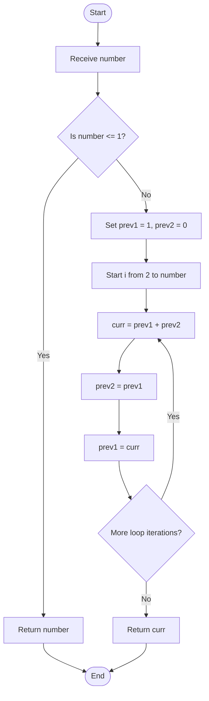

# 13. Nth Fibonacci Number

## Problem statement

Find the **Nth Fibonacci number** for a given non-negative integer `number`.

The Fibonacci series starts with:

```text
0, 1, 1, 2, 3, 5, 8, 13, 21, ...
```

Each term after the first two is the sum of the previous two terms.

\[
F(0)=0,\quad F(1)=1
\]

\[
F(n)=F(n-1)+F(n-2),\quad n\geq 2
\]

The uploaded Python program implements two approaches:

1. Using iteration (`for` loop)
2. Using recursion

## Concepts used

- Variables
- Functions
- `for` loop
- Recursion
- Conditional statements
- Multiple assignment

## 1. Understand the Fibonacci series

| Position (`n`) | Fibonacci number (`F(n)`) |
|---:|---:|
| 0 | 0 |
| 1 | 1 |
| 2 | 1 |
| 3 | 2 |
| 4 | 3 |
| 5 | 5 |
| 6 | 8 |
| 7 | 13 |
| 8 | 21 |
| 9 | 34 |

For example, the 6th-position term using zero-based indexing is `F(6) = 8`.

**Important:** This program treats the first term as position 0, not position 1.

## 2. Approach 1 — Using iteration

The first function uses a `for` loop to calculate the Fibonacci number.

### Code

```python
def fibonacci_using_loop(number: int) -> int:
    """Find the Nth Fibonacci number using iteration."""

    if number <= 1:
        return number

    prev1 = 1
    prev2 = 0

    for i in range(2, number + 1):
        curr = prev1 + prev2

        prev2 = prev1
        prev1 = curr

    return curr
```

### How it works

1. If `number` is 0 or 1, return it directly. These are the first two Fibonacci values.
2. Initialize:
   - `prev1 = 1` — the previous Fibonacci value.
   - `prev2 = 0` — the value before `prev1`.
3. Start the loop from 2 up to `number`.
4. Add the two previous values to calculate the current value.
5. Move the previous values forward:
   - `prev2 = prev1`
   - `prev1 = curr`
6. After the loop, return `curr`.

### Dry run: Find `F(6)`

Initial values:

```text
prev1 = 1
prev2 = 0
```

| `i` | `prev1` | `prev2` | `curr = prev1 + prev2` | Update after calculation |
|---:|---:|---:|---:|---|
| 2 | 1 | 0 | 1 | `prev2=1`, `prev1=1` |
| 3 | 1 | 1 | 2 | `prev2=1`, `prev1=2` |
| 4 | 2 | 1 | 3 | `prev2=2`, `prev1=3` |
| 5 | 3 | 2 | 5 | `prev2=3`, `prev1=5` |
| 6 | 5 | 3 | 8 | `prev2=5`, `prev1=8` |

The loop finishes and returns:

```text
F(6) = 8
```

### Flowchart



## 3. Understand multiple assignment and variable updates

The loop updates two variables:

```python
prev2 = prev1
prev1 = curr
```

These statements move the two stored Fibonacci values forward by one position.

For example, if:

```text
prev1 = 5
prev2 = 3
curr = 8
```

After the updates:

```text
prev2 = 5
prev1 = 8
```

The next iteration can calculate `8 + 5`.

## 4. Approach 2 — Using recursion

The second function solves the problem by calling itself.

### Code

```python
def fibonacci_using_recursion(number: int) -> int:
    """Find the Nth Fibonacci number using recursion."""

    if number <= 1:
        return number

    return (
        fibonacci_using_recursion(number - 1)
        + fibonacci_using_recursion(number - 2)
    )
```

### How it works

1. Check the base case: if `number` is 0 or 1, return `number`.
2. Otherwise, calculate the result by adding:
   - Fibonacci of `number - 1`
   - Fibonacci of `number - 2`
3. Each function call continues until it reaches a base case.

The recursive formula is:

\[
F(n)=F(n-1)+F(n-2)
\]

### Dry run: Find `F(4)`

The calls expand as follows:

```text
F(4)
├── F(3)
│   ├── F(2)
│   │   ├── F(1) = 1
│   │   └── F(0) = 0
│   └── F(1) = 1
└── F(2)
    ├── F(1) = 1
    └── F(0) = 0
```

Now calculate:

```text
F(2) = 1 + 0 = 1
F(3) = 1 + 1 = 2
F(4) = 2 + 1 = 3
```

Therefore:

```text
F(4) = 3
```

### Recursion flowchart

```mermaid
flowchart TD
    A([Call fibonacci(number)]) --> B{"Is number <= 1?"}
    B -- Yes --> C["Return number"]
    B -- No --> D["Calculate fibonacci(number - 1)"]
    D --> E["Calculate fibonacci(number - 2)"]
    E --> F["Add both returned values"]
    F --> G["Return sum"]
    C --> H([End])
    G --> H
```

## 5. Compare both approaches

| Feature | Iteration | Recursion |
|---|---|---|
| Main technique | `for` loop | Function calls itself |
| Base condition | `number <= 1` | `number <= 1` |
| Stores previous values | Two variables | Uses recursive calls |
| Time complexity | `O(n)` | `O(2^n)` |
| Auxiliary space | `O(1)` | `O(n)` |
| Repeated calculations | No | Yes |

The iterative approach is more efficient for larger values because it calculates each term once and stores only two previous values. The recursive approach is useful for understanding recursion and the mathematical definition of Fibonacci numbers, but it repeats many calculations.

## 6. Complete Python program

This follows the two functions and main block in your uploaded `13_Nth_Fibonacci(1).py` file.

```python
def fibonacci_using_loop(number: int) -> int:
    """Find the Nth Fibonacci number using iteration."""

    if number <= 1:
        return number

    prev1 = 1
    prev2 = 0

    for i in range(2, number + 1):
        curr = prev1 + prev2

        prev2 = prev1
        prev1 = curr

    return curr


def fibonacci_using_recursion(number: int) -> int:
    """Find the Nth Fibonacci number using recursion."""

    if number <= 1:
        return number

    return (
        fibonacci_using_recursion(number - 1)
        + fibonacci_using_recursion(number - 2)
    )


if __name__ == "__main__":

    number = int(input("Enter a number: "))

    if number < 0:
        print("Please enter a non-negative number.")

    else:
        result_loop = fibonacci_using_loop(number)
        result_recursion = fibonacci_using_recursion(number)

        print(f"Fibonacci using Loop: {result_loop}")
        print(f"Fibonacci using Recursion: {result_recursion}")
```

## 7. Sample outputs

### Example 1: Input is 6

```text
Enter a number: 6
Fibonacci using Loop: 8
Fibonacci using Recursion: 8
```

### Example 2: Input is 0

```text
Enter a number: 0
Fibonacci using Loop: 0
Fibonacci using Recursion: 0
```

### Example 3: Input is 1

```text
Enter a number: 1
Fibonacci using Loop: 1
Fibonacci using Recursion: 1
```

### Example 4: Negative input

```text
Enter a number: -4
Please enter a non-negative number.
```

## 8. Time and space complexity

### Iterative approach

- **Time:** `O(n)` — the loop runs from 2 through `number`.
- **Auxiliary space:** `O(1)` — it uses a fixed number of variables, regardless of the input size.

### Recursive approach

- **Time:** `O(2^n)` — the basic recursive function branches into two calls and repeats many calculations.
- **Auxiliary space:** `O(n)` — the deepest chain of recursive calls can reach a depth proportional to `n`.

| Approach | Time complexity | Auxiliary space complexity |
|---|---|---|
| Iteration | `O(n)` | `O(1)` |
| Recursion | `O(2^n)` | `O(n)` |

These are the complexity values stated in the uploaded source file.

## 9. Important Python concepts

| Concept | How it is used |
|---|---|
| Function | Each approach is implemented in a separate reusable function. |
| `for` loop | Repeats the Fibonacci calculation in the iterative approach. |
| Recursion | The recursive function calls itself with smaller arguments. |
| Base case | `number <= 1` stops further recursive calls. |
| Conditional statement | Handles the first two Fibonacci values and negative input. |
| Multiple variable updates | Moves `prev1` and `prev2` to the next pair of values. |
| Return statement | Sends the calculated Fibonacci number back to the caller. |
| `range(2, number + 1)` | Includes `number` as the final loop position. |

## 10. Interview questions

**1. What is the Fibonacci series?**

It is a sequence in which each term after the first two is the sum of the previous two terms.

**2. What are the first two Fibonacci numbers in this program?**

`F(0) = 0` and `F(1) = 1`.

**3. What is recursion?**

Recursion is a programming technique in which a function calls itself to solve smaller versions of a problem.

**4. What is a base case?**

A base case is the condition that stops recursive calls. Here, it is `number <= 1`.

**5. Why does the recursive approach take more time?**

It recalculates the same Fibonacci values in different branches of the recursion tree.

**6. Why is the iterative approach `O(1)` in auxiliary space?**

It stores only a fixed number of variables: `prev1`, `prev2`, and `curr`.

**7. What does `range(2, number + 1)` do?**

It generates loop values from 2 through `number`, including the final position.

**8. Which approach is more efficient in this program?**

The iterative approach, because it takes `O(n)` time and `O(1)` auxiliary space.

## 11. Practice questions

1. Find `F(5)` using both approaches.
2. Find `F(8)` using the iterative approach.
3. Write the first 10 terms of the Fibonacci series.
4. Draw the recursion tree for `F(5)`.
5. Explain why the recursive approach calculates some values more than once.
6. Compare the time and space complexity of both approaches.

## 12. Key takeaways

- The Fibonacci sequence starts with 0 and 1.
- Each next term is the sum of the previous two terms.
- The iterative solution uses a loop and two previous-value variables.
- The recursive solution uses the Fibonacci formula and a base case.
- The iterative approach takes `O(n)` time and `O(1)` auxiliary space.
- The recursive approach takes `O(2^n)` time and `O(n)` auxiliary space in this implementation.
- The program uses zero-based indexing: `F(0) = 0`.

## Navigation

- Previous: [12. Day of the Week](./12_Day_of_the_Week.md)
- Next: [14. Decimal to Binary](./14_Decimal_to_Binary.md)
- Python source: [13_Nth_Fibonacci.py](./13_Nth_Fibonacci.py)
