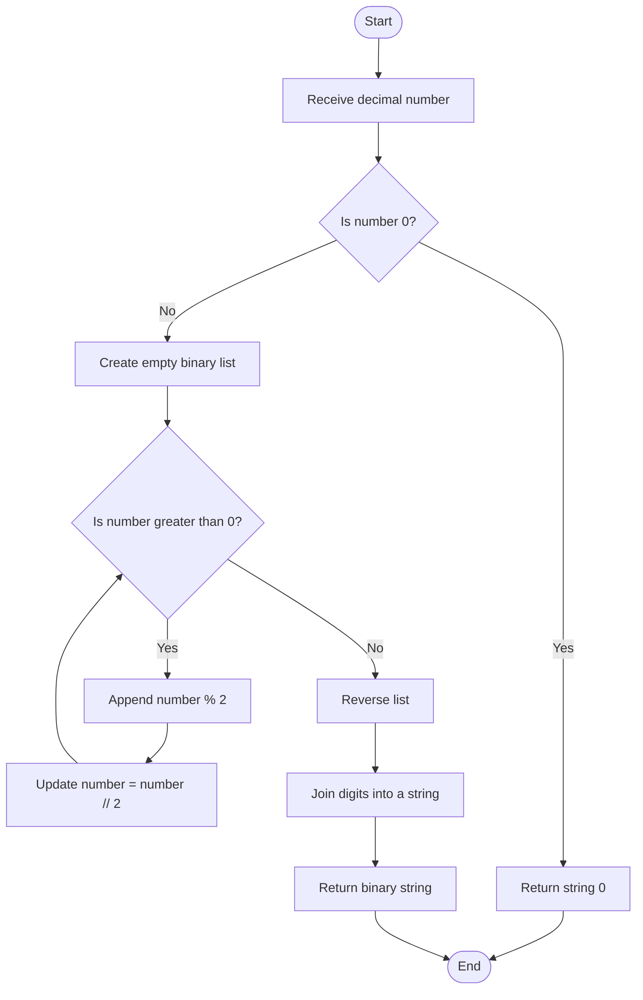
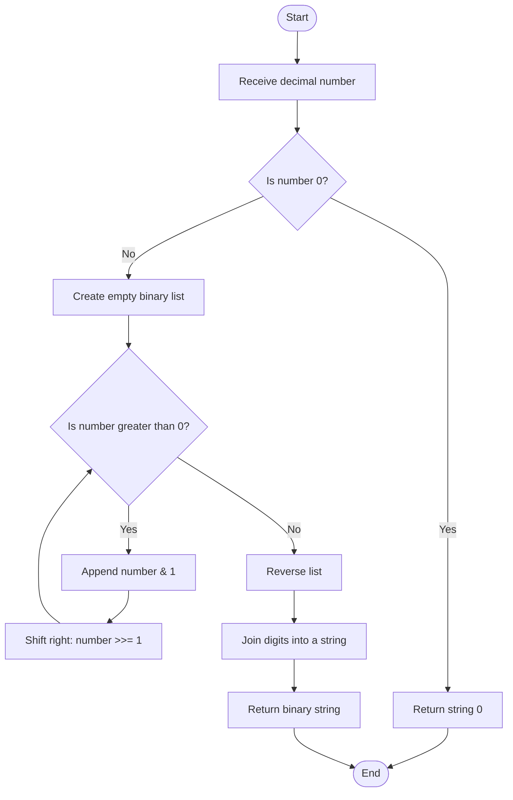

# 14. Decimal to Binary

## Problem statement

Convert a non-negative decimal number (base 10) into its binary representation (base 2).

The uploaded Python solution implements two approaches:

1. **Repeated division by 2** — use the remainder at each step to build the binary digits.
2. **Bitwise operations** — use `& 1` to get the last binary bit and `>>= 1` to remove that bit.

Both functions return the binary number as a string. The program handles zero and rejects negative input in its main block.

### Examples

| Decimal | Binary |
|---:|---:|
| 0 | `0` |
| 1 | `1` |
| 2 | `10` |
| 5 | `101` |
| 10 | `1010` |
| 13 | `1101` |

## Concepts used

- Variables
- Functions
- `while` loop
- Lists
- String join
- List reversing
- Modulus operator (`%`)
- Floor division (`//`)
- Bitwise operators (`&`, `>>`)

## 1. Understand decimal and binary

- **Decimal (base 10):** uses the digits `0` to `9`.
- **Binary (base 2):** uses only the digits `0` and `1`.

For example:

\[
13_{10}=1101_2
\]

The binary digits represent powers of 2:

\[
1101_2 = (1\times 2^3)+(1\times 2^2)+(0\times 2^1)+(1\times 2^0)
\]

\[
=8+4+0+1=13
\]

## 2. Approach 1 — Using repeated division

The first function is:

```python
def decimal_to_binary_using_division(number: int) -> str:
    """Convert a decimal number to binary using repeated division."""

    if number == 0:
        return "0"

    binary = []

    while number > 0:
        binary.append(str(number % 2))
        number //= 2

    return "".join(binary[::-1])
```

### How it works

1. If the input is zero, return `"0"` directly.
2. Create an empty list named `binary`.
3. While the number is greater than zero:
   - `number % 2` finds the remainder after division by 2. The remainder is either 0 or 1.
   - Convert the remainder to a string and append it to the list.
   - `number //= 2` divides the number by 2 and keeps the integer part.
4. Reverse the collected digits because remainders are found from right to left.
5. Use `"".join(...)` to combine the reversed digits into one string.

### Dry run: Convert 13 to binary

| Step | Current number | `number % 2` | Append | `number // 2` |
|---:|---:|---:|---:|---:|
| 1 | 13 | 1 | `"1"` | 6 |
| 2 | 6 | 0 | `"0"` | 3 |
| 3 | 3 | 1 | `"1"` | 1 |
| 4 | 1 | 1 | `"1"` | 0 |

The list contains:

```text
["1", "0", "1", "1"]
```

These digits were collected in reverse order. After reversing:

```text
["1", "1", "0", "1"]
```

Joining them gives:

```text
1101
```

Therefore, `13` in decimal is `1101` in binary.

### Flowchart



## 3. Approach 2 — Using bitwise operations

The second function is:

```python
def decimal_to_binary_using_bitwise(number: int) -> str:
    """Convert a decimal number to binary using bitwise operations."""

    if number == 0:
        return "0"

    binary = []

    while number > 0:
        binary.append(str(number & 1))
        number >>= 1

    return "".join(binary[::-1])
```

### Understand the bitwise operators

**1. Bitwise AND (`&`)**

The expression:

```python
number & 1
```

checks the rightmost bit of the number's binary representation. Its result is either `0` or `1`.

For example:

```text
13 in binary = 1101
                 0001
                 ----
13 & 1           0001 = 1
```

If the rightmost bit is 0, the result is 0. If it is 1, the result is 1.

**2. Right shift (`>>`)**

The expression:

```python
number >>= 1
```

shifts the binary bits one position to the right. For a non-negative integer, this is equivalent to integer division by 2.

For example:

```text
13 in binary = 1101
13 >> 1      =  110  = 6
```

### Dry run: Convert 13 to binary

| Step | Current number | `number & 1` | Append | `number >> 1` |
|---:|---:|---:|---:|---:|
| 1 | 13 (`1101`) | 1 | `"1"` | 6 (`110`) |
| 2 | 6 (`110`) | 0 | `"0"` | 3 (`11`) |
| 3 | 3 (`11`) | 1 | `"1"` | 1 (`1`) |
| 4 | 1 (`1`) | 1 | `"1"` | 0 (`0`) |

The collected list is `["1", "0", "1", "1"]`. Reverse and join it to get `1101`.

### Flowchart



## 4. Compare both approaches

| Feature | Repeated division | Bitwise operations |
|---|---|---|
| Get the next binary digit | `number % 2` | `number & 1` |
| Remove the processed bit | `number //= 2` | `number >>= 1` |
| Build result | Append digits, reverse, join | Append digits, reverse, join |
| Main idea | Division and remainder | Binary bit manipulation |
| Time complexity | `O(log n)` | `O(log n)` |
| Auxiliary space | `O(log n)` | `O(log n)` |

Both approaches produce the same binary string for a non-negative input.

## 5. Why do we reverse the list?

Repeated division and bitwise extraction both find the least significant (rightmost) binary bit first.

For 13, the bits are collected in this order:

```text
1, 0, 1, 1
```

But the normal binary representation is read from left to right:

```text
1101
```

Therefore, the code uses:

```python
binary[::-1]
```

This creates a reversed copy of the list. Then:

```python
"".join(binary[::-1])
```

combines the characters into a string.

## 6. Complete dry run for zero

If the input is `0`, both functions immediately execute:

```python
if number == 0:
    return "0"
```

The `while` loop is skipped, and the function returns the string `"0"`.

This special case is necessary because the loop condition `number > 0` would otherwise never run and the empty list would produce an empty string.

## 7. Complete Python program

This follows the two functions and main block in your uploaded `14_Decimal_to_Binary.py` file.

```python
def decimal_to_binary_using_division(number: int) -> str:
    """Convert a decimal number to binary using repeated division."""

    if number == 0:
        return "0"

    binary = []

    while number > 0:
        binary.append(str(number % 2))
        number //= 2

    return "".join(binary[::-1])


def decimal_to_binary_using_bitwise(number: int) -> str:
    """Convert a decimal number to binary using bitwise operations."""

    if number == 0:
        return "0"

    binary = []

    while number > 0:
        binary.append(str(number & 1))
        number >>= 1

    return "".join(binary[::-1])


if __name__ == "__main__":

    number = int(input("Enter a decimal number: "))

    if number < 0:
        print("Please enter a non-negative number.")

    else:
        result_division = decimal_to_binary_using_division(number)
        result_bitwise = decimal_to_binary_using_bitwise(number)

        print(f"Binary using Division: {result_division}")
        print(f"Binary using Bitwise Operations: {result_bitwise}")
```

## 8. Sample outputs

### Example 1: Input is 13

```text
Enter a decimal number: 13
Binary using Division: 1101
Binary using Bitwise Operations: 1101
```

### Example 2: Input is 10

```text
Enter a decimal number: 10
Binary using Division: 1010
Binary using Bitwise Operations: 1010
```

### Example 3: Input is 0

```text
Enter a decimal number: 0
Binary using Division: 0
Binary using Bitwise Operations: 0
```

### Example 4: Negative input

```text
Enter a decimal number: -5
Please enter a non-negative number.
```

## 9. Time and space complexity

For a positive number `n`, each loop iteration divides or shifts the number by 2. The number of iterations is proportional to the number of binary digits, which is `O(log n)`.

| Approach | Time complexity | Auxiliary space complexity |
|---|---|---|
| Repeated division | `O(log n)` | `O(log n)` |
| Bitwise operations | `O(log n)` | `O(log n)` |

**Why is the space complexity `O(log n)`?**

The `binary` list stores one character for each binary digit. A positive number has `O(log n)` binary digits, so the list requires `O(log n)` space. The reversed list/string construction also uses space proportional to the output length.

For input `0`, both functions return immediately.

## 10. Important Python concepts

| Concept | Meaning in this program |
|---|---|
| `while` loop | Repeats until the number becomes zero. |
| `%` | Gets the remainder after division by 2. |
| `//` | Performs integer division by 2. |
| `&` | Performs bitwise AND; `number & 1` gets the last bit. |
| `>>` | Shifts bits right by one position. |
| `list.append()` | Adds a binary digit to the list. |
| `[::-1]` | Reverses the list using slicing. |
| `"".join()` | Combines string digits into one string. |
| Function return type `str` | Indicates that each conversion function returns a string. |

## 11. Interview questions

**1. What is the binary number system?**

The binary number system is base 2 and uses only two digits: 0 and 1.

**2. Why do we divide by 2 when converting decimal to binary?**

Because binary is base 2. Repeated division by 2 produces the binary digits as remainders.

**3. What does `% 2` return?**

It returns the remainder after division by 2, which is either 0 or 1 for a non-negative integer.

**4. What is the purpose of `//`?**

It performs floor division. In this program, `number // 2` updates the number to the integer quotient.

**5. What does `number & 1` do?**

It performs bitwise AND with 1 and extracts the rightmost binary bit.

**6. What does `number >>= 1` mean?**

It shifts the bits one position to the right. For a non-negative integer, this is equivalent to integer division by 2.

**7. Why is the collected list reversed?**

The algorithm extracts the least significant bit first, while the usual binary representation is written from the most significant bit to the least significant bit.

**8. Why do the functions return strings?**

A binary representation is a sequence of digits. Returning a string preserves leading or internal zero digits in the representation.

**9. What is the time complexity?**

Both approaches take `O(log n)` time because the number is reduced by a factor of 2 in every iteration.

## 12. Practice questions

1. Convert decimal `7` to binary.
2. Convert decimal `15` to binary.
3. Convert decimal `20` to binary.
4. Convert decimal `25` to binary.
5. Explain the difference between `% 2` and `& 1`.
6. Explain the difference between `// 2` and `>> 1`.
7. Trace both approaches for decimal number `18`.

## 13. Key takeaways

- Binary uses only 0 and 1.
- Repeated division by 2 gives binary digits through remainders.
- Bitwise AND with 1 extracts the rightmost bit.
- Right shift by one position removes the rightmost bit.
- Both approaches collect bits from right to left, so the list must be reversed.
- Both solutions use `O(log n)` time and `O(log n)` auxiliary space.
- The uploaded program accepts non-negative integers and handles zero separately.

## Navigation

- Previous: [13. Nth Fibonacci](./13_Nth_Fibonacci.md)
- Next: [15. Nth Term of a Series](./15_n-th_term_of_series.md)
- Python source: [14_Decimal_to_Binary.py](./14_Decimal_to_Binary.py)
