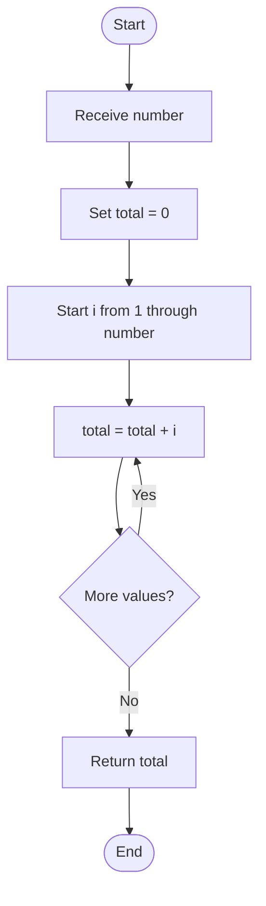
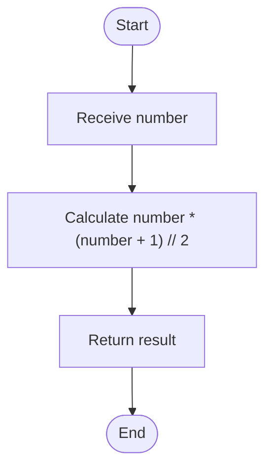

# 15. Nth Term of a Series — Triangular Numbers

## Problem statement

Find the Nth term of the triangular number series:

```text
1, 3, 6, 10, 15, 21, 28, ...
```

Each term is the sum of all positive integers from 1 through `n`.

For example:

- Term 1 = `1`
- Term 2 = `1 + 2 = 3`
- Term 3 = `1 + 2 + 3 = 6`
- Term 4 = `1 + 2 + 3 + 4 = 10`

The uploaded program implements two approaches:
1. Using a `for` loop.
2. Using a mathematical formula.

## Concepts used

- Variables and functions
- `for` loop
- Arithmetic operators
- Mathematical formula

## 1. Approach 1 — Using a for loop

### Code

```python
def find_nth_term_using_loop(number: int) -> int:
    """Find the Nth term using a for loop."""

    total = 0

    for i in range(1, number + 1):
        total += i

    return total
```

### How it works

1. Initialize `total = 0`.
2. Loop from 1 through `number`.
3. Add each value of `i` to `total`.
4. Return the final sum.

### Dry run: Find the 5th term

Input: `number = 5`

| Iteration | `i` | `total` before addition | `total` after addition |
|---:|---:|---:|---:|
| 1 | 1 | 0 | 1 |
| 2 | 2 | 1 | 3 |
| 3 | 3 | 3 | 6 |
| 4 | 4 | 6 | 10 |
| 5 | 5 | 10 | 15 |

Result: **15**

### Flowchart



## 2. Approach 2 — Using a mathematical formula

The sum of the first `n` positive integers can be calculated directly:

\[
T_n=\frac{n(n+1)}{2}
\]

The source code uses integer floor division:

```python
def find_nth_term_using_formula(number: int) -> int:
    """Find the Nth term using a mathematical formula."""

    return number * (number + 1) // 2
```

### Dry run: Find the 5th term

\[
T_5=\frac{5(5+1)}{2}
=\frac{5\times6}{2}
=\frac{30}{2}=15
\]

Result: **15**

### Flowchart



## 3. Compare both approaches

| Feature | For loop | Mathematical formula |
|---|---|---|
| Method | Adds each number | Calculates directly |
| Time complexity | `O(n)` | `O(1)` |
| Auxiliary space | `O(1)` | `O(1)` |
| Main concept | Iteration | Arithmetic formula |

The formula approach is faster for large values because it does not need to visit every number from 1 to `n`.

## 4. Complete Python program

This matches the two functions and main block in the uploaded `15_n-th_term_of_series(1).py` file.

```python
def find_nth_term_using_loop(number: int) -> int:
    """Find the Nth term using a for loop."""

    total = 0

    for i in range(1, number + 1):
        total += i

    return total


def find_nth_term_using_formula(number: int) -> int:
    """Find the Nth term using a mathematical formula."""

    return number * (number + 1) // 2


if __name__ == "__main__":

    number = int(input("Enter a number: "))

    if number <= 0:
        print("Please enter a positive number.")

    else:
        result_loop = find_nth_term_using_loop(number)
        result_formula = find_nth_term_using_formula(number)

        print(f"Nth Term using Loop: {result_loop}")
        print(f"Nth Term using Formula: {result_formula}")
```

## 5. Sample output

```text
Enter a number: 5
Nth Term using Loop: 15
Nth Term using Formula: 15
```

For an invalid input:

```text
Enter a number: 0
Please enter a positive number.
```

## 6. Complexity analysis

| Approach | Time | Auxiliary space | Reason |
|---|---|---|---|
| Loop | `O(n)` | `O(1)` | Runs once for each integer from 1 to `n` |
| Formula | `O(1)` | `O(1)` | Uses a fixed number of arithmetic operations |

## 7. Important Python concepts

- `range(1, number + 1)` includes values from 1 through `number`.
- `total += i` is shorthand for `total = total + i`.
- `//` performs integer floor division.
- A function makes the calculation reusable.
- The main block checks that the input is positive before calling the functions.

## 8. Interview questions

**1. What is a triangular number?**

A triangular number is the sum of consecutive positive integers starting from 1.

**2. What is the formula for the Nth triangular number?**

\[
T_n=\frac{n(n+1)}{2}
\]

**3. What is the 6th triangular number?**

\[
T_6=\frac{6\times7}{2}=21
\]

**4. Which approach is faster?**

The mathematical formula takes constant time, `O(1)`, while the loop takes `O(n)` time.

**5. Why is the loop approach `O(1)` space?**

It uses only a fixed number of variables and does not create a collection that grows with `n`.

## 9. Practice questions

1. Find the 7th triangular number.
2. Find the 10th triangular number using both approaches.
3. Write the first 8 terms of the triangular number series.
4. Explain why `range(1, number + 1)` is used.
5. Compare the loop and formula approaches.

## 10. Key takeaways

- The series is formed by adding consecutive positive integers.
- The loop approach builds the sum step by step.
- The formula is `n * (n + 1) // 2`.
- The loop takes `O(n)` time.
- The formula takes `O(1)` time.
- Both approaches use `O(1)` auxiliary space.

## Navigation

- Previous: [14. Decimal to Binary](./14_Decimal_to_Binary.md)
- Next: [16. Armstrong Number](./16_Armstrong_Number.md)
- Python source: [15_n-th_term_of_series.py](./15_n-th_term_of_series.py)
