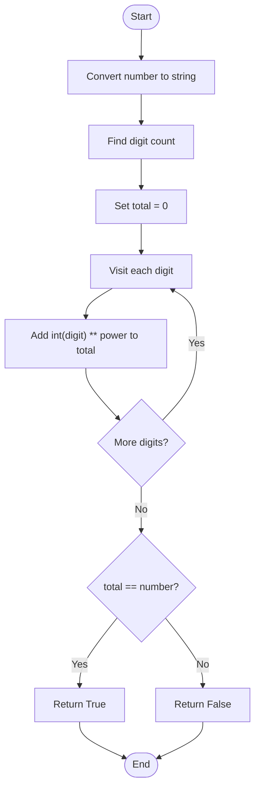
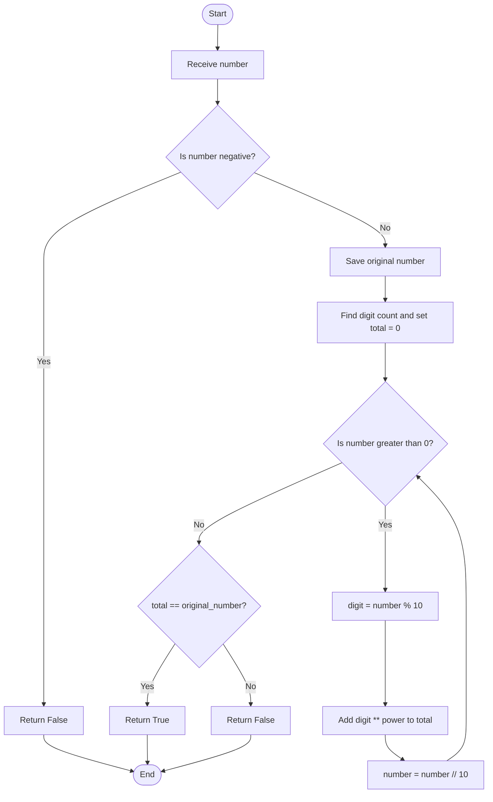

# 16. Armstrong Number

## Problem statement

Check whether a given number is an **Armstrong number**.

An Armstrong number is a number equal to the sum of its digits, where each digit is raised to the power of the total number of digits.

For a number with `d` digits:

\[
n=\sum(\text{each digit})^d
\]

### Example: 153

153 has 3 digits.

\[
1^3+5^3+3^3=1+125+27=153
\]

Therefore, **153 is an Armstrong number**.

Other examples include `0`, `1`, `370`, `371`, and `407`.

The uploaded file implements two approaches:
1. Using string conversion.
2. Using mathematical operations.

## Concepts used

- Variables and functions
- `for` loop and `while` loop
- String conversion
- Modulus operator (`%`)
- Floor division (`//`)
- Exponentiation operator (`**`)

## 1. Approach 1 — Using string conversion

### Code

```python
def is_armstrong_using_string(number: int) -> bool:
    """Check whether a number is Armstrong using string conversion."""

    digits = str(number)
    power = len(digits)

    total = 0

    for digit in digits:
        total += int(digit) ** power

    return total == number
```

### How it works

1. Convert the number to a string using `str(number)`.
2. Find the number of digits using `len(digits)`.
3. Initialize `total = 0`.
4. Loop through each character in the string.
5. Convert the character back to an integer and raise it to `power`.
6. Add each result to `total`.
7. Compare the total with the original number.

### Dry run: Check 153

| Digit | Power | Calculation | Value added | Total |
|---:|---:|---|---:|---:|
| 1 | 3 | `1 ** 3` | 1 | 1 |
| 5 | 3 | `5 ** 3` | 125 | 126 |
| 3 | 3 | `3 ** 3` | 27 | 153 |

Finally:

```text
total == number
153 == 153
```

Result: `True`.

### Flowchart



## 2. Approach 2 — Using mathematical operations

This approach extracts digits using `% 10` and removes the last digit using `// 10`.

### Code

```python
def is_armstrong_using_loop(number: int) -> bool:
    """Check whether a number is Armstrong using mathematical operations."""

    if number < 0:
        return False

    original_number = number
    power = len(str(number))
    total = 0

    while number > 0:
        digit = number % 10
        total += digit ** power
        number //= 10

    return total == original_number
```

### How it works

1. If the number is negative, return `False`.
2. Save the original number because the loop changes `number`.
3. Find the digit count using `len(str(number))`.
4. Initialize `total = 0`.
5. While the number is greater than zero:
   - Extract the last digit with `% 10`.
   - Add `digit ** power` to `total`.
   - Remove the last digit with `// 10`.
6. Compare `total` with `original_number`.

### Dry run: Check 153

| Step | Current number | Digit (`% 10`) | Digit power (`digit ** 3`) | Total | Remaining (`// 10`) |
|---:|---:|---:|---:|---:|---:|
| 1 | 153 | 3 | 27 | 27 | 15 |
| 2 | 15 | 5 | 125 | 152 | 1 |
| 3 | 1 | 1 | 1 | 153 | 0 |

Compare:

```text
total == original_number
153 == 153
```

Result: `True`.

### Flowchart



## 3. Compare both approaches

| Feature | String approach | Mathematical approach |
|---|---|---|
| Read digits | Iterate through string characters | Extract digits with `% 10` |
| Remove digits | Not required | `number //= 10` |
| Digit count | `len(digits)` | `len(str(number))` |
| Time complexity | `O(d)` | `O(d)` |
| Auxiliary space | `O(d)` | `O(1)` as stated in the source |

Here, `d` is the number of digits. The mathematical approach avoids storing a separate list or string of all digits, although the uploaded code uses `str(number)` to determine the digit count.

## 4. Complete Python program

This matches the functions and main block in your uploaded `16_Armstrong_Number(1).py` file.

```python
def is_armstrong_using_string(number: int) -> bool:
    """Check whether a number is Armstrong using string conversion."""

    digits = str(number)
    power = len(digits)

    total = 0

    for digit in digits:
        total += int(digit) ** power

    return total == number


def is_armstrong_using_loop(number: int) -> bool:
    """Check whether a number is Armstrong using mathematical operations."""

    if number < 0:
        return False

    original_number = number
    power = len(str(number))
    total = 0

    while number > 0:
        digit = number % 10
        total += digit ** power
        number //= 10

    return total == original_number


if __name__ == "__main__":

    number = int(input("Enter a number: "))

    result_string = is_armstrong_using_string(number)
    result_loop = is_armstrong_using_loop(number)

    print(
        f"String Approach: {number} is "
        f"{'an Armstrong Number' if result_string else 'not an Armstrong Number'}."
    )

    print(
        f"Mathematical Approach: {number} is "
        f"{'an Armstrong Number' if result_loop else 'not an Armstrong Number'}."
    )
```

## 5. Sample outputs

### Armstrong number

```text
Enter a number: 153
String Approach: 153 is an Armstrong Number.
Mathematical Approach: 153 is an Armstrong Number.
```

### Not an Armstrong number

```text
Enter a number: 123
String Approach: 123 is not an Armstrong Number.
Mathematical Approach: 123 is not an Armstrong Number.
```

### Single-digit number

```text
Enter a number: 7
String Approach: 7 is an Armstrong Number.
Mathematical Approach: 7 is an Armstrong Number.
```

## 6. Time and space complexity

Let `d` be the number of digits.

| Approach | Time complexity | Space complexity |
|---|---|---|
| String conversion | `O(d)` | `O(d)` |
| Mathematical operations | `O(d)` | `O(1)` as stated in the source |

Both approaches process each digit once. The string approach stores the string representation, while the mathematical approach uses a fixed number of variables for digit processing.

## 7. Important Python concepts

- `str(number)` converts an integer to a string.
- `len(digits)` counts the characters in the string.
- `int(digit)` converts a digit character back to an integer.
- `**` performs exponentiation.
- `% 10` extracts the last digit.
- `// 10` removes the last digit.
- `original_number` preserves the input before the loop changes it.
- A Boolean function returns either `True` or `False`.

## 8. Interview questions

**1. What is an Armstrong number?**

A number equal to the sum of each of its digits raised to the power of its digit count.

**2. Is 153 an Armstrong number?**

Yes. `1³ + 5³ + 3³ = 153`.

**3. Why do we calculate the number of digits?**

The digit count determines the power to which every digit is raised.

**4. What does `% 10` do?**

It extracts the last digit of a non-negative integer.

**5. What does `// 10` do?**

It removes the last digit by integer division.

**6. Why save `original_number`?**

The mathematical approach changes `number` while extracting digits, so the original value is needed for the final comparison.

**7. What is the difference between the two approaches?**

The first processes characters in a string. The second extracts digits using arithmetic operations.

## 9. Practice questions

1. Check whether `370` is an Armstrong number.
2. Check whether `371` is an Armstrong number.
3. Check whether `407` is an Armstrong number.
4. Check whether `123` is an Armstrong number.
5. Trace the mathematical approach for `9474`.
6. Explain why the power depends on the number of digits.

## 10. Key takeaways

- The power used is the number of digits.
- The string approach processes each digit as a character.
- The mathematical approach extracts digits using `% 10` and `// 10`.
- Save the original number before changing it.
- Both approaches take `O(d)` time.
- The uploaded mathematical function returns `False` for negative numbers.

## Navigation

- Previous: [15. Nth Term of a Series](./15_n-th_term_of_series.md)
- Next: [17. Palindrome Number](./17_Palindrome_Number.md)
- Python source: [16_Armstrong_Number.py](./16_Armstrong_Number.py)
