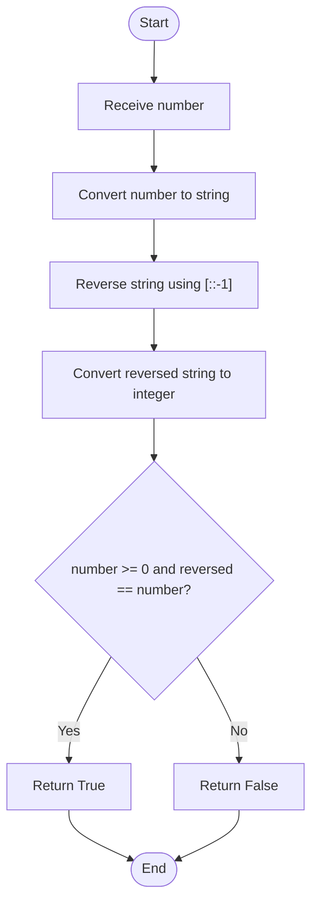
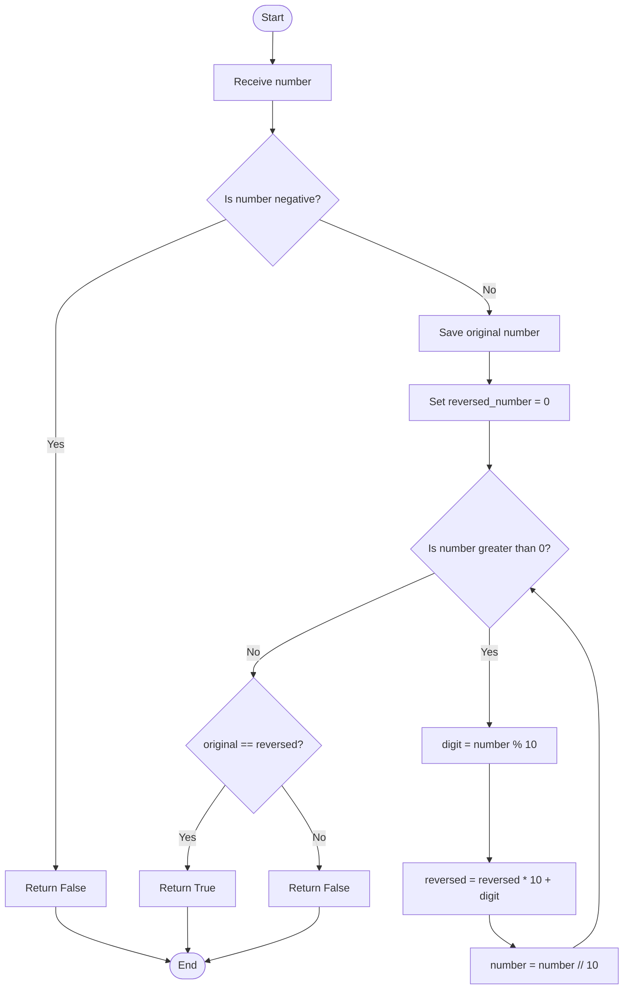

# 17. Palindrome Number

## Problem statement

Check whether a given integer is a **palindrome number**.

A palindrome number reads the same from left to right and from right to left.

Examples:
- `121` is a palindrome.
- `1331` is a palindrome.
- `123` is not a palindrome.
- Negative numbers are not treated as palindromes by the uploaded program.

The uploaded Python file implements two approaches:
1. Using string slicing.
2. Using mathematical operations.

## Concepts used

- Variables and functions
- Conditional statements
- String slicing
- `while` loop
- Modulus operator (`%`)
- Floor division (`//`)

## 1. Approach 1 — Using string slicing

### Code

```python
def is_palindrome_using_string(number: int) -> bool:
    """Check whether a number is palindrome using string slicing."""

    reversed_number = int(str(number)[::-1])

    return number >= 0 and reversed_number == number
```

### How it works

1. Convert the number into a string using `str(number)`.
2. Use `[::-1]` to reverse the string.
3. Convert the reversed string back to an integer.
4. Check that the original number is non-negative and equals the reversed number.
5. Return `True` if both conditions hold; otherwise return `False`.

### Understand `[::-1]`

In Python, a slice with a step of `-1` reads a sequence backwards.

```python
text = "12321"
print(text[::-1])
```

Output:

```text
12321
```

### Dry run: Check 121

| Step | Operation | Result |
|---:|---|---|
| 1 | `str(121)` | `"121"` |
| 2 | `str(121)[::-1]` | `"121"` |
| 3 | `int("121")` | `121` |
| 4 | Compare `121 == 121` and `121 >= 0` | `True` |

Result: **Palindrome**

### Flowchart



## 2. Approach 2 — Using mathematical operations

This approach reverses the number digit by digit.

### Code

```python
def is_palindrome_using_loop(number: int) -> bool:
    """Check whether a number is palindrome using mathematical operations."""

    if number < 0:
        return False

    original_number = number
    reversed_number = 0

    while number > 0:
        digit = number % 10

        reversed_number = reversed_number * 10 + digit

        number //= 10

    return original_number == reversed_number
```

### How it works

1. If the number is negative, return `False`.
2. Store the original number because the loop will change `number`.
3. Initialize `reversed_number = 0`.
4. While `number > 0`:
   - Extract the last digit using `% 10`.
   - Append it to the reversed number using `reversed_number * 10 + digit`.
   - Remove the last digit using `// 10`.
5. Compare the reversed number with the original number.

### Dry run: Check 121

Initial values:

```text
original_number = 121
reversed_number = 0
number = 121
```

| Step | `number` | `digit = number % 10` | Reversed calculation | New reversed number | `number // 10` |
|---:|---:|---:|---|---:|---:|
| 1 | 121 | 1 | `0 * 10 + 1` | 1 | 12 |
| 2 | 12 | 2 | `1 * 10 + 2` | 12 | 1 |
| 3 | 1 | 1 | `12 * 10 + 1` | 121 | 0 |

Now compare:

```text
original_number == reversed_number
121 == 121
```

Result: **Palindrome**

### Flowchart



## 3. Compare both approaches

| Feature | String slicing | Mathematical operations |
|---|---|---|
| Reversal method | `[::-1]` | Extract and append digits |
| Main concepts | String conversion and slicing | `%`, `//`, arithmetic |
| Time complexity | `O(d)` | `O(d)` |
| Auxiliary space | `O(d)` | `O(1)` |
| Negative numbers | Returns `False` | Returns `False` |

Here, `d` is the number of digits.

## 4. Complete Python program

This matches the functions and main block in your uploaded `17_Palindrome_Number(1).py` file.

```python
def is_palindrome_using_string(number: int) -> bool:
    """Check whether a number is palindrome using string slicing."""

    reversed_number = int(str(number)[::-1])

    return number >= 0 and reversed_number == number


def is_palindrome_using_loop(number: int) -> bool:
    """Check whether a number is palindrome using mathematical operations."""

    if number < 0:
        return False

    original_number = number
    reversed_number = 0

    while number > 0:
        digit = number % 10

        reversed_number = reversed_number * 10 + digit

        number //= 10

    return original_number == reversed_number


if __name__ == "__main__":

    number = int(input("Enter a number: "))

    result_string = is_palindrome_using_string(number)
    result_loop = is_palindrome_using_loop(number)

    print(
        f"String Approach: {number} is "
        f"{'a Palindrome' if result_string else 'not a Palindrome'}."
    )

    print(
        f"Mathematical Approach: {number} is "
        f"{'a Palindrome' if result_loop else 'not a Palindrome'}."
    )
```

## 5. Sample outputs

### Palindrome number

```text
Enter a number: 121
String Approach: 121 is a Palindrome.
Mathematical Approach: 121 is a Palindrome.
```

### Not a palindrome

```text
Enter a number: 123
String Approach: 123 is not a Palindrome.
Mathematical Approach: 123 is not a Palindrome.
```

### Negative number

```text
Enter a number: -121
String Approach: -121 is not a Palindrome.
Mathematical Approach: -121 is not a Palindrome.
```

### Zero

```text
Enter a number: 0
String Approach: 0 is a Palindrome.
Mathematical Approach: 0 is a Palindrome.
```

## 6. Time and space complexity

Let `d` be the number of digits.

| Approach | Time complexity | Auxiliary space complexity |
|---|---|---|
| String slicing | `O(d)` | `O(d)` |
| Mathematical operations | `O(d)` | `O(1)` |

Both approaches process a number of characters or digits proportional to `d`. The mathematical method stores only a fixed number of variables.

## 7. Important Python concepts

- `str(number)` converts an integer to a string.
- `[::-1]` reverses a string.
- `int(...)` converts the reversed string back to an integer.
- `% 10` extracts the last digit.
- `// 10` removes the last digit.
- `reversed_number * 10 + digit` appends a digit to the right side of a number.
- `original_number` preserves the input for comparison.
- `return` sends a Boolean result from the function.

## 8. Interview questions

**1. What is a palindrome number?**

A number that remains the same when its digits are reversed.

**2. Is 121 a palindrome?**

Yes. Its reverse is also 121.

**3. Is 123 a palindrome?**

No. Its reverse is 321.

**4. How does `[::-1]` work?**

It uses slicing with a step of `-1` to read a string from the end to the beginning.

**5. Why do we store `original_number`?**

The mathematical approach modifies `number` while extracting its digits. The original value is needed for the final comparison.

**6. How do you append a digit to a reversed number?**

Use `reversed_number = reversed_number * 10 + digit`.

**7. Why does the program return `False` for negative numbers?**

The uploaded implementation explicitly treats negative numbers as not being palindromes.

**8. Which approach uses less auxiliary space?**

The mathematical approach uses `O(1)` auxiliary space, compared with `O(d)` for string slicing.

## 9. Practice questions

1. Check whether `1221` is a palindrome.
2. Check whether `12321` is a palindrome.
3. Check whether `1234` is a palindrome.
4. Trace the mathematical approach for `4554`.
5. Explain how `reversed_number * 10 + digit` works.
6. Compare the space complexity of both approaches.

## 10. Key takeaways

- A palindrome reads the same forwards and backwards.
- String slicing can reverse a number's string representation.
- Mathematical reversal uses `% 10` and `// 10`.
- Save the original value before modifying the working number.
- Both approaches take `O(d)` time.
- The mathematical approach uses `O(1)` auxiliary space.

## Navigation

- Previous: [16. Armstrong Number](./16_Armstrong_Number.md)
- Next: [18. Digit Root](./18_Digit_Root.md)
- Python source: [17_Palindrome_Number.py](./17_Palindrome_Number.py)
