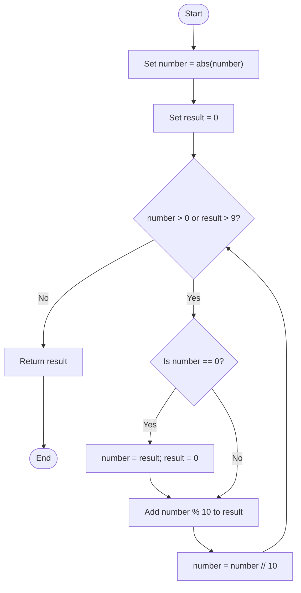
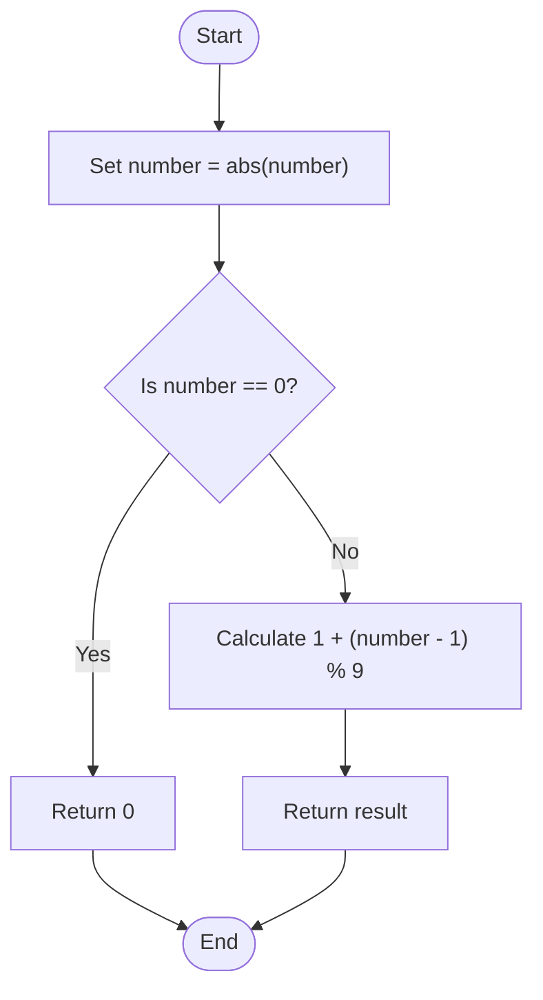

# 18. Digit Root

## Problem statement

Find the **digital root** of a number.

The digital root is obtained by repeatedly adding the digits of a number until a single-digit result remains.

### Example: 9875

```text
9 + 8 + 7 + 5 = 29
2 + 9 = 11
1 + 1 = 2
```

Therefore, the digital root of `9875` is **2**.

The uploaded Python file implements two approaches:
1. Repeated digit addition.
2. A mathematical formula.

## Concepts used

- Variables and functions
- `while` loop
- Conditional statements
- Modulus operator (`%`)
- Floor division (`//`)
- Mathematical properties

## 1. Approach 1 — Using repeated digit addition

### Code

```python
def digital_root_using_loop(number: int) -> int:
    """Calculate the digital root using repeated digit addition."""

    number = abs(number)

    result = 0

    while number > 0 or result > 9:

        # Start another iteration with the previous digit sum
        if number == 0:
            number = result
            result = 0

        result += number % 10
        number //= 10

    return result
```

### How it works

1. Convert the input to its absolute value using `abs(number)`.
2. Initialize `result = 0`.
3. Continue while the number still has digits or the current sum is greater than 9.
4. If the current number has become zero but the sum is still greater than 9:
   - Move the previous sum into `number`.
   - Reset `result` to zero.
   - This begins another digit-summing round.
5. Add the last digit using `number % 10`.
6. Remove the last digit using `number //= 10`.
7. When the loop ends, return the single-digit result.

### Dry run: Find the digital root of 9875

Initial values:

```text
number = 9875
result = 0
```

**First digit-summing round**

| Step | Number before | Extracted digit (`% 10`) | Result after addition | Number after (`// 10`) |
|---:|---:|---:|---:|---:|
| 1 | 9875 | 5 | 5 | 987 |
| 2 | 987 | 7 | 12 | 98 |
| 3 | 98 | 8 | 20 | 9 |
| 4 | 9 | 9 | 29 | 0 |

Now `number == 0` and `result == 29`, which is greater than 9. The program starts another round:

```text
number = 29
result = 0
```

**Second digit-summing round**

| Step | Number before | Extracted digit | Result after addition | Number after |
|---:|---:|---:|---:|---:|
| 1 | 29 | 9 | 9 | 2 |
| 2 | 2 | 2 | 11 | 0 |

The result is still greater than 9, so another round begins:

```text
number = 11
result = 0
```

**Third digit-summing round**

| Step | Number before | Extracted digit | Result after addition | Number after |
|---:|---:|---:|---:|---:|
| 1 | 11 | 1 | 1 | 1 |
| 2 | 1 | 1 | 2 | 0 |

Now `number == 0` and `result == 2`, which is a single digit. The loop stops.

Result: **2**

### Flowchart



## 2. Approach 2 — Using a mathematical formula

For a positive integer, the digital root can be calculated directly:

\[
DR(n)=1+(n-1)\bmod 9,\quad n>0
\]

The uploaded function also handles zero separately and uses the absolute value for negative inputs.

### Code

```python
def digital_root_using_formula(number: int) -> int:
    """Calculate the digital root using the mathematical formula."""

    number = abs(number)

    if number == 0:
        return 0

    return 1 + (number - 1) % 9
```

### How it works

1. Convert the number to its absolute value.
2. If it is zero, return zero.
3. Otherwise, apply `1 + (number - 1) % 9`.
4. Return the result.

### Dry run: Find the digital root of 9875

\[
DR(9875)=1+(9875-1)\bmod9
\]

\[
=1+9874\bmod9
\]

\[
=1+4=5
\]

**Correction:** The remainder is not 4. Since `9874 = 9 × 1097 + 1`, the correct calculation is:

\[
DR(9875)=1+1=2
\]

Result: **2**

### More examples

| Number | Formula | Digital root |
|---:|---|---:|
| 9875 | `1 + (9875 - 1) % 9` | 2 |
| 1234 | `1 + (1234 - 1) % 9` | 1 |
| 99 | `1 + (99 - 1) % 9` | 9 |
| 0 | Special case | 0 |

### Flowchart



## 3. Compare both approaches

| Feature | Repeated digit addition | Mathematical formula |
|---|---|---|
| Main technique | Repeatedly sum digits | Modulo-9 property |
| Uses loop | Yes | No |
| Time complexity | `O(d²)` worst case, as stated in the source | `O(1)` |
| Auxiliary space | `O(1)` | `O(1)` |
| Best for | Understanding the digit-sum process | Direct calculation |

Here, `d` is the number of digits. The source file states `O(d²)` worst-case time for repeated digit addition.

## 4. Complete Python program

This matches the functions and main block in your uploaded `18_Digit_Root.py` file.

```python
def digital_root_using_loop(number: int) -> int:
    """Calculate the digital root using repeated digit addition."""

    number = abs(number)

    result = 0

    while number > 0 or result > 9:

        # Start another iteration with the previous digit sum
        if number == 0:
            number = result
            result = 0

        result += number % 10
        number //= 10

    return result


def digital_root_using_formula(number: int) -> int:
    """Calculate the digital root using the mathematical formula."""

    number = abs(number)

    if number == 0:
        return 0

    return 1 + (number - 1) % 9


if __name__ == "__main__":

    number = int(input("Enter a number: "))

    result_loop = digital_root_using_loop(number)
    result_formula = digital_root_using_formula(number)

    print(f"Digital Root using Loop: {result_loop}")
    print(f"Digital Root using Formula: {result_formula}")
```

## 5. Sample outputs

### Example 1: Input is 9875

```text
Enter a number: 9875
Digital Root using Loop: 2
Digital Root using Formula: 2
```

### Example 2: Input is 99

```text
Enter a number: 99
Digital Root using Loop: 9
Digital Root using Formula: 9
```

### Example 3: Input is 0

```text
Enter a number: 0
Digital Root using Loop: 0
Digital Root using Formula: 0
```

### Example 4: Negative input

```text
Enter a number: -123
Digital Root using Loop: 6
Digital Root using Formula: 6
```

## 6. Time and space complexity

Let `d` be the number of digits.

| Approach | Time complexity | Auxiliary space complexity |
|---|---|---|
| Repeated digit addition | `O(d²)` worst case, as stated in the source | `O(1)` |
| Mathematical formula | `O(1)` | `O(1)` |

The repeated-addition approach may need multiple rounds of digit summation. The formula approach uses a fixed number of arithmetic operations.

## 7. Important Python concepts

- `abs(number)` returns the non-negative magnitude of a number.
- `% 10` extracts the last digit.
- `// 10` removes the last digit.
- `while` repeats the digit-summing process.
- `number = result` starts another digit-summing round.
- `result = 0` resets the sum for the next round.
- `% 9` is used in the digital-root formula.
- A special condition handles zero.

## 8. Interview questions

**1. What is a digital root?**

It is the single-digit value obtained by repeatedly adding the digits of a number.

**2. Find the digital root of 9875.**

`9 + 8 + 7 + 5 = 29`, then `2 + 9 = 11`, then `1 + 1 = 2`.

**3. What is the digital-root formula for a positive number?**

\[
DR(n)=1+(n-1)\bmod9
\]

**4. Why is zero handled separately in the formula approach?**

The formula shown is defined for `n > 0`. The function returns zero directly when the input is zero.

**5. Why does the loop use `abs(number)`?**

The uploaded implementation calculates the digital root using the magnitude of the input, so negative and positive values with the same magnitude produce the same result.

**6. What does `% 10` do?**

It extracts the last decimal digit.

**7. Which approach is faster?**

The mathematical formula takes constant time, `O(1)`, while repeated digit addition requires one or more digit-processing rounds.

## 9. Practice questions

1. Find the digital root of `456`.
2. Find the digital root of `9999`.
3. Find the digital root of `12345`.
4. Find the digital root of `0`.
5. Trace the loop approach for `789`.
6. Calculate the digital root of `-456`.
7. Explain why the formula uses `(number - 1) % 9`.

## 10. Key takeaways

- The digital root is the single-digit result of repeated digit addition.
- The loop approach extracts digits using `% 10` and `// 10`.
- The formula for positive values is `1 + (n - 1) % 9`.
- Both functions in the uploaded file use the absolute value.
- Zero is handled explicitly by the formula approach.
- The formula approach takes `O(1)` time and `O(1)` auxiliary space.

## Navigation

- Previous: [17. Palindrome Number](./17_Palindrome_Number.md)
- Python source: [18_Digit_Root.py](./18_Digit_Root.py)
