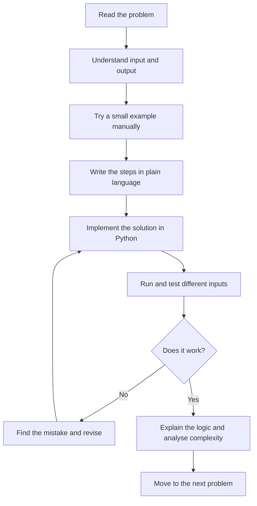
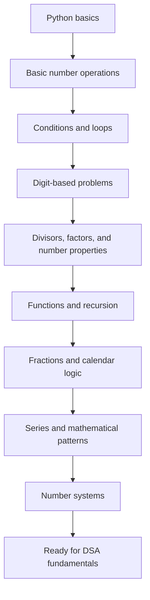
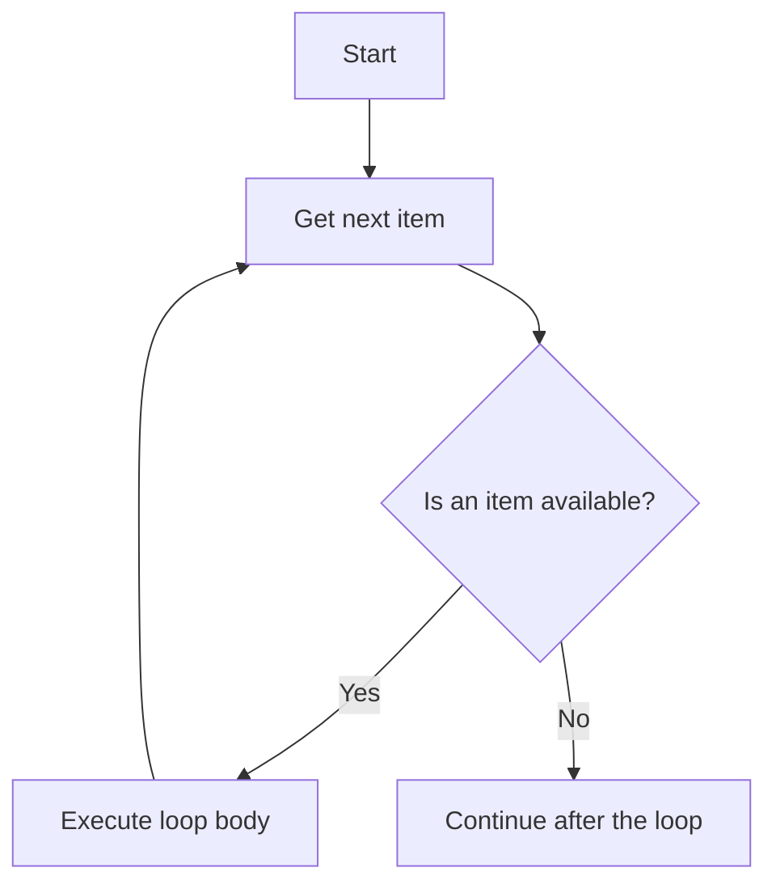
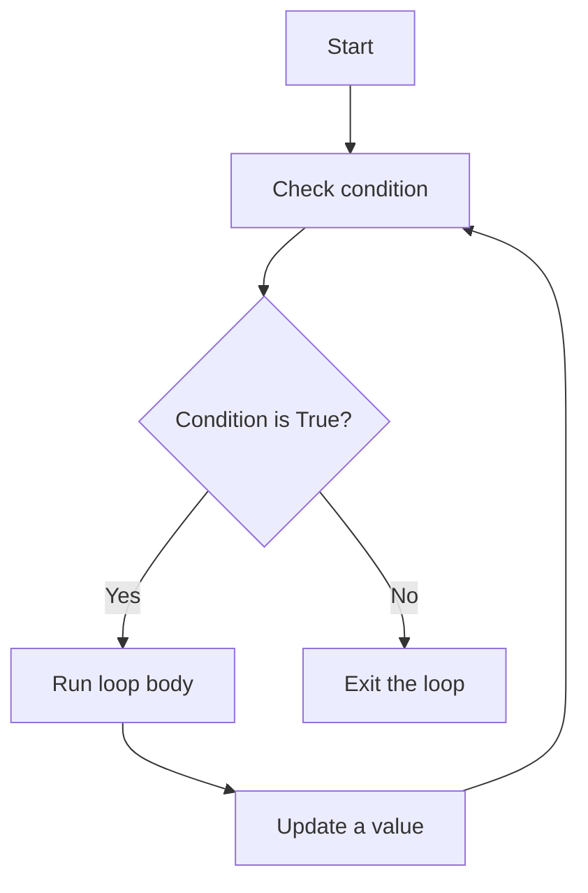
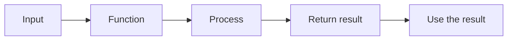
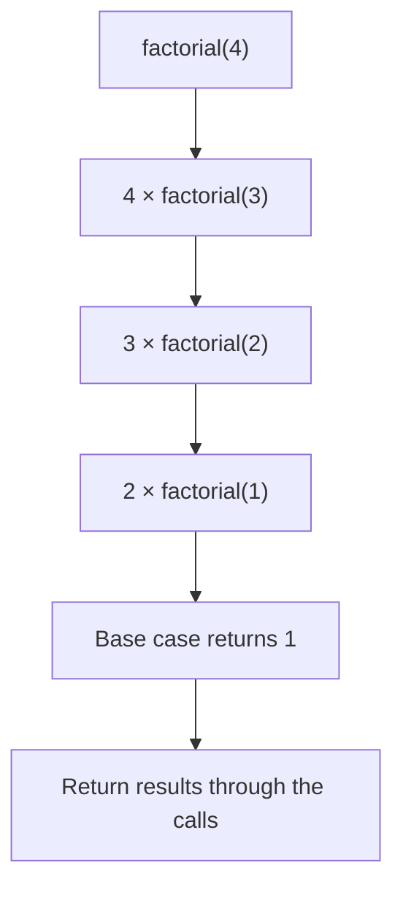
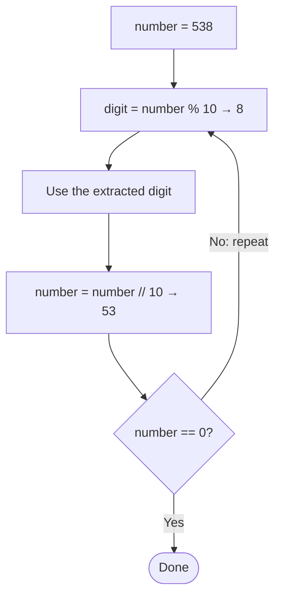

# Easy Problems — Python Programming Before DSA

Welcome to the **Easy** section of this repository. These beginner-friendly problems help you strengthen Python fundamentals, mathematical thinking, and problem-solving skills before moving into Data Structures and Algorithms (DSA).

You do not need advanced programming knowledge to begin. Start with the first problem, understand the idea, trace a small example, and then try writing the solution yourself.

> **Learning principle:** Do not just copy the code. Understand the problem, explain the logic in your own words, and practise changing the input.

---

## Table of Contents

- [What You Will Learn](#what-you-will-learn)
- [How to Use This Section](#how-to-use-this-section)
- [Suggested Learning Path](#suggested-learning-path)
- [Easy Problem Catalogue](#easy-problem-catalogue)
- [Core Python Concepts](#core-python-concepts)
- [Common Problem-Solving Pattern: Digit Extraction](#common-problem-solving-pattern-digit-extraction)
- [How to Approach a New Problem](#how-to-approach-a-new-problem)
- [Practice Checklist](#practice-checklist)
- [When to Move to the Next Level](#when-to-move-to-the-next-level)
- [Beginner Tips](#beginner-tips)
- [Continue Learning](#continue-learning)

---

## What You Will Learn

By completing these problems, you will practise:

| Skill | What it means |
|---|---|
| Variables and data types | Store numbers and other values |
| Operators | Perform calculations and comparisons |
| Conditional statements | Make decisions using `if`, `elif`, and `else` |
| Loops | Repeat instructions using `for` and `while` |
| Functions | Divide a program into reusable blocks |
| Strings | Work with text and convert values |
| Number logic | Solve problems involving digits, divisors, and mathematical properties |
| Basic recursion | Understand a function calling itself |
| Problem-solving | Turn a question into a clear sequence of steps |
| Complexity basics | Get an introduction to time and space complexity |

You will also see different ways to solve the same problem. Comparing approaches helps you understand why one solution may be simpler or more efficient than another.

## How to Use This Section

Each problem has:
- A Python implementation (`.py`).
- A Markdown explanation (`.md`) describing the problem and its solution.

A useful workflow is:

1. Open the Markdown explanation and understand the problem.
2. Try a small example manually before looking at the complete solution.
3. Read the Python implementation and understand each important line.
4. Run the Python file with different inputs.
5. Compare the approaches, if the script contains more than one.
6. Review the time and space complexity.



**A good habit:** Spend 10–15 minutes attempting a problem before checking the solution. If you get stuck, revise the relevant concept and try again.

## Suggested Learning Path

The problem numbers provide a suggested order. This path is flexible: revisit earlier problems whenever you need more practice.



## Easy Problem Catalogue

All 18 problems listed below have Python solution files and corresponding Markdown explanations in this folder.

| # | Problem | Simple way to think about it | Main concepts / approaches | Python solution | Explanation |
|---:|---|---|---|---|---|
| 01 | **Sum of Digits** | Take each digit and add it to a running total. | String iteration; `% 10`; `// 10` | [Python](./01_Sum_of_Digits.py) | [Markdown](./01_Sum_of_Digits.md) |
| 02 | **Reverse Digits** | Read the digits from right to left to build the answer. | String slicing; digit extraction and reversal | [Python](./02_Reverse_Digits.py) | [Markdown](./02_Reverse_Digits.md) |
| 03 | **Prime Testing** | Check whether any candidate divisor divides the number. | Divisibility; loops; checking up to the square root | [Python](./03_Prime_Testing.py) | [Markdown](./03_Prime_Testing.md) |
| 04 | **Check Power** | Repeatedly divide by the base and check whether the result reaches 1 exactly. | Conditions; repeated division; `%`; `//` | [Python](./04_Check_Power.py) | [Markdown](./04_Check_Power.md) |
| 05 | **Overlapping Rectangles** | Determine whether two rectangles share any area. | Coordinate geometry; boundary comparisons; conditions | [Python](./05_Overlapping_Rectangles.py) | [Markdown](./05_Overlapping_Rectangles.md) |
| 06 | **Factorial** | Multiply the whole numbers from 1 through `n`. | `while` loop; functions; recursion | [Python](./06_Factorial.py) | [Markdown](./06_Factorial.md) |
| 07 | **Pair Cube Count** | Count pairs that satisfy `i³ + j³ = n`. | Nested loops; conditions; exponentiation | [Python](./07_Pair_Cube_Count.py) | [Markdown](./07_Pair_Cube_Count.md) |
| 08 | **GCD or HCF** | Find the greatest number that divides both inputs. | Repeated subtraction; Euclidean algorithm; recursion | [Python](./08_GCD_or_HCF.py) | [Markdown](./08_GCD_or_HCF.md) |
| 09 | **LCM** | Find the smallest positive number divisible by both inputs. | Multiples; GCD; mathematical formula | [Python](./09_LCM.py) | [Markdown](./09_LCM.md) |
| 10 | **Perfect Number** | Add the positive divisors smaller than the number and compare the sum with it. | Divisors; loops; divisor pairs; square root | [Python](./10_Perfect_Number.py) | [Markdown](./10_Perfect_Number.md) |
| 11 | **Add Two Fractions** | Make denominators compatible, add the fractions, and simplify the result. | Arithmetic; common denominator; GCD; simplification | [Python](./11_Add_Two_Fractions.py) | [Markdown](./11_Add_Two_Fractions.md) |
| 12 | **Day of the Week** | Calculate the weekday for a given calendar date. | Conditions; leap years; date arithmetic | [Python](./12_Day_of_the_Week.py) | [Markdown](./12_Day_of_the_Week.md) |
| 13 | **Nth Fibonacci** | Generate the Fibonacci sequence up to the requested position. | Iteration; recursion; series | [Python](./13_Nth_Fibonacci.py) | [Markdown](./13_Nth_Fibonacci.md) |
| 14 | **Decimal to Binary** | Repeatedly divide by 2 and use the remainders to form the binary number. | Number systems; division; bitwise operations | [Python](./14_Decimal_to_Binary.py) | [Markdown](./14_Decimal_to_Binary.md) |
| 15 | **Nth Term of a Series** | Calculate the sum `1 + 2 + ... + n`. | `for` loop; arithmetic-series formula | [Python](./15_n-th_term_of_series.py) | [Markdown](./15_n-th_term_of_series.md) |
| 16 | **Armstrong Number** | Add each digit raised to the number of digits and compare the sum with the original number. | Digit extraction; strings; loops; powers | [Python](./16_Armstrong_Number.py) | [Markdown](./16_Armstrong_Number.md) |
| 17 | **Palindrome Number** | Reverse the number and check whether it is unchanged. | String slicing; loops; digit reversal | [Python](./17_Palindrome_Number.py) | [Markdown](./17_Palindrome_Number.md) |
| 18 | **Digit Root** | Keep adding the digits until one digit remains. | Repeated digit sum; arithmetic; modulo 9 formula | [Python](./18_Digit_Root.py) | [Markdown](./18_Digit_Root.md) |

> **Note:** The Markdown links assume each explanation file is stored beside its corresponding Python file in the `Easy` folder.

## Core Python Concepts

These concepts appear repeatedly throughout the problems.

### 1. `for` Loop

A `for` loop repeats a block of code for each item in a sequence.

```python
for number in range(1, 4):
    print(number)
```

Output:

```text
1
2
3
```



### 2. `while` Loop

A `while` loop continues as long as its condition is `True`. Update the relevant value so the loop can eventually stop.

```python
number = 3

while number > 0:
    print(number)
    number -= 1
```

Output:

```text
3
2
1
```



### 3. Modulo `%` and Floor Division `//`

These operators are especially useful in digit-based problems.

For `number = 123`:

| Expression | Result | Meaning |
|---|---:|---|
| `123 % 10` | `3` | Get the last digit |
| `123 // 10` | `12` | Remove the last digit |

### 4. Functions

A function is a reusable block of code. It can receive input, perform a task, and return a result.

```python
def add(a: int, b: int) -> int:
    return a + b

answer = add(10, 20)
print(answer)
```

Output:

```text
30
```



### 5. Recursion

Recursion happens when a function calls itself. A recursive function needs a **base case** so that it can stop.

```python
def factorial(number: int) -> int:
    if number == 1:
        return 1
    return number * factorial(number - 1)
```

This small example demonstrates recursion for positive integers. A complete program should also handle input validation and the `0! = 1` case.



## Common Problem-Solving Pattern: Digit Extraction

Many number problems use the same two operations:

- `number % 10` extracts the last digit.
- `number // 10` removes the last digit.

For example, with `538`, `% 10` gives `8`, then `// 10` leaves `53`. Repeat until the number becomes `0`.



Example: sum the digits of `538`.

| Step | Digit taken | Total so far | Number remaining |
|---:|---:|---:|---:|
| 1 | 8 | 8 | 53 |
| 2 | 3 | 11 | 5 |
| 3 | 5 | 16 | 0 |

The digit sum is **16**.

The same extraction pattern can be adapted:
- **Sum of digits:** add each extracted digit.
- **Reverse digits:** append each extracted digit to a new number.
- **Palindrome number:** reverse the digits and compare with the original.
- **Armstrong number:** raise each digit to the required power and add the results.

## How to Approach a New Problem

Use this five-step method whenever you see a new programming question:

1. **Understand:** What exactly is the question asking?
2. **Identify:** What input will you receive, and what output is expected?
3. **Plan:** Write the solution steps in plain English.
4. **Code and test:** Convert the steps into Python and test normal and edge cases.
5. **Review:** Explain why the solution works and consider its time and space complexity.

Example: for input `246`, the digit-sum process is:

```text
246 → take 6 → remaining number 24
 24 → take 4 → remaining number 2
  2 → take 2 → remaining number 0

Sum = 6 + 4 + 2 = 12
```

The key operations are:

```python
digit = number % 10
number = number // 10
```

Try tracing the same process with `1357` before running the code.

## Practice Checklist

Use this checklist to track your progress.

### Before Solving

- [ ] I can explain the problem in my own words.
- [ ] I understand the expected input and output.
- [ ] I have tried at least one example manually.

### While Solving

- [ ] I attempted the problem before checking the solution.
- [ ] I can explain each important line of code.
- [ ] I tested more than one input.
- [ ] I checked edge cases where relevant.

### After Solving

- [ ] I can explain the approach without reading the code.
- [ ] I understand the time complexity.
- [ ] I understand the space complexity.
- [ ] I can solve the problem again without copying.

## When to Move to the Next Level

You do not need to memorise every solution. You should be comfortable with the ideas behind them.

You are ready to move towards the next section when you can:

- Use conditions and loops without confusion.
- Write and call simple functions.
- Work with strings and basic number operations.
- Trace a program using sample inputs.
- Explain the logic of a solution in simple language.
- Recognise when a loop or recursive call stops.
- Understand basic Big O time and space complexity.

If some of these are still difficult, that is normal. Practise the relevant problems again before moving ahead.

## Beginner Tips

- **Understand before memorising:** Learn why the code works.
- **Type the code yourself:** Avoid only copying and pasting.
- **Predict the output:** Make a guess before running the program.
- **Test edge cases:** Try zero, one, negative values, repeated digits, or other boundary inputs when relevant.
- **Compare approaches:** A solution that is easy to write is not always the most efficient.
- **Be consistent:** A little practice every day is better than rushing through many problems once.
- **Explain your solution:** If you can teach the logic to someone else, you probably understand it.

## Continue Learning

After completing the Easy section, continue to:

- [Medium](../Medium/)
- [Hard](../Hard/)

Return to the [main repository README](../../README.md) to see the complete learning roadmap.

**Remember:** The goal is not to finish all the questions quickly. The goal is to build the problem-solving foundation that will make learning DSA easier.
