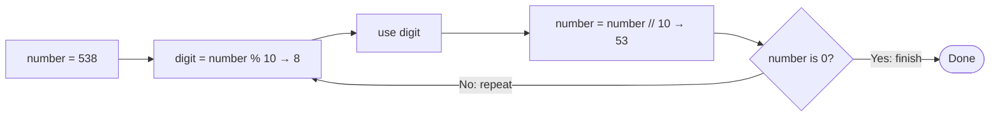

# Easy Logic-Building Problems

This folder contains beginner exercises for practicing arithmetic, loops,
conditions, functions, and simple algorithms. Each Python file is intended to
run independently.

## At a glance

| # | Problem | Simple way to think about it | Approaches in the script | Status |
| ---: | --- | --- | --- | --- |
| 01 | [Sum of Digits](./01_Sum_of_Digits.py) | Take each digit and add it to a running total. | Convert to text and loop, or repeatedly use `% 10` and `// 10`. | Implemented |
| 02 | [Reverse Digits](./02_Reverse_Digits.py) | Read the digits from right to left to build the answer. | String slicing, or repeatedly extract the last digit. | Implemented |
| 03 | [Prime Testing](./03_Prime_Testing.py) | A number is not prime if any smaller candidate divisor divides it. | Check all candidates, or stop at the square root. | Implemented |
| 04 | [Check Power](./04_Check_Power.py) | Divide by the base repeatedly; it is a power if the result reaches 1 exactly. | Repeated division. | Implemented |
| 05 | [Overlapping Rectangles](./05_Overlapping_Rectangles.py) | Determine whether two rectangles share any area. | To be decided when the problem is implemented. | Placeholder |
| 06 | [Factorial](./06_Factorial.py) | Multiply the whole numbers from 1 through `n`. | `while` loop or recursion. | Implemented |
| 07 | [Pair Cube Count](./07_Pair_Cube_Count.py) | Check pairs against `i³ + j³ = n`, and count the matches. | Nested loops. | Implemented |
| 08 | [GCD or HCF](./08_GCD_or_HCF.py) | Find the largest number that divides both inputs. | Repeated subtraction or Euclid's remainder algorithm. | Implemented |
| 09 | [LCM](./09_LCM.py) | Find the smallest positive number divisible by both inputs. | Check multiples, or use `LCM(a, b) = abs(a * b) // GCD(a, b)`. | Implemented |
| 10 | [Perfect Number](./10_Perfect_Number.py) | Add the positive divisors smaller than the number and compare the sum to it. | Check every candidate divisor, or check divisor pairs up to the square root. | Implemented |
| 11 | [Add Two Fractions](./11_Add_Two_Fractions.py) | Make denominators equal, add the numerators, then simplify. | To be decided when the problem is implemented. | Placeholder |
| 12 | [Day of the Week](./12_Day_of_the_Week.py) | Find the weekday for a calendar date. | To be decided when the problem is implemented. | Placeholder |

The placeholder descriptions above are based on the filenames only; their
problem statements and solutions have not been added yet.

## A picture for common problem patterns

The digit exercises are easier to follow when you repeatedly take the last
digit. For example, with `538`, `% 10` gives `8`, then `// 10` leaves `53`.
Repeat until no digits remain.



For sum of digits, add each extracted digit to a total. For reversing digits,
append each extracted digit to a new number. The same extraction step supports
two different problems.

<details>
<summary>Example: sum the digits of 538</summary>

| Step | Digit taken | Total so far | Number remaining |
| ---: | ---: | ---: | ---: |
| 1 | 8 | 8 | 53 |
| 2 | 3 | 11 | 5 |
| 3 | 5 | 16 | 0 |

The digit sum is **16**.

</details>

## How to work through any problem here

1. Read the problem name and identify the input and the expected answer.
2. Try a tiny example by hand before writing code.
3. Break the solution into repeated steps, if there are any.
4. Check special cases, such as zero, one, negative inputs, or equal values.
5. Run the script and compare its output with your hand-worked example.
6. If the script has two approaches, compare how each one works and how much
   time and extra space it uses.

## Running a problem

From this directory, run an implemented script with Python. For example:

```bash
python 01_Sum_of_Digits.py
```

Each implemented script asks for the input it needs. Placeholder files do not
contain a runnable solution yet.

## Complexity quick reference

Let `d` be the number of digits and `n` be the input value.

| Pattern | Example | Typical time |
| --- | --- | --- |
| Process each digit | Sum or reverse digits | `O(d)` |
| Try every possible divisor | Basic prime or perfect-number check | `O(n)` |
| Check divisors only up to the square root | Optimized prime or perfect-number check | `O(√n)` |
| Repeatedly reduce the problem size | Euclidean GCD | `O(log(min(a, b)))` |
| Compare every pair of candidates | Cube-sum pairs | `O(n²)` |

The exact complexity depends on the approach and input range described in each
script.
