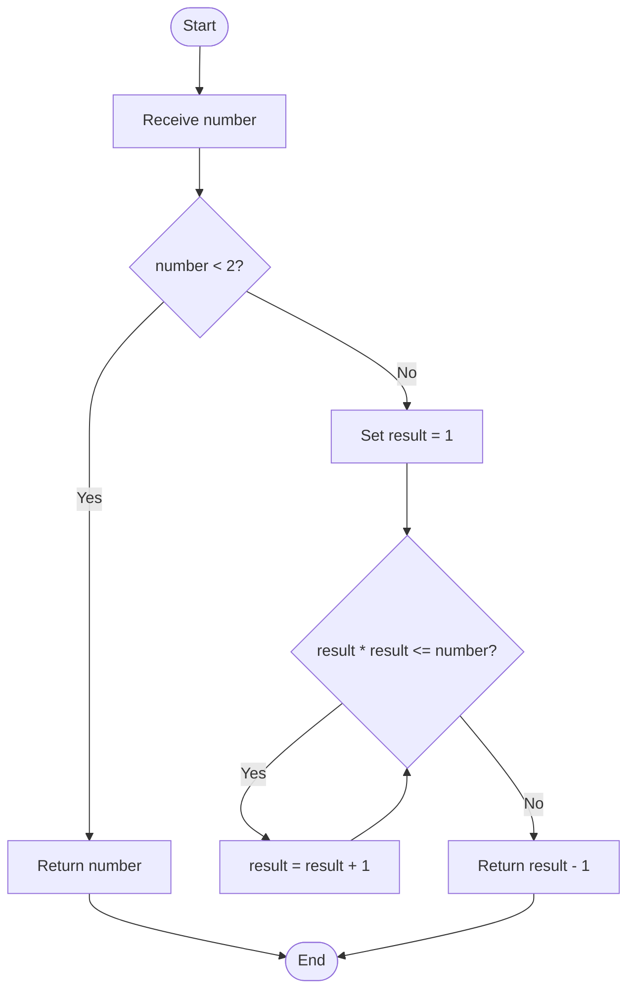
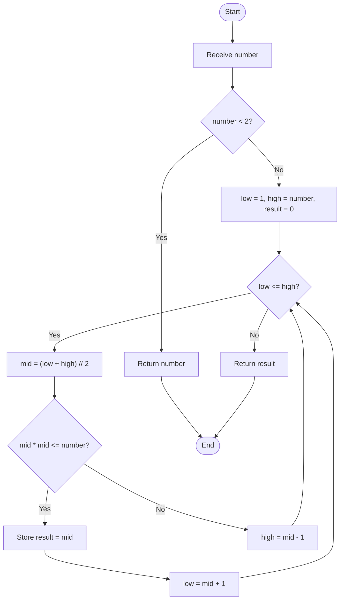

# 01. Integer Square Root

## Problem Statement

Given a non-negative integer `n`, find its **integer square root**.

The integer square root is the floor value of the ordinary square root:

\[
\lfloor \sqrt{n} \rfloor
\]

In simple words, return the largest integer `x` such that `x * x <= n`.

### Examples

| Input | Output | Explanation |
|---:|---:|---|
| `25` | `5` | `5 × 5 = 25` |
| `26` | `5` | `5 × 5 = 25`, while `6 × 6 = 36` |
| `8` | `2` | `2 × 2 = 4`, while `3 × 3 = 9` |
| `0` | `0` | The square root of 0 is 0 |
| `1` | `1` | The square root of 1 is 1 |

**Important:** This problem asks for the floor of the square root. For example, the answer for `26` is `5`, not `5.09...`.

## Concepts Used

- Variables
- Functions
- `while` loop
- Conditional statements
- Binary search
- Integer division (`//`)
- Time and space complexity

The source file contains two approaches: Linear Search using a `while` loop, and Binary Search.

---

## Approach 1: Using Linear Search

### Idea

Start checking from `1` and keep increasing the candidate value while its square is less than or equal to the input number. When the candidate's square becomes greater than the input, the previous candidate is the answer.

### Code

```python
def square_root_using_loop(number: int) -> int:
    """Find the integer square root using a while loop."""

    if number < 2:
        return number

    result = 1

    while result * result <= number:
        result += 1

    return result - 1
```

### Step-by-Step Dry Run

Suppose `number = 26`. Initially, `result = 1`.

| Iteration | `result` | `result * result` | Condition `result * result <= 26` |
|---:|---:|---:|---|
| 1 | 1 | 1 | True |
| 2 | 2 | 4 | True |
| 3 | 3 | 9 | True |
| 4 | 4 | 16 | True |
| 5 | 5 | 25 | True |
| 6 | 6 | 36 | False |

The loop stops when `result` becomes `6`, because `36 > 26`. The function returns `result - 1`, which is `5`.

**Output: `5`**

### Flowchart



### Complexity Analysis

Let `n` be the input number.

| Complexity | Value | Reason |
|---|---|---|
| Time | \(O(\sqrt{n})\) | The candidate increases one by one until it passes the square root of `n`. |
| Auxiliary Space | \(O(1)\) | Only a fixed number of variables are used. |

This approach is useful for learning loops and conditions, and for small input values.

---

## Approach 2: Using Binary Search

### Idea

Instead of checking every integer one by one, use Binary Search to reduce the search range.

For `n >= 2`, the answer is between `1` and `n`.

At every iteration:

1. Find the middle value.
2. Calculate `mid * mid`.
3. If the square is less than or equal to `n`, `mid` may be the answer. Store it and search the right half for a larger valid value.
4. If the square is greater than `n`, search the left half.
5. When the search ends, return the last valid answer.

### Code

```python
def square_root_using_binary_search(number: int) -> int:
    """Find the integer square root using binary search."""

    if number < 2:
        return number

    low = 1
    high = number
    result = 0

    while low <= high:
        mid = (low + high) // 2

        if mid * mid <= number:
            result = mid
            low = mid + 1
        else:
            high = mid - 1

    return result
```

### Step-by-Step Dry Run

Suppose `number = 26`.

Initial values:

```text
low = 1
high = 26
result = 0
```

| Step | `low` | `high` | `mid = (low + high) // 2` | `mid * mid` | Action |
|---:|---:|---:|---:|---:|---|
| 1 | 1 | 26 | 13 | 169 | Too large; `high = 12` |
| 2 | 1 | 12 | 6 | 36 | Too large; `high = 5` |
| 3 | 1 | 5 | 3 | 9 | Valid; `result = 3`, `low = 4` |
| 4 | 4 | 5 | 4 | 16 | Valid; `result = 4`, `low = 5` |
| 5 | 5 | 5 | 5 | 25 | Valid; `result = 5`, `low = 6` |

Now `low = 6` and `high = 5`, so `low <= high` is false and the loop ends. The last valid value stored in `result` is `5`.

**Output: `5`**

### Flowchart



### Complexity Analysis

Let `n` be the input number.

| Complexity | Value | Reason |
|---|---|---|
| Time | \(O(\log n)\) | Each iteration reduces the search interval to approximately half. |
| Auxiliary Space | \(O(1)\) | Only a fixed number of variables are used. |

### Why is Binary Search faster?

Linear Search checks candidates one by one. Binary Search eliminates approximately half of the remaining search range in every iteration. For large inputs, this requires far fewer iterations.

---

## Comparison of Both Approaches

| Feature | Linear Search | Binary Search |
|---|---|---|
| Main technique | Check values one by one | Repeatedly halve the search range |
| Time complexity | \(O(\sqrt{n})\) | \(O(\log n)\) |
| Auxiliary space | \(O(1)\) | \(O(1)\) |
| Implementation | Simple | Requires search boundaries |
| Main learning focus | Loops and conditions | Binary Search |

Both approaches produce the same result for valid non-negative inputs. Binary Search is more efficient for large numbers.

## Complete Python Program

The following program reproduces the implementation in the source `.py` file.

```python
def square_root_using_loop(number: int) -> int:
    """Find the integer square root using a while loop."""

    if number < 2:
        return number

    result = 1

    while result * result <= number:
        result += 1

    return result - 1


def square_root_using_binary_search(number: int) -> int:
    """Find the integer square root using binary search."""

    if number < 2:
        return number

    low = 1
    high = number
    result = 0

    while low <= high:
        mid = (low + high) // 2

        if mid * mid <= number:
            result = mid
            low = mid + 1
        else:
            high = mid - 1

    return result


if __name__ == "__main__":

    number = int(input("Enter a number: "))

    if number < 0:
        print("Please enter a non-negative number.")

    else:
        result_loop = square_root_using_loop(number)
        result_binary = square_root_using_binary_search(number)

        print(f"Square Root using Loop: {result_loop}")
        print(f"Square Root using Binary Search: {result_binary}")
```

## Sample Outputs

### Perfect Square

```text
Enter a number: 25
Square Root using Loop: 5
Square Root using Binary Search: 5
```

### Non-Perfect Square

```text
Enter a number: 26
Square Root using Loop: 5
Square Root using Binary Search: 5
```

### Zero

```text
Enter a number: 0
Square Root using Loop: 0
Square Root using Binary Search: 0
```

### Negative Number

```text
Enter a number: -10
Please enter a non-negative number.
```

## Important Python Concepts

### 1. Integer Division (`//`)

Integer division returns the floor of the quotient.

```python
print(7 // 2)
```

Output:

```text
3
```

Binary Search uses this operation to calculate the middle value:

```python
mid = (low + high) // 2
```

### 2. Updating Search Boundaries

In Binary Search, `low = mid + 1` moves the search to the right half, while `high = mid - 1` moves it to the left half.

### 3. Why Store `result`?

When `mid * mid <= number`, `mid` is a valid answer, but there may be a larger valid integer. The code stores the valid value:

```python
result = mid
```

It then continues searching the right half. When the search finishes, `result` contains the greatest integer whose square does not exceed the input.

## Edge Cases to Test

| Input | Expected integer square root | Reason |
|---:|---:|---|
| `0` | `0` | Boundary value |
| `1` | `1` | Boundary value |
| `2` | `1` | `1² <= 2 < 2²` |
| `8` | `2` | `2² <= 8 < 3²` |
| `16` | `4` | Perfect square |
| `26` | `5` | Not a perfect square |
| `100` | `10` | Perfect square |
| `-5` | Rejected by main program | Negative input is not allowed |

**Implementation note:** The main program checks for negative input before calling either function. The functions themselves are intended for non-negative inputs; if called directly with a negative value, their `number < 2` branch returns that negative value. Keep the validation when using these functions in a program.

## Interview Questions

1. What is an integer square root?
2. What is the difference between `sqrt(n)` and `floor(sqrt(n))`?
3. Why does the linear-search approach take \(O(\sqrt{n})\) time?
4. How does Binary Search reduce the search space?
5. Why do we use `low <= high` in the Binary Search loop?
6. Why is `result` updated only when `mid * mid <= number`?
7. What is the time complexity of Binary Search?
8. Why is the auxiliary space complexity \(O(1)\) in both approaches?

## Practice Questions

1. Find the floor square root of a given non-negative integer.
2. Check whether a number is a perfect square.
3. Find the smallest integer whose square is greater than a given number.
4. Implement integer square root using Binary Search without using a built-in square-root function.
5. Trace Binary Search manually for `number = 50`.

## Key Takeaways

- Integer square root means the floor value of the square root.
- The answer is the largest integer `x` satisfying `x * x <= number`.
- Linear Search checks possible answers one by one.
- Binary Search repeatedly halves the search range.
- Linear Search takes \(O(\sqrt{n})\) time in this implementation.
- Binary Search takes \(O(\log n)\) time.
- Both approaches use \(O(1)\) auxiliary space.

---

## Navigation

- [← Back to Easy README](./Easy_README.md)
- [Python Solution: 01_Square_Root.py](./01_Square_Root.py)
- [Main Repository README](../../README.md)
