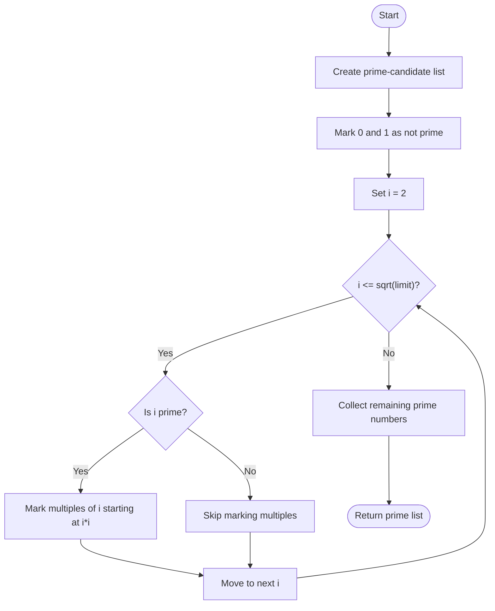
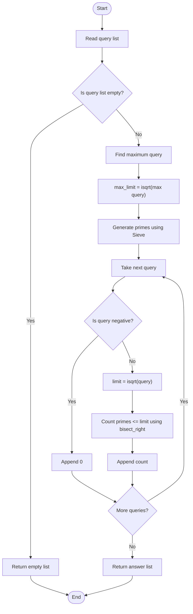

# 02. Numbers Having Exactly 3 Divisors

## Problem Statement

You are given a list of query numbers. For each query `n`, count how many positive integers less than or equal to `n` have **exactly 3 positive divisors**.

A divisor is a number that divides another number without leaving a remainder.

### Examples

| Query `n` | Numbers with exactly 3 divisors | Count |
|---:|---|---:|
| `10` | `4`, `9` | `2` |
| `20` | `4`, `9` | `2` |
| `30` | `4`, `9`, `25` | `3` |
| `1` | None | `0` |
| `0` | None | `0` |

For example, the number `4` has exactly three divisors: `1`, `2`, and `4`.

If the input is:

```text
[10, 20, 30]
```

The output is:

```text
[2, 2, 3]
```

## Concepts Used

- Prime numbers
- Prime squares
- Sieve of Eratosthenes
- Binary Search
- `isqrt()` from Python's `math` module
- `bisect_right()` from Python's `bisect` module
- Lists and functions
- Time and space complexity

## The Mathematical Idea

The key observation is:

**A positive integer has exactly 3 positive divisors if and only if it is the square of a prime number.**

Let's understand why.

### Example 1: A prime square

Take `9`.

Since:

\[
9 = 3^2
\]

Its positive divisors are:

```text
1, 3, 9
```

It has exactly 3 divisors.

### Example 2: Another prime square

Take `25`.

Since:

\[
25 = 5^2
\]

Its positive divisors are:

```text
1, 5, 25
```

It also has exactly 3 divisors.

### Example 3: A square of a non-prime number

Take `16`.

Since:

\[
16 = 4^2
\]

Its positive divisors are:

```text
1, 2, 4, 8, 16
```

It has 5 divisors, not 3.

### Why must the square root be prime?

If a number is \(p^2\), where `p` is prime, its only positive divisors are:

\[
1,\ p,\ p^2
\]

Therefore, it has exactly three divisors.

So, instead of checking every number and counting its divisors, we only need to count the prime numbers up to the square root of the query.

For a query `n`:

\[
\text{Answer} = \text{Number of primes } p \text{ such that } p \leq \lfloor\sqrt{n}\rfloor
\]

This is the main idea used by the uploaded Python solution.

---

## Approach Used: Sieve of Eratosthenes + Binary Search

The source code combines two efficient techniques:

1. **Sieve of Eratosthenes:** Generate all prime numbers up to the square root of the maximum query.
2. **Binary Search:** Count how many generated primes are less than or equal to the square root of each query.

### Step 1: Find the required prime limit

Suppose the queries are:

```python
queries = [10, 20, 30]
```

The maximum query is `30`.

We only need primes up to:

\[
\lfloor\sqrt{30}\rfloor = 5
\]

The primes up to `5` are:

```text
[2, 3, 5]
```

There is no need to generate primes up to `30`.

### Step 2: Generate primes using the Sieve of Eratosthenes

The Sieve of Eratosthenes finds all prime numbers up to a given limit.

For example, to find primes up to `10`:

1. Initially, consider numbers from `0` to `10` as prime candidates.
2. Mark `0` and `1` as not prime.
3. Start with `2`. It is prime, so mark its multiples (`4`, `6`, `8`, `10`) as not prime.
4. Move to `3`. It is prime, so mark its multiples (`6`, `9`) as not prime.
5. Continue until the square root of the limit.
6. The remaining unmarked numbers greater than `1` are prime.

The primes up to `10` are:

```text
[2, 3, 5, 7]
```

### Sieve Flowchart



### Step 3: Count primes using Binary Search

For each query `n`, calculate:

\[
limit = \lfloor\sqrt{n}\rfloor
\]

Then use `bisect_right(primes, limit)`.

Python's `bisect_right()` returns the insertion position of `limit` in a sorted list, placing it after any existing equal values. Because the prime list is sorted, this position is also the number of primes less than or equal to `limit`.

For example:

```python
primes = [2, 3, 5]
limit = 4
```

The primes less than or equal to `4` are:

```text
[2, 3]
```

Therefore:

```python
bisect_right(primes, 4)
```

returns:

```text
2
```

That is the answer for query `16`, because the numbers not exceeding `16` with exactly three divisors are `4` and `9`.

---

## Step-by-Step Dry Run

Consider:

```python
queries = [10, 20, 30]
```

### Step 1: Find the maximum query

```text
max(queries) = 30
```

### Step 2: Calculate the prime-generation limit

```text
isqrt(30) = 5
```

### Step 3: Generate primes up to 5

```text
primes = [2, 3, 5]
```

### Step 4: Process every query

| Query | `isqrt(query)` | Primes less than or equal to the limit | Count |
|---:|---:|---|---:|
| 10 | 3 | `[2, 3]` | 2 |
| 20 | 4 | `[2, 3]` | 2 |
| 30 | 5 | `[2, 3, 5]` | 3 |

Final output:

```text
[2, 2, 3]
```

### Complete Process Flowchart



---

## Complete Python Program

This is the implementation from the uploaded `02_3_Divisors.py` file.

```python
from math import isqrt
from bisect import bisect_right


def sieve_of_eratosthenes(limit: int) -> list[int]:
    """Return all prime numbers up to the given limit."""

    is_prime = [True] * (limit + 1)

    if limit >= 0:
        is_prime[0] = False

    if limit >= 1:
        is_prime[1] = False

    for i in range(2, isqrt(limit) + 1):
        if is_prime[i]:
            for j in range(i * i, limit + 1, i):
                is_prime[j] = False

    return [
        i for i in range(2, limit + 1)
        if is_prime[i]
    ]


def three_divisors(queries: list[int]) -> list[int]:
    """Count numbers with exactly 3 divisors for each query."""

    if not queries:
        return []

    max_limit = isqrt(max(queries))

    primes = sieve_of_eratosthenes(max_limit)

    ans = []

    for num in queries:
        if num < 0:
            ans.append(0)
            continue

        count = bisect_right(primes, isqrt(num))
        ans.append(count)

    return ans


if __name__ == "__main__":

    numbers = list(map(int, input(
        "Enter query numbers separated by spaces: "
    ).split()))

    result = three_divisors(numbers)

    print("Output:", result)
```

## Sample Outputs

### Example 1

```text
Enter query numbers separated by spaces: 10
Output: [2]
```

### Example 2

```text
Enter query numbers separated by spaces: 10 20 30
Output: [2, 2, 3]
```

### Example 3

```text
Enter query numbers separated by spaces: 1 4 9 16 25
Output: [0, 1, 2, 2, 3]
```

Explanation for the third example:

| Query | Prime squares not exceeding query | Count |
|---:|---|---:|
| 1 | None | 0 |
| 4 | 4 | 1 |
| 9 | 4, 9 | 2 |
| 16 | 4, 9 | 2 |
| 25 | 4, 9, 25 | 3 |

---

## Important Python Concepts

### 1. `isqrt()` — Integer Square Root

The `isqrt()` function from Python's `math` module returns the floor of the square root as an integer.

```python
from math import isqrt

print(isqrt(30))
```

Output:

```text
5
```

Unlike `sqrt()`, it does not return a floating-point value.

### 2. Sieve of Eratosthenes

The Sieve is an efficient way to generate prime numbers up to a given limit. Instead of testing every number separately for primality, it marks multiples of each prime as composite.

### 3. `bisect_right()`

The `bisect_right()` function from Python's `bisect` module performs binary search on a sorted list.

```python
from bisect import bisect_right

primes = [2, 3, 5, 7]

print(bisect_right(primes, 5))
```

Output:

```text
3
```

The result is `3` because three values in the list are less than or equal to `5`: `2`, `3`, and `5`.

### 4. `continue`

The `continue` statement skips the rest of the current loop iteration and moves to the next item.

In this program:

```python
if num < 0:
    ans.append(0)
    continue
```

A negative query is assigned a count of `0`, and the loop moves to the next query.

---

## Complexity Analysis

Let:

- `M` = integer square root of the maximum query.
- `Q` = number of queries.
- `P` = number of primes up to `M`.

| Operation | Time Complexity |
|---|---|
| Generate primes using Sieve | \(O(M \log\log M)\) |
| Process one query using Binary Search | \(O(\log P)\) |
| Process all queries | \(O(Q\log P)\) |

**Overall Time Complexity:**

\[
O(M\log\log M + Q\log P)
\]

**Auxiliary Space Complexity:**

\[
O(M)
\]

The sieve uses a boolean list of size approximately `M`, and the prime list stores the primes found up to `M`.

---

## Important Implementation Note

The uploaded function handles an empty query list and appends `0` for negative queries inside its processing loop. However, it calculates:

```python
max_limit = isqrt(max(queries))
```

before checking whether individual queries are negative.

Therefore, if the list contains only negative values, such as `[-5, -10]`, `isqrt(max(queries))` receives a negative number and raises a `ValueError`.

The main program also assumes that the user enters at least one query. This note describes the behavior of the supplied implementation; the complete code above is kept unchanged.

---

## Interview Questions

1. Which positive integers have exactly 3 divisors?
2. Why is the square of a prime number guaranteed to have exactly 3 divisors?
3. Why does `16` not have exactly 3 divisors?
4. What is the Sieve of Eratosthenes?
5. Why does the sieve start marking multiples from `i * i`?
6. Why do we only need primes up to the square root of the maximum query?
7. What does `isqrt()` do?
8. How does `bisect_right()` count primes less than or equal to a limit?
9. What is the time complexity of the Sieve of Eratosthenes?
10. Why is Binary Search useful in this problem?

## Practice Questions

1. List all numbers less than or equal to `100` that have exactly 3 divisors.
2. Find the count for queries `[50, 100, 200]`.
3. Explain why `49` has exactly 3 divisors.
4. Explain why `36` does not have exactly 3 divisors.
5. Implement a function that checks whether a number has exactly 3 divisors.
6. Try solving the problem without using `bisect_right()`.

## Key Takeaways

- A positive integer has exactly 3 divisors if and only if it is the square of a prime number.
- The problem can be transformed into counting primes up to `isqrt(n)`.
- The Sieve of Eratosthenes efficiently generates the required prime numbers.
- `bisect_right()` counts how many primes are less than or equal to a given limit.
- Precomputing primes once allows multiple queries to be answered efficiently.
- The supplied solution uses \(O(M\log\log M + Q\log P)\) time and \(O(M)\) auxiliary space.

---

## Navigation

- [← Back to Easy README](./Easy_README.md)
- [Python Solution: 02_3_Divisors.py](./02_3_Divisors.py)
- [Main Repository README](../../README.md)
