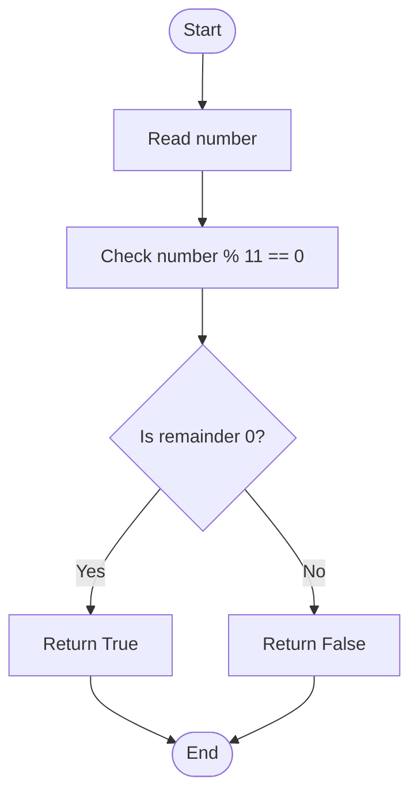

# 03. Divisibility by 11

## Problem Statement

Given an integer `number`, check whether it is exactly divisible by `11`.

A number is divisible by `11` if dividing it by `11` leaves a remainder of `0`. In Python, the modulo operator (`%`) gives us this remainder.

### Examples

| Input | Output | Explanation |
|---:|---|---|
| `121` | Divisible by 11 | `121 % 11 = 0` |
| `55` | Divisible by 11 | `55 % 11 = 0` |
| `20` | Not divisible by 11 | `20 % 11 = 9` |
| `0` | Divisible by 11 | `0 % 11 = 0` |
| `-33` | Divisible by 11 | `-33 % 11 = 0` |

## Concepts Used

- Conditional statements (`if` and `else`)
- Modulo operator (`%`)
- Functions
- Boolean values (`True` and `False`)

---

## Approach: Using the Modulo Operator

### Idea

The modulo operator `%` returns the remainder after division.

For a number to be divisible by `11`, its remainder after division by `11` must be zero:

```python
number % 11 == 0
```

- If the condition is `True`, the number is divisible by `11`.
- If the condition is `False`, the number is not divisible by `11`.

### Code

```python
def is_divisible_by_11(number: int) -> bool:
    """Return True if the number is divisible by 11."""
    return number % 11 == 0
```

### Step-by-Step Dry Run

Suppose:

```python
number = 121
```

Evaluate:

```python
121 % 11 == 0
```

Since `121 ÷ 11` leaves a remainder of `0`, the condition becomes:

```python
0 == 0
```

This is `True`, so the function returns `True`.

**Result:** `121` is divisible by `11`.

Now consider `number = 20`:

```python
20 % 11 == 0
```

Since `20 ÷ 11` leaves a remainder of `9`, the condition becomes:

```python
9 == 0
```

This is `False`, so the function returns `False`.

### Flowchart



## Complete Python Program

This is the implementation from the uploaded `03_Divisibility_by_11.py` file.

```python
def is_divisible_by_11(number: int) -> bool:
    """Return True if the number is divisible by 11."""
    return number % 11 == 0


if __name__ == "__main__":

    number = int(input("Enter a number: "))

    if is_divisible_by_11(number):
        print(f"{number} is divisible by 11.")
    else:
        print(f"{number} is not divisible by 11.")
```

## Sample Outputs

### Example 1: Divisible by 11

```text
Enter a number: 121
121 is divisible by 11.
```

### Example 2: Not Divisible by 11

```text
Enter a number: 20
20 is not divisible by 11.
```

### Example 3: Zero

```text
Enter a number: 0
0 is divisible by 11.
```

## Complexity Analysis

The function performs one modulo operation and one comparison.

| Complexity | Value | Reason |
|---|---|---|
| Time Complexity | \(O(1)\) | A fixed number of operations are performed. |
| Auxiliary Space Complexity | \(O(1)\) | No additional data structure is created. |

## Important Python Concepts

### 1. Modulo Operator (`%`)

The modulo operator gives the remainder after division.

```python
print(121 % 11)
print(20 % 11)
```

Output:

```text
0
9
```

### 2. Comparison Operator (`==`)

The `==` operator checks whether two values are equal.

```python
121 % 11 == 0
```

This expression evaluates to `True`.

### 3. Boolean Return Value

The function returns a Boolean value:

- `True` means the number is divisible by `11`.
- `False` means the number is not divisible by `11`.

The `if` statement uses this result to decide which message to print.

## Edge Cases to Test

| Input | Expected result | Explanation |
|---:|---|---|
| `0` | Divisible | Zero divided by 11 has remainder 0 |
| `11` | Divisible | `11 % 11 = 0` |
| `12` | Not divisible | `12 % 11 = 1` |
| `121` | Divisible | `121 % 11 = 0` |
| `-33` | Divisible | `-33 % 11 = 0` |

## Interview Questions

1. What does the modulo (`%`) operator do?
2. How can you check whether a number is divisible by `11` in Python?
3. What is the difference between `/`, `//`, and `%`?
4. What is the return type of `is_divisible_by_11()`?
5. What does `number % 11 == 0` mean?
6. What are the time and auxiliary space complexities of this function?

## Practice Questions

1. Write a function to check whether a number is divisible by `5`.
2. Write a function to check whether a number is divisible by `3`.
3. Check whether a number is divisible by both `3` and `5`.
4. Check whether a number is even or odd using the modulo operator.
5. Write a function that returns the remainder when a number is divided by `11`.

## Key Takeaways

- A number is divisible by `11` when its remainder after division by `11` is zero.
- Python's modulo operator (`%`) gives the remainder.
- The expression `number % 11 == 0` evaluates to a Boolean value.
- The function uses \(O(1)\) time and \(O(1)\) auxiliary space.

---

## Navigation

- [← Back to Easy README](./Easy_README.md)
- [Python Solution: 03_Divisibility_by_11.py](./03_Divisibility_by_11.py)
- [Main Repository README](../../README.md)
