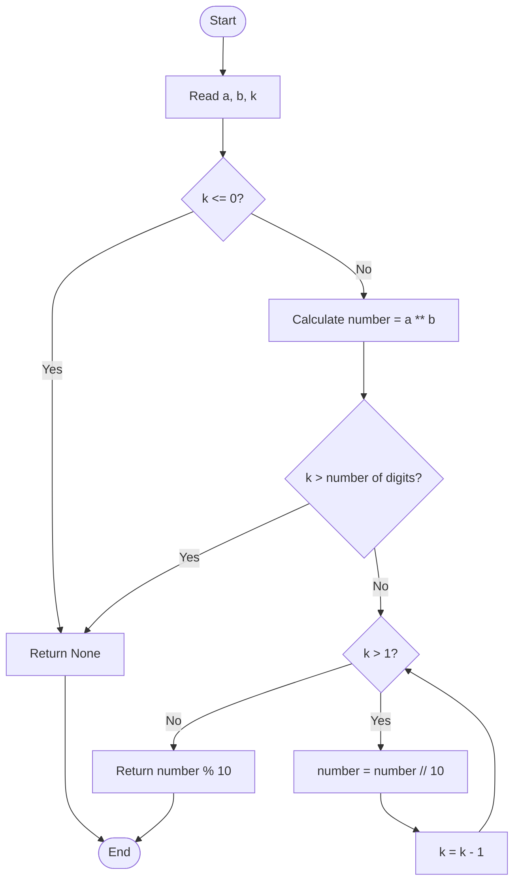

# 04. K-th Digit of a Number Raised to a Power

## Problem Statement

Given integers `a`, `b`, and `k`, calculate `a ** b` and find the **K-th digit from the right**. The rightmost digit is position 1. If `k` is zero, negative, or greater than the number of digits, the requested digit does not exist.

### Examples

| `a` | `b` | `k` | `a ** b` | Result |
|---:|---:|---:|---:|---:|
| 2 | 5 | 1 | 32 | 2 |
| 2 | 5 | 2 | 32 | 3 |
| 3 | 3 | 1 | 27 | 7 |
| 3 | 3 | 2 | 27 | 2 |
| 2 | 3 | 4 | 8 | Does not exist |

## Concepts Used

- Exponentiation (`**`)
- `while` loop
- Integer division (`//`)
- Modulo operator (`%`)
- Conditional statements
- Functions
- `None` as a return value

---

## Approach: Calculate the Power and Extract the K-th Digit

### Idea

1. Check whether `k` is positive. If `k <= 0`, return `None`.
2. Calculate `a ** b`.
3. Convert the result to a string to find its number of digits.
4. If `k` is greater than the digit count, return `None`.
5. Remove the last digit `k - 1` times using `// 10`.
6. Extract the remaining last digit using `% 10`.

### Function

```python
def find_kth_digit(a: int, b: int, k: int) -> int | None:
    """Return the K-th digit from the right in a^b."""

    if k <= 0:
        return None

    number = a ** b

    if k > len(str(number)):
        return None

    while k > 1:
        number //= 10
        k -= 1

    return number % 10
```

## Step-by-Step Dry Run

Consider:

```python
a = 2
b = 5
k = 2
```

### Step 1: Calculate the power

```python
number = a ** b
number = 2 ** 5
number = 32
```

### Step 2: Check whether the digit exists

```python
len(str(number)) = len("32") = 2
```

Since `k = 2` is not greater than `2`, the requested digit exists.

### Step 3: Remove digits from the right

The loop runs while `k > 1`.

| Iteration | `number` before division | `number // 10` | `k` after decrement |
|---:|---:|---:|---:|
| 1 | 32 | 3 | 1 |

The loop stops because `k` is now `1`.

### Step 4: Extract the last digit

```python
number % 10
3 % 10
```

Result: **`3`**

### Flowchart



---

## Understanding the Digit Extraction

Two operators make the digit extraction possible.

### 1. Integer Division (`//`)

Integer division by `10` removes the last digit of a positive integer.

```python
number = 538
number = number // 10
print(number)
```

Output:

```text
53
```

### 2. Modulo (`%`)

Modulo by `10` extracts the last digit of a positive integer.

```python
number = 538
digit = number % 10
print(digit)
```

Output:

```text
8
```

### Combined Example

Starting with `538`:

| Operation | Result | Meaning |
|---|---:|---|
| `538 % 10` | 8 | 1st digit from the right |
| `538 // 10` | 53 | Remove the 1st digit |
| `53 % 10` | 3 | 2nd digit from the right |
| `53 // 10` | 5 | Remove the 2nd digit |
| `5 % 10` | 5 | 3rd digit from the right |

---

## Complete Python Program

This is the complete implementation supplied in the question.

```python
def find_kth_digit(a: int, b: int, k: int) -> int | None:
    """Return the K-th digit from the right in a^b."""

    if k <= 0:
        return None

    number = a ** b

    if k > len(str(number)):
        return None

    while k > 1:
        number //= 10
        k -= 1

    return number % 10


if __name__ == "__main__":

    a = int(input("Enter a: "))
    b = int(input("Enter b: "))
    k = int(input("Enter k: "))

    result = find_kth_digit(a, b, k)

    if result is None:
        print("Digit does not exist.")
    else:
        print("K-th digit:", result)
```

## Sample Outputs

### Example 1: First digit from the right

```text
Enter a: 2
Enter b: 5
Enter k: 1
K-th digit: 2
```

### Example 2: Second digit from the right

```text
Enter a: 2
Enter b: 5
Enter k: 2
K-th digit: 3
```

### Example 3: Requested digit does not exist

```text
Enter a: 2
Enter b: 3
Enter k: 4
Digit does not exist.
```

### Example 4: Invalid K value

```text
Enter a: 3
Enter b: 3
Enter k: 0
Digit does not exist.
```

---

## Complexity Analysis

Let:

- `d` = number of digits in `a ** b`.
- `b` = exponent.
- `a` = base.

The supplied problem description states:

| Complexity | Value |
|---|---|
| Time Complexity | \(O(b\log a + d)\) |
| Auxiliary Space Complexity | \(O(d)\) |

Reasoning:

- Calculating `a ** b` requires work based on the size of the exponentiation result.
- `len(str(number))` converts the result to a string to determine its digit count.
- The loop removes up to `k - 1` digits. For a valid `k`, this is at most `d - 1` iterations.
- The string conversion requires storage proportional to the number of digits.

**Note:** Exact exponentiation and big-integer operation costs depend on operand sizes and Python's integer implementation. The complexity above follows the model stated in the supplied problem description.

## Important Python Concepts

### 1. Exponentiation (`**`)

The `**` operator raises a number to a power.

```python
print(2 ** 5)
print(3 ** 3)
```

Output:

```text
32
27
```

### 2. `len()` and `str()`

`str()` converts a value to a string, and `len()` returns the number of characters.

```python
number = 32
digits = len(str(number))
print(digits)
```

Output:

```text
2
```

The function uses this to check whether the requested digit position exists.

### 3. `None`

The function returns `None` when `k` is invalid or the requested digit does not exist.

```python
result = find_kth_digit(2, 3, 4)

if result is None:
    print("Digit does not exist.")
```

### 4. Type Hint: `int | None`

```python
def find_kth_digit(a: int, b: int, k: int) -> int | None:
```

This means the function can return either an integer or `None`. The union type syntax `|` is supported in Python 3.10 and later.

## Edge Cases to Test

| `a` | `b` | `k` | Expected behavior |
|---:|---:|---:|---|
| 2 | 5 | 1 | Returns `2` |
| 2 | 5 | 2 | Returns `3` |
| 2 | 3 | 2 | Returns `None` |
| 2 | 3 | 0 | Returns `None` |
| 2 | 3 | -1 | Returns `None` |
| 0 | 3 | 1 | Returns `0` |
| 10 | 2 | 2 | Returns `0` |

**Input assumptions and limitations:** The supplied function is intended for integer results from non-negative exponents. It does not validate `b`. A negative exponent can make `a ** b` a floating-point value, so the later integer-division operation may not behave as intended. The main program also assumes that entered values can be converted to integers.

## Interview Questions

1. What does the exponentiation operator `**` do in Python?
2. How can you extract the last digit of an integer?
3. What is the difference between `% 10` and `// 10`?
4. Why does the function check `k <= 0`?
5. Why do we check `k > len(str(number))`?
6. Why does the loop run while `k > 1` rather than `k > 0`?
7. What does `int | None` mean in a function's return type?
8. What is the time complexity of the supplied solution?

## Practice Questions

1. Find the first digit from the right of a given number.
2. Find the third digit from the right of a given number.
3. Count the number of digits in an integer.
4. Find the sum of the digits of a number.
5. Reverse a number using `% 10` and `// 10`.
6. Modify the function to find the K-th digit from the left.

## Key Takeaways

- The expression `a ** b` calculates the power.
- The rightmost digit is the 1st digit from the right.
- `number // 10` removes the last digit.
- `number % 10` extracts the last digit.
- The function returns `None` for an invalid or unavailable K-th digit.
- The implementation removes `k - 1` digits before extracting the requested digit.

---

## Navigation

- [← Back to Easy README](./Easy_README.md)
- [Python Solution: K-th Digit of a Raised-to-Power Number](./04_Kth_Digit_of_Power.py)
- [Main Repository README](../../README.md)
