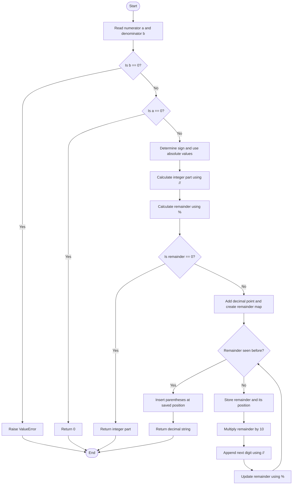

# 05. Fraction to Recurring Decimal

## Problem Statement

Given two integers, numerator `a` and denominator `b`, convert the fraction `a / b` into a decimal string. If the fractional digits repeat, enclose the repeating sequence in parentheses.

Examples:

| Fraction | Decimal string |
|---|---|
| `1 / 2` | `"0.5"` |
| `1 / 3` | `"0.(3)"` |
| `1 / 6` | `"0.1(6)"` |
| `1 / 7` | `"0.(142857)"` |
| `-1 / 2` | `"-0.5"` |
| `2 / 1` | `"2"` |

A denominator of zero is invalid and raises `ValueError`.

## Concepts Used

- Integer division (`//`)
- Modulo operator (`%`)
- Dictionary
- `while` loop
- String slicing
- XOR operator (`^`)
- Exception handling

## Main Approach: Long Division with Remainder Tracking

The program performs long division and uses a dictionary to remember remainders that have already appeared.

**Key observation:** If the same remainder appears again, the same sequence of decimal digits will repeat from that point. The dictionary records the position where each remainder first appeared, allowing the program to place parentheses around the repeating digits.

### Steps

1. If the denominator is zero, raise a `ValueError`.
2. If the numerator is zero, return `"0"`.
3. Determine the sign using XOR.
4. Convert numerator and denominator to their absolute values.
5. Calculate the integer part using `//`.
6. Calculate the initial remainder using `%`.
7. If the remainder is zero, return the integer part.
8. Otherwise, repeatedly process the remainder:
   - If it has appeared before, insert parentheses at its saved position and stop.
   - Otherwise, store its current position in the dictionary.
   - Multiply the remainder by `10`.
   - Append the next digit using integer division.
   - Update the remainder using modulo.

## Step-by-Step Dry Run

Convert:

```python
a = 1
b = 6
```

### 1. Integer part

```python
1 // 6 = 0
```

So the initial result is `"0"`.

### 2. Initial remainder

```python
1 % 6 = 1
```

The remainder is not zero, so append a decimal point:

```text
0.
```

### 3. Generate decimal digits

| Iteration | Remainder before | Position stored | Remainder × 10 | Next digit (`// 6`) | New remainder (`% 6`) | Result |
|---:|---:|---:|---:|---:|---:|---|
| 1 | 1 | 2 | 10 | 1 | 4 | `0.1` |
| 2 | 4 | 3 | 40 | 6 | 4 | `0.16` |

At the beginning of the next iteration, remainder `4` appears again. Its first position was `3`, so the digits from that position repeat.

Insert parentheses:

```text
0.1(6)
```

**Final result: `"0.1(6)"`**

### Flowchart



## Understanding the Important Operations

### 1. Integer Division (`//`)

Integer division gives the whole-number quotient.

```python
print(10 // 6)
```

Output:

```text
1
```

The program uses it to calculate the integer part and each next decimal digit.

### 2. Modulo (`%`)

Modulo gives the remainder.

```python
print(10 % 6)
```

Output:

```text
4
```

The remainder is used to continue long division and detect repeating digits.

### 3. Why Multiply the Remainder by 10?

For `1 / 6`:

```text
Remainder = 1
1 × 10 = 10
10 // 6 = 1  → next digit
10 % 6 = 4   → next remainder
```

### 4. Dictionary for Repetition

The dictionary stores:

```text
remainder: position in result
```

For `1 / 6`:

```text
Remainder 1 → first seen at position 2
Remainder 4 → first seen at position 3
Remainder 4 → seen again
```

When a remainder appears again, the digits from its saved position form the repeating part.

### 5. String Slicing

The program inserts parentheses using:

```python
result = (
    result[:position]
    + "("
    + result[position:]
    + ")"
)
```

For example, with `result = "0.16"` and `position = 3`:

```text
result[:3] = "0.1"
result[3:] = "6"
```

The result becomes `"0.1(6)"`.

### 6. XOR (`^`) for the Sign

The program checks whether exactly one input is negative:

```python
result = "-" if (a < 0) ^ (b < 0) else ""
```

| Numerator negative? | Denominator negative? | XOR | Result sign |
|---|---|---|---|
| No | No | False | Positive |
| Yes | No | True | Negative |
| No | Yes | True | Negative |
| Yes | Yes | False | Positive |

---

## Complete Python Program

This matches the uploaded `05_Fraction_to_Recurring_Decimal.py` implementation.

```python
def fraction_to_decimal(a: int, b: int) -> str:
    """Convert a fraction into a decimal string."""

    if b == 0:
        raise ValueError("Denominator cannot be zero.")

    if a == 0:
        return "0"

    result = "-" if (a < 0) ^ (b < 0) else ""

    a = abs(a)
    b = abs(b)

    result += str(a // b)

    remainder = a % b

    if remainder == 0:
        return result

    result += "."

    remainder_map = {}

    while remainder > 0:

        if remainder in remainder_map:
            position = remainder_map[remainder]

            result = (
                result[:position]
                + "("
                + result[position:]
                + ")"
            )
            break

        remainder_map[remainder] = len(result)

        remainder *= 10

        result += str(remainder // b)

        remainder %= b

    return result


if __name__ == "__main__":

    a = int(input("Enter numerator: "))
    b = int(input("Enter denominator: "))

    try:
        result = fraction_to_decimal(a, b)
        print("Decimal representation:", result)

    except ValueError as error:
        print(error)
```

## Sample Outputs

### Terminating decimal

```text
Enter numerator: 1
Enter denominator: 2
Decimal representation: 0.5
```

### Repeating decimal

```text
Enter numerator: 1
Enter denominator: 3
Decimal representation: 0.(3)
```

### Non-repeating and repeating digits

```text
Enter numerator: 1
Enter denominator: 6
Decimal representation: 0.1(6)
```

### Multiple repeating digits

```text
Enter numerator: 1
Enter denominator: 7
Decimal representation: 0.(142857)
```

### Negative fraction

```text
Enter numerator: -1
Enter denominator: 2
Decimal representation: -0.5
```

### Zero numerator

```text
Enter numerator: 0
Enter denominator: 5
Decimal representation: 0
```

### Zero denominator

```text
Enter numerator: 5
Enter denominator: 0
Denominator cannot be zero.
```

## Complexity Analysis

Let `b` be the absolute value of the denominator, as specified in the source file.

| Complexity | Value | Explanation |
|---|---|---|
| Time | \(O(b)\) | There are at most `b` possible remainders; each is processed once before termination or repetition is detected. |
| Auxiliary Space | \(O(b)\) | The dictionary can store up to `b` remainder-position entries. |

The source file specifies:

\[
O(b)\text{ time},\qquad O(b)\text{ auxiliary space}
\]

## Edge Cases to Test

| Numerator | Denominator | Expected result |
|---:|---:|---|
| `0` | `5` | `"0"` |
| `1` | `2` | `"0.5"` |
| `1` | `3` | `"0.(3)"` |
| `1` | `6` | `"0.1(6)"` |
| `1` | `7` | `"0.(142857)"` |
| `2` | `1` | `"2"` |
| `-1` | `2` | `"-0.5"` |
| `1` | `-2` | `"-0.5"` |
| `-1` | `-2` | `"0.5"` |
| `5` | `0` | Raises `ValueError` |

## Interview Questions

1. What is a recurring decimal?
2. Why do some fractions produce repeating decimal digits?
3. How can we detect a repeating decimal using remainders?
4. Why does the same remainder produce the same next decimal digit?
5. Why is a dictionary useful in this problem?
6. What information is stored in `remainder_map`?
7. Why do we multiply the remainder by `10`?
8. What is the purpose of `//` and `%` in long division?
9. How does XOR help determine the sign?
10. Why should a denominator of zero raise an exception?

## Practice Questions

1. Convert `1 / 4` into a decimal string.
2. Convert `1 / 9` into a decimal string.
3. Convert `1 / 11` into a decimal string.
4. Convert `5 / 6` into a decimal string.
5. Explain the remainder sequence when converting `1 / 7`.
6. Trace the dictionary contents while converting `1 / 12`.

## Key Takeaways

- Fraction-to-decimal conversion can be performed using long division.
- `//` calculates the next decimal digit, while `%` calculates the next remainder.
- A repeated remainder indicates that decimal digits will repeat.
- A dictionary remembers the first position of each remainder.
- String slicing inserts parentheses around the repeating part.
- XOR determines whether the result should have a negative sign.
- The supplied solution uses \(O(b)\) time and \(O(b)\) auxiliary space, where `b` is the absolute denominator.

---

## Navigation

- [← Back to Easy README](./Easy_README.md)
- [Python Solution: 05_Fraction_to_Recurring_Decimal.py](./05_Fraction_to_Recurring_Decimal.py)
- [Main Repository README](../../README.md)
