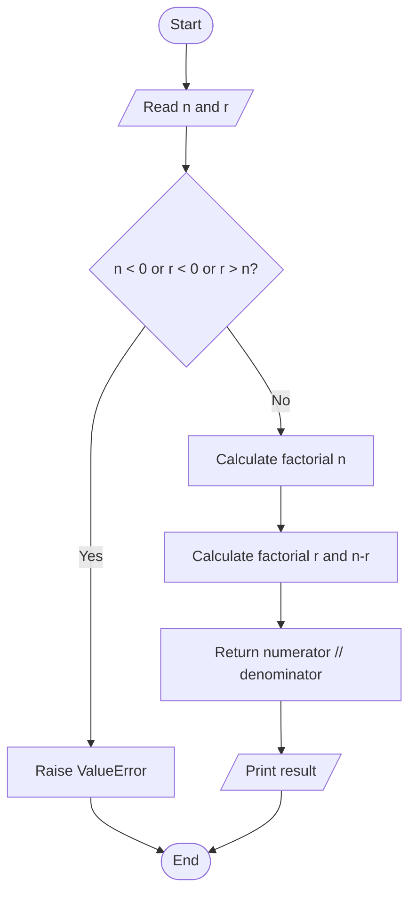
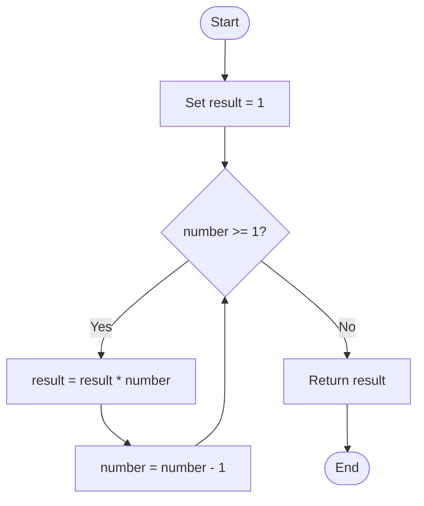

# 06. Calculate nCr (Combination)

## 1. Problem Statement

Given two integers `n` and `r`, calculate the number of ways to select `r` items from `n` distinct items when the order of selection does not matter.

This is called a **combination** and is written as `nCr` or \(\binom{n}{r}\).

### Formula

\[
\binom{n}{r} = \frac{n!}{r!(n-r)!}
\]

Here, `!` means factorial. For example, `5! = 5 × 4 × 3 × 2 × 1`.

### Examples

| Input | Output | Explanation |
|---|---:|---|
| `n = 5, r = 2` | `10` | There are 10 ways to choose 2 items from 5. |
| `n = 6, r = 3` | `20` | There are 20 ways to choose 3 items from 6. |
| `n = 4, r = 0` | `1` | There is exactly one way to choose nothing. |
| `n = 4, r = 4` | `1` | There is exactly one way to choose all items. |

## 2. Concepts Used

- **Factorial:** Multiply all positive integers from a number down to 1.
- **While loop:** Repeat multiplication until the factorial input reaches zero.
- **Multiplication:** Build factorial values and the denominator.
- **Integer division (`//`):** Return the integer result of the combination formula.
- **Conditional statements:** Reject invalid inputs before calculating.
- **Functions:** Keep factorial calculation and combination calculation separate.

## 3. Understand the Formula

For example, calculate \(5C2\):

\[
5C2 = \frac{5!}{2!(5-2)!}
\]

Substitute the factorial values:

\[
= \frac{5 \times 4 \times 3 \times 2 \times 1}
{(2 \times 1)(3 \times 2 \times 1)}
\]

\[
= \frac{120}{2 \times 6}
= \frac{120}{12}
= 10
\]

So, there are **10 different ways** to select 2 items from 5.

<LearningViz type_id="COMBINATION_FORMULA" initial_values={{"n":5,"r":2}} />

The order does not matter in a combination. Selecting A and B is the same selection as selecting B and A.

## 4. Approach Used in the Code

The program uses two functions:

1. `factorial(number)` calculates a factorial using a `while` loop.
2. `calculate_ncr(n, r)` validates the inputs, calculates the three factorial values, and applies the combination formula.

### Step 1: Calculate factorial

```python
def factorial(number: int) -> int:
    """Calculate the factorial of a non-negative integer."""

    result = 1

    while number >= 1:
        result *= number
        number -= 1

    return result
```

The variable `result` starts at `1` because 1 is the multiplication identity. Each loop iteration multiplies `result` by the current value of `number`, then decreases `number` by one.

For `factorial(4)`:

| Iteration | `number` before multiplication | `result` after multiplication |
|---:|---:|---:|
| 1 | 4 | 4 |
| 2 | 3 | 12 |
| 3 | 2 | 24 |
| 4 | 1 | 24 |

When `number` becomes `0`, the condition `number >= 1` is false and the loop stops. The function returns `24`.

The same function also correctly returns `1` for `factorial(0)`, because the loop does not execute.

### Step 2: Validate the input

```python
if n < 0 or r < 0 or r > n:
    raise ValueError("Invalid values: n must be >= r >= 0.")
```

Valid combinations require:

- `n >= 0`
- `r >= 0`
- `r <= n`

If any condition is violated, the function raises a `ValueError`.

### Step 3: Calculate the numerator

```python
numerator = factorial(n)
```

This calculates \(n!\).

### Step 4: Calculate the denominator

```python
denominator = factorial(r) * factorial(n - r)
```

This calculates \(r! \times (n-r)!\).

### Step 5: Apply the formula

```python
return numerator // denominator
```

The factorial formula always produces an integer for valid `n` and `r`, so the code uses integer division (`//`).

## 5. Dry Run

Consider:

```python
n = 5
r = 2
```

The function first checks that `5 >= 2 >= 0`, so the input is valid.

| Calculation | Result |
|---|---:|
| `factorial(5)` | 120 |
| `factorial(2)` | 2 |
| `factorial(5 - 2)` = `factorial(3)` | 6 |
| `numerator` | 120 |
| `denominator` = `2 * 6` | 12 |
| `120 // 12` | **10** |

Final output:

```text
5C2 = 10
```

## 6. Flowchart



### Factorial function flow



## 7. Complete Python Code

The following is the same implementation as the supplied source code:

```python
"""
Problem: Calculate nCr (Combination)

Description:
Calculate the number of ways to select r items
from n items without considering their order.

Formula:
nCr = n! / (r! * (n-r)!)

Concepts Used:
- Factorial
- While Loop
- Multiplication
- Integer Division
- Conditional Statements

Time Complexity: O(n)
Auxiliary Space: O(1)
"""


def factorial(number: int) -> int:
    """Calculate the factorial of a non-negative integer."""

    result = 1

    while number >= 1:
        result *= number
        number -= 1

    return result


def calculate_ncr(n: int, r: int) -> int:
    """Calculate the combination nCr."""

    if n < 0 or r < 0 or r > n:
        raise ValueError("Invalid values: n must be >= r >= 0.")

    numerator = factorial(n)

    denominator = factorial(r) * factorial(n - r)

    return numerator // denominator


if __name__ == "__main__":

    n = int(input("Enter a value of n: "))
    r = int(input("Enter a value of r: "))

    try:
        result = calculate_ncr(n, r)
        print(f"{n}C{r} =", result)

    except ValueError as error:
        print(error)
```

## 8. Sample Outputs

### Example 1: Normal input

```text
Enter a value of n: 5
Enter a value of r: 2
5C2 = 10
```

### Example 2: Select all items

```text
Enter a value of n: 4
Enter a value of r: 4
4C4 = 1
```

### Example 3: Select zero items

```text
Enter a value of n: 4
Enter a value of r: 0
4C0 = 1
```

### Example 4: Invalid input

```text
Enter a value of n: 3
Enter a value of r: 5
Invalid values: n must be >= r >= 0.
```

## 9. Time and Space Complexity

Let `n` be the first input and `r` the second input, with `0 <= r <= n`.

### Time Complexity: O(n)

The function calculates:

- `factorial(n)`: O(n)
- `factorial(r)`: O(r)
- `factorial(n-r)`: O(n-r)

Together, these loops perform O(n + r + (n-r)) work, which simplifies to **O(n)**.

### Auxiliary Space Complexity: O(1)

The code uses a fixed number of variables (`result`, `numerator`, and `denominator`) and iterative loops. It does not use recursion or an additional data structure.

**Important Python detail:** Python integers can grow to contain many digits. The O(1) auxiliary-space description counts the number of variables, as in the supplied problem header; it does not count the increasing memory needed to store very large integer values.

## 10. Important Python Concepts

| Concept | Meaning in this program |
|---|---|
| `def` | Defines a reusable function. |
| Type hints | `number: int` and `-> int` indicate expected input and return types. |
| `while` | Repeats factorial multiplication while the condition is true. |
| `*=` | Multiplies a variable by a value and assigns the result back. |
| `-=` | Subtracts a value from a variable and assigns the result back. |
| `raise ValueError` | Signals that the supplied combination values are invalid. |
| `//` | Performs integer division. |
| `try` / `except` | Catches the `ValueError` raised by `calculate_ncr`. |
| `if __name__ == "__main__"` | Runs the input/output section when the file is executed directly. |

## 11. Edge Cases

| Input `(n, r)` | Expected result / behavior |
|---|---|
| `(0, 0)` | `1` |
| `(5, 0)` | `1` |
| `(5, 5)` | `1` |
| `(5, 1)` | `5` |
| `(5, 2)` | `10` |
| `(-1, 0)` | Raises `ValueError` |
| `(5, -1)` | Raises `ValueError` |
| `(3, 5)` | Raises `ValueError` |

The function's validation covers negative values and cases where `r` is greater than `n`.

## 12. Interview Questions

**Q1. What is a combination?**

A combination is a way of selecting items where the order of selection does not matter.

**Q2. What is the difference between permutation and combination?**

- Combination: order does not matter.
- Permutation: order matters.

**Q3. Why does the formula divide by `r!`?**

Because the same selected group can be arranged in `r!` different orders, and combinations count that group only once.

**Q4. What is `0!`?**

`0! = 1`. This is why the factorial function returns `1` when its input is zero.

**Q5. Why is `//` used instead of `/`?**

For valid inputs, the combination result is an integer. `//` returns an integer result rather than a floating-point value.

**Q6. What happens when `r > n`?**

The function raises a `ValueError` because selecting more items than are available is invalid.

## 13. Practice Questions

Try solving these without looking at the code:

1. Calculate `6C2`.
2. Calculate `7C3`.
3. Calculate `8C0`.
4. Calculate `8C8`.
5. What should happen for `n = 4, r = 6`?
6. Write a function to calculate `nPr` (permutation).

## 14. Key Takeaways

- A combination counts selections where order does not matter.
- The formula uses three factorial calculations.
- A `while` loop can calculate factorial iteratively.
- Input validation prevents invalid combinations.
- The supplied implementation takes O(n) loop time and O(1) auxiliary variable space.

## 15. Repository Navigation

- Previous: [05 - Fraction to Recurring Decimal](05_Fraction_to_Recurring_Decimal.md)
- Next: [07 - Update this link when the next problem is added](#)
- [Back to Easy Problems README](Easy_README.md)
